# Star Citizen Japanese Text Creator

Star Citizen のゲーム内テキストを AI で日本語に翻訳し、ゲームに適用する Windows デスクトップアプリケーションです。
AI チャットによるゲーム情報検索、音声読み上げ、スマホからの利用にも対応しています。

> **📖 [図解つき 使い方マニュアル](https://batake321.github.io/StarCitizenJapaneseTextCreater/)** — インストールから翻訳の当て方、船舶管理・Web チャットまで一通り解説しています。初めての方はこちらから。

## 機能

- **Data.p4k 自動抽出** - ゲームの Data.p4k (ZIP64 + ZStd) から英語/日本語の global.ini を自動抽出
- **AI 翻訳** - Claude / Gemini / OpenAI / Ollama (ローカル LLM) の 4 バックエンドに対応、複数同時並列翻訳
- **翻訳エディタ** - AI 翻訳結果の確認・手動編集・検索 (ワイルドカード対応)・フィルタリング・原文維持
- **用語集** - 固有名詞の翻訳ルールを登録し、一括置換も可能。複数選択で一括削除
- **AI チャット + 音声読み上げ** - AI に Star Citizen の最新データを検索させて日本語で回答。VoiceVox による音声読み上げ対応
- **Web チャット (スマホ対応)** - ブラウザからチャット・音声入力が可能。HTTPS 対応でスマホのマイクも利用可
- **ナレッジ (記憶)** - AI に情報を教えて記憶させる機能。バグ情報・用語・Tips を保存し、チャットに自動反映
- **ロケーション検索** - ステーション・都市の施設情報（精錬所・ハンガー・エレベーター等）を Star Citizen Wiki API + UEX から統合取得
- **コモディティ交易** - UEX 価格データから最適ルート自動計算、在庫・コンテナサイズ表示、所持船管理、AI チャット連携
- **キーバインドエディタ** - キーボード・マウス・ゲームパッド (Xbox)・HOTAS (VKB Gladiator NXT 左右) のビジュアル表示、activation mode 色分け、翻訳連携
- **ミッション一覧** - Data.p4k から全ミッションを抽出し、カテゴリ別に一覧表示。報酬・レピュテーション要件/報酬・前提ミッション・敵構成・制限時間など詳細情報を表示
- **ゲームデータ連携** - Data.p4k の DCB データベースからオンデマンドで船・武器・コンポーネント情報を取得
- **プロファイル管理** - キャラクターデザイン・キーバインド設定のバックアップ/リストア
- **ゲームパス自動検出** - RSI Launcher のログから Star Citizen のインストール先を自動検出
- **チャンネル切替** - PTU / LIVE / EPTU など複数チャンネルをワンクリックで切替

## ダウンロード

> **[StarCitizenJapaneseTextCreater-v2.0.7-win-x64.zip (最新 v2.0.7 / 翻訳DB同梱)](https://github.com/batake321/StarCitizenJapaneseTextCreater/releases/download/v2.0.7/StarCitizenJapaneseTextCreater-v2.0.7-win-x64.zip)**
>
> zip の中の exe を実行しても、zip の中の `SCJPTextCreator-v2.0.7-Setup.exe` でインストールしても動きます。インストーラーでは作業ディレクトリ (一時ファイルの場所) を選べて、無ければ作成します。exe を直接使う場合は、起動後に設定タブで設定してください。
>
> **[sc_japanese_backup.zip (翻訳データベース 4.10.2 対応 2026/10/17 更新)](https://github.com/batake321/StarCitizenJapaneseTextCreater/releases/download/v2.0.7/sc_japanese_backup.zip)** — アプリの「インポート (復元)」から取り込めます。

> **💡 アプリ更新後は翻訳タブの [日本語化] → [実行] を行ってください。**

### 🔰 翻訳だけ使うなら

翻訳だけ使うなら、簡単に使えるようにしました。翻訳済みのデータベースが初めから入れてあるので、翻訳タブの **[日本語化]** ボタンを押して、ゲーム内で表示される名前に便利なオプションを付けるか選んで **[実行]** ボタンを押すだけです。

### 📦 翻訳DBについて

v1.14.5 以降、アプリ本体に翻訳データベースが同梱されています。別途バックアップをインポートする必要はありません。

- **初回インストール**: ダウンロードして展開するだけで翻訳データが使えます
- **アプリ更新時**: 同梱DBが新しくなっていれば、起動時に同梱DBを元に作り直します。自分で入力したもの（手動・CSV・用語集で入れた訳、用語集、チャットの記憶）は今のDBから引き継ぎます。ゲームやネットから取ったデータは同梱DBのものになります。作業フォルダのDBが空・壊れている・無いときも、起動時に同梱DBから作り直します
- **翻訳データをリセットしたい場合**: WorkDir 内の以下のファイルを削除してからアプリを起動してください。同梱DBがコピーされクリーンな状態になります
  - `translations.db` — 翻訳データ
  - `gamedata_cache.db` — ゲームデータインデックス（ミッション・船・アイテム等）
  - WorkDir の既定値は `C:\temp` です（設定タブで変更可能）

### 🚀 v2.0.7 更新内容

- **休戦ゾーンに入ったとき・着陸場に到着したときに音を鳴らします**（ハンガーリクエストが出せる合図）。既定の音声は VOICEVOX（九州そら）で作った「休戦ゾーンに侵入しました。ハンガーリクエスト可能です」「到着しました。ハンガーリクエスト可能です」。設定タブで入切と音のファイルを変えられます。Pyro のステーションでは休戦ゾーンの通知が出ないので、到着の音が合図になります。ゲームログのタブを開いていなくても鳴ります
- **所持船に入手の種類（pledge / ゲーム内購入 / ミッション）と期限**を持たせました。ゲーム内で買った船とミッションで得た船（所持船に無い船の呼び出し）は、ゲームログから自動で所持船に入ります（2026/10/15 23:01 以降。行の「取り消す」で戻せます。それより前の購入は「入れる」ボタン）。期限は「船を追加」の欄で入れられ、期限切れは薄い字になります。期限はゲームのログに出ないので手入力です
- **船のワイプ画面**: ゲーム内購入とミッションの船を一覧に出し、最初から全部チェックした状態で、1 隻ずつ選んで消せます。「すべての船を表示」で pledge の船も出せます
- **ゲームログの船名**: ID と船の対応をログのファイルをまたいで覚え、呼び出し完了のあとに乗った自分の船で呼び出した船を確定し、どちらも無いときは ATC の行から「Apollo 系（推定）」のように出します
- **ゲームログに燃料低下・保険請求の失敗（理由と場所）を追加**し、量子ジャンプの行に経路計算の燃料の見積りを添えました。着陸場の給油・修理・弾薬の補充は、ゲームのログに記録が無いので出せません
- ゲームログの内容をダブルクリックすると、船も［詳細］タブで開きます

<details>
<summary>v2.0.6 更新内容</summary>


- **「鉱石」タブを新設**: 採掘・積み荷の資源の在庫を「資源 × 品質」ごとに持ちます。採掘の拾得・積み荷の購入で増え、売却・納品で減ります。手入力で追加・編集・削除でき、同じ資源の同じ品質は 1 行にまとめます。売買の記録には先入れ先出しで計算した仕入れ・利益・利益率を出します
- **ゲームログの売買に量・単価・利益を表示**: 「ヘリウム (Helium) 1,728 SCU (単価 1,348 aUEC/SCU) / 利益 +995,807 aUEC (74.7%)」のように出します
- **ゲームログに乗船・下船・操縦・到着・出発・ハンガー要求を追加**: 呼び出し・格納も「ORISON のハンガーエレベーターで Crusader Mercury Star Runner を呼び出しました」のように場所名つきの文にしました。他人の船の格納は出しません
- **ゲームログに貨物エレベーターと納品を追加**: 「Area141 の貨物エレベーターで ドリヴァイン ×20、アフォライト ×15 を降ろしました」「納品: ドリヴァイン ×20（小規模購入依頼：手掘り採掘資材）」。台から拾い直した鉱石を採掘と数えていた誤りも直しました
- **ゲームログの「所持」ボタン**: 購入（船のコンポーネント・個人装備）・採掘・降ろした品の行で「入れる」⇄「取り消す」、納品の行で「減らす」⇄「取り消す」。自動で入れたものも同じボタンで取り消せます。自動で所持・在庫を変えるのは 2026/10/15 23:01 以降の分だけです
- **所持個人装備**: ［個人装備］タブの下に、所持している個人装備（銃・アーマー・弾倉・消耗品など）の一覧を追加しました。購入の行から入れられ、手入力もできます
- ゲームログの品名をダブルクリックすると［詳細］タブで開きます

</details>

<details>
<summary>v2.0.5 更新内容</summary>


- **ゲームログに手掘りの採掘を出すように**: 拾った鉱石を 1 個ずつ「採掘: アフォライト ×1 (所持 6)」のように出します。持ち物から取り出しただけのものは出しません。ゲームのログには岩の種類・場所・ROC や採掘船の採掘量・鉱石の品質は記録されないので、それらは出せません
- **ゲームログの商品売買に資源名を出すように**: GUID の先頭 8 文字ではなく「建設資材 48 SCU」「鉄 ×12」のように出します (資源の表をゲームデータから取り出します)
- **ゲームログの船名**: 船名を覚える行を増やし、自分の船と分からない格納の行は出さないようにしました。「呼び出し完了」も出します。ships に無い船 (Grey's Shiv など) も名前を引きます
- **チャットが装備の互換性を口 (アイテムポート) のデータで答えるように**: アンダースーツ・胴アーマー・ヘルメット・脚・バックパックの口をゲームデータから取り出し、「バックパックの口: あり (S1〜S3) / なし」「胴アーマーの口: あり / なし」を品目の詳細と比較の表に出します。口のデータが無いときは「わかりません」と答えます。「フライトスーツ」という呼び名でもアンダースーツの一覧を出せます
- **アンダースーツに「耐 G」を表示**: チャットの詳細・比較の表・個人装備の表に出します (0 でも 0% と出します)
- 資源の表と装備の口は、初回起動後に裏で一度だけゲームデータから取り出します (約 20 秒。インデックス構築は要りません)

</details>

<details>
<summary>v2.0.4 更新内容</summary>


- **船の積載量 (SCU) をゲームデータから出すようにしました**: 貨物の置き場の大きさから計算します (例: Constellation Mk V Centaurus 240 SCU)。ゲームデータで分からない船は UEX、それも無ければ RSI の Ship Matrix の値を使い、どれでも分からないときは空欄にします (「0 SCU」とは出しません)。［詳細］タブの船・販売中の船・アップグレード管理・装備タブの船選びにも積載量を出します
- **店で買った船の装備を所持リストに入れられるように**: ゲームログタブの購入の行に「装備に入れる」ボタンを付けました。入れた購入は「入れ済み」になり、二重に入りません。同じ装備は数量を足して 1 行にまとめ、数量の欄はその場で書き換えられます。ミサイルも所持リストに入れられます
- **販売中の船 (RSI ストア) も品名ダブルクリックで［詳細］を開けるように**
- **船の装備名を英語に揃えました**: AI 翻訳でカタカナになっていた装備名 (Rampart→ランパート など) を英語に戻し、以降の翻訳でもカタカナにしないようにしました
- **アプリの品名を今の翻訳にそろえました**: 所持リスト・装備タブ・［詳細］などの品名を、今の翻訳と同じ名前で出します。訳や用語集を直すと、アプリの表示もそれに合わせて作り直します
- **採掘の鉱物名を商品の名前とそろえました**: ベキサイト→ベキサライト、ボレース→ボラセ、トリト→トリタイト など
- **コモディティの商品名を「日本語 (英語)」で出すように** (例: ララナイト (Laranite))。価格の画面の取り込みで別の訳を拾っていた品目 (Quartz→石英、Scrap→廃棄 など) も直しました
- 更新後、ゲーム内に反映するには翻訳タブの［日本語化］→［実行］を押してください

</details>

<details>
<summary>v2.0.3 更新内容</summary>


- **所持船のタブの一覧が空になる不具合を直しました**: 起動してから交易の価格の取得が終わるまで（数分かかることがあります）、所持船の一覧が空になっていました。起動したらすぐ DB から読むようにしました。My Hangar の同期の後も、一覧を読み直してから表示します。所持船のデータ自体は消えていません
- **v2.0.2 の差し替え分**: DB の入れ替えの途中で落ちたときの後片付けと、インデックス構築・インポートが重なったときの価格の取得の再開を直しました

</details>

<details>
<summary>v2.0.2 更新内容</summary>


- **インストール後に DB が空になる不具合を直しました** (個人武器の詳細が何も出ない、など):
  - 同梱DBが新しくなったら、同梱DBを元に作り直します。自分で入力したもの (手動・CSV・用語集で入れた訳、用語集、チャットの記憶) は今のDBから引き継ぎます。古い版のDBからも引き継げます
  - 作業フォルダのDBが空・壊れている・無いときも、起動時に同梱DBから作り直します
  - 作り直しは別のファイルで行ってから入れ替えます。失敗しても今のDBはそのまま残り、前のDBは .bak として1つ残します。失敗したときは画面で知らせ、ログに残します。作り直しの間は「準備中」の窓を出します
- **インポート (復元) の決まりを変えました**:
  - ゲームやネットから取ったデータは、バックアップの内容に置き換えます
  - 自分で登録したもの (手動の訳・用語集・記憶・所持船・My Hangar の同期データ・装備の割り当てなど) は今のものを残し、バックアップにだけあるものを足します
  - 「追加・上書き・全置換」の選択は無くしました
  - 途中で失敗したら、取り込む前の状態に戻します
  - 品目一覧・ベクトル・評判の表もインポートで入るように
- **［インデックス構築］**: 途中で失敗・中止しても、構築前の状態に戻します。構築でベクトル検索などの記録と wiki のミッション情報が消えていたのを直しました
- **「パッチ更新あり」の判定**: ファイルの日時ではなく、ゲームの版 (build_manifest.id) で比べるように
- UEX の価格に付けるゲームの版が、いつも "4.0" になっていたのを直しました
- インストーラーで、作業フォルダに Program Files の中を選べないようにしました。作業フォルダに書けないときにアプリが落ちる箇所を直しました

</details>

<details>
<summary>v2.0.1 更新内容</summary>

- **アプリのアイコンを新しくしました**: 交差したライフルと輪のある惑星の部隊章 (exe・インストーラー)

</details>

<details>
<summary>v2.0.0 更新内容（メジャーアップデート）</summary>

- **［個人戦闘］に「ダメージ判定」タブを追加**:
  - 銃を選び、スコープ・マズル・アンダーバレル・マガジンを付けたときの DPS・1発のダメージ・弾速・ダウンまでの発数を、付けないときと並べて表示
  - 付けられるオプションだけを選べます (ゲームデータの差し口とサイズ・タグから判定)
  - マズルのダメージ・連射・弾速の補正を反映 (補正の重ね方は推定)
  - 元の表は［表］タブにそのまま
- **［詳細］タブを強化**:
  - 分類・種類・サイズで絞り込める一覧を追加
  - 詳細を罫線入りの表で表示
  - 銃には「装着できるアタッチメント」の一覧 (パーツごとの表、色違いはまとめて表示)
  - 品名を「日本語名 (英語名)」で表示 (［表］・ダメージ判定も同じ)
  - 射撃モード名を日本語に (ビーム、連射ビーム、連続、散弾など)
- **［ゲームログ］タブを新設**: Game.log から、死亡・衝突、契約の受注・完了・失敗、購入・売買、量子ジャンプ、区域への出入り、船の呼び出し・格納などを表で表示。過去のログもまとめて読みます
- **キーバインドエディターがコントローラー・HOTAS に対応**:
  - ボタンを押すと、その割り当てを強調して表示
  - 押して割り当てを変更できます
  - HOTAS の左右の判定・入れ替え
  - 保存は上書き／新規作成を選べます
- **日本語化を改善**:
  - 公式の日本語データで「訳が無い」となっていた約1,300件 (VOLT の武器、新しいアタッチメントなど) を AI で翻訳
  - トークンやタブの崩れた訳を自動で訳し直すように
- **チャット**:
  - 銃の付けられるアタッチメントを AI に渡すように
  - ベクトル検索の埋め込みを Gemini の現行モデル (gemini-embedding-001) に
  - 検索用の日本語名の取り違え (「PH」など) を修正
- **ゲームデータ**:
  - 個人武器とアタッチメントの差し口・補正値を取り込むように
  - マズルの販売価格を取得するように
- 翻訳DB・ゲームデータ (4.10.2) を更新

</details>

<details>
<summary>v1.22.3 更新内容</summary>

- **［船舶装備］［個人装備］［詳細］タブを追加**:
  - ［船舶装備］パワープラント・クーラー・シールド・レーダー・量子ドライブを出力・冷却・HP・速度などで比べられます
  - ［個人装備］アーマー・服・道具などをダメージ軽減・温度・容量などで比べられます
  - ［詳細］名前で検索して、説明文・性能・距離による減衰・射程・販売場所を表示。各表の名前をダブルクリックしても開きます
- **［船舶戦闘］［個人戦闘］**:
  - 各列の Select で含む/含まないを選んで絞り込み、Shift+クリックで複数列の並べ替え (順位を表示)
  - ［船舶戦闘］はミサイル以外を 1 つの表に。ダメージの種類・弾 (使う/使わない)・Damage/Alpha・ミサイル/魚雷/ロケットポッドと追尾の種類を追加
  - ［個人戦闘］のダウンまでの発数を、胴・頭それぞれ H/M/L で選べるように
  - 「最大DPS」を「バーストDPS」に。チャージ式などには注釈
  - 店の最安値にマウスを乗せると、販売している星系・場所・店名・値段を表示
  - セルを選んで Ctrl+C で名前などをコピー
  - Arlington Rifle などの射撃モードの計算の誤りを修正。同じ名前の別の武器が消える不具合を修正
- **船舶管理の装備タブ**:
  - タレット・ジンバル/マウントを所持コンポーネントに登録・付け替え。ジンバルを付けると下に武器の行が出ます (ジンバルを外すと下の武器も外れる)
  - 搭載枠のサイズ・受け付ける種類をゲームデータから取り込み、候補を正しく絞るように
  - 搭載枠を日本語で表示 (例: 武器左翼/VariPuck S4 ジンバルマウント)。種別に実弾武器・エネルギー武器を表示
  - 所持コンポーネントに性能の列 (出力・冷却・HP・速度・感度・Alpha など)
- **日本語化**:
  - 機体ロードアウトマネージャーで「@ITEMPORT_HARDPOINT_JUMP_DRIVE」などがそのまま出る不具合を修正
  - 訳の中の改行で行が割れる不具合、古い訳が残って訳が食い違う不具合を修正
- **チャット**: 宇宙船の壊れ方 (シールド→装甲→船体、実弾とエネルギー弾の違い) を AI に覚えさせました。船の武器を種類・弾の有無で比べられるように
- **インデックス構築を高速化** (約 10 分 → 約 4 分)
- 地上車両用ミサイルなど、取り込めていなかったミサイルの値をゲームデータから取るように
- 翻訳DB・ゲームデータ (4.10.2) を更新

</details>

<details>
<summary>v1.22.2 更新内容</summary>

- **インストーラーを同梱**: zip の中の exe をそのまま実行しても、`SCJPTextCreator-v1.22.2-Setup.exe` でインストールしても動きます。インストーラーでは作業ディレクトリ (一時ファイルの場所) を選べて、無ければ作成します。更新しても所持船などの個人データや設定は消えません
- **.NET 10 に移行**: 動かすには .NET 10 Desktop Runtime が必要です。インストーラーは無ければ自動で入れます。zip の exe は、無ければ起動時にダウンロードの案内が出ます
- **［船舶戦闘］［個人戦闘］タブを追加**: 武器のダメージ表。1発のダメージ・最大DPS・平均DPS・弾速・店の最安値など。個人武器はヘビーアーマー相手に何発で倒せるかも表示。各列で絞り込み (含む/含まない) と、複数列の並べ替えができます
- **チャット**:
  - 種類全体の比較 (「店売りのスナイパーで一番強いのは？」など) に対応。武器・装備・個人装備・船・車両
  - 武器の質問に、何発で倒せるか (素肌・ライト・ミディアム・ヘビー × 頭・胴・腕・脚、ダウンと死亡) を付けるように
  - 店の値段を DB に保存し、質問のときは裏で取り直して、変わっていれば答え直すように
- **設定ファイルが壊れていても起動するように**: 壊れたファイルは別名で残し、初期値で起動します

</details>

<details>
<summary>v1.22.1 更新内容</summary>

- **チャット**:
  - 新しい Claude (Opus 5.5 など) をメインにすると毎回 400 エラーになる不具合を修正
  - 外部AI相談のチェックが効かない (メインの AI がエラーだと相談まで進まない) 不具合を修正
  - 外部AI相談で返事の無い AI を 60 秒で打ち切るように (いつまでも答えが出ないことがあった)
  - 外部AI相談・検証エージェントに、メインの AI が取得したゲームデータを渡し、データに無い数値や推測を書かないように
  - Web チャットで受け取った選択 (メイン・外部相談・検証) をログに出すように
  - 船の質問で、日本語の説明文・メーカー・種別・派生型 (Ironclad Assault など) まで AI に渡すように
  - 調べものが多い質問で「ツール呼び出し回数の上限に達しました」で終わらず、集めたデータで答えるように

</details>

<details>
<summary>v1.22.0 更新内容</summary>


- **Star Citizen 4.10.2 対応**: 4.10.2 対応の翻訳DB・ゲームデータを同梱
- **翻訳タブを簡単に**: [日本語化] を押し、オプションを選んで [実行] するだけになりました。ほかのボタンは [新しいパッチを読み取る] と [AI翻訳]。ログは「ログ」タブに移りました
- **ミッション一覧**: ContractGenerator のミッション (RSI ディスカバリー月間など) を追加。カテゴリ「RSIディスカバリー月間」
- **チャット**:
  - 綴り違いやカタカナでも検索できるように (あいまい検索・カタカナの英語化・ベクトル検索)
  - 船の質問に船のデータ (貨物積載量 SCU) を返すように
  - Web チャットで選んだ AI が使われない不具合を修正
  - 外部AI相談・検証エージェントの説明を表示
- **ミッションタブ**: ゲームの書式タグをゲームに準じて表示 (<EM4> の強調を色付き、~mission(…) を〔場所〕〔船〕などで表示)
- **翻訳**:
  - AI が英語のまま返したもの (数字・記号・名前など) は原文維持にして、次から翻訳対象にしない
  - AI が訳文の途中で改行すると訳が途中で切れる不具合を修正 (切れた訳は保存せず訳し直す)
  - 韓国語が混じった訳・強調タグが壊れた訳は保存せず訳し直す
  - 原文の書き間違いで閉じていない強調タグ (<EM4>語句<EM4>) を日本語化のときに閉じる
  - よく出る用語 (Quantum Drive、給油リクエストなど 53 語) を用語集に登録して訳語を統一
  - 新しい Claude (Opus 5.5 など) で翻訳が失敗する不具合を修正
- **AI モデル**: Claude 5.5 / Gemini 3.x に更新。起動時に各社の使えるモデルを確認し、使えなくなったモデルを知らせる
- **ログ**: ログタブの内容を作業フォルダの app_log.txt にも保存
- **文字化け対策**: 「廃墟」の「墟」がゲーム内で文字化けするため「廃棄された」に置き換え
- **ベクトル検索構築**: チェックを外した AI が使われる不具合を修正
- **Claude の外部相談**: temperature のエラーで失敗する問題に対応

</details>

<details>
<summary>v1.17.0 更新内容</summary>

- **My Hangar 同期 (RSI アカウント連携)**: 船舶管理タブに「アップグレード管理」を追加。内蔵ブラウザ (WebView2) で RSI にご自身でログインすると、保有 pledge・船・保険・アップグレード権利 (CCU) を自動取得します。アプリは ID / パスワードを扱わず、ページ上のクリックや送信も行いません (読み取りのみ)
- **アップグレードシミュレーション**: 保有船ごとに使える権利を表示。「Upgrade」で適用 → 連鎖 → 「Undo」。使用中の権利は紫色、使用可は緑色で表示、元船を持たない権利は「使用不可」、連鎖のない船は灰色で区別
- **売却 (melt) のクレジット管理**: 「Sell」で pledge 単位の売却を試算。現在の Store Credit ＋ 売却で得られる Credit（適用中の CCU 額を含む）、失う機体、LTI 喪失警告、Buy Back 残トークンを常時表示。売却した船を起点とする権利は「使用不可 (売却)」に
- **船の由来・保有数・装備**: 各船に「単品 / パック / CCU 適用済 / VIP 特典」の由来と同梱機、同型の保有数 (×N) を表示。パックは「+」で展開。船名のツールチップにメーカー・役割・サイズ・実装状態・装備スロット (武器 / シールド / 量子ドライブ 等) を表示
- **所持船タブの拡張**: My Hangar 同期で所持船リストを自動更新 (手入力分は保護)。各行に保有数・由来・Upgradable・販売状況・購入可能なアップグレード数と「アップグレード」ボタンを追加。バージョン違い (Executive Edition 等) は別の船として扱います
- **CCU プランナー / melt シミュレーション**: 船ごとの「要る / 要らない / 保留」マーク、適用提案の自動計算、melt 時の Store Credit・実支払 (税 10%)・失う機体・LTI 喪失警告
- **RSI ストアの販売情報**: 起動時と「ストア情報を更新」で、現在販売中の船・パッケージ・パック・アップグレードと Warbond の有無・価格をバックグラウンド取得して表示。保有船と権利に「販売中」「Warbond 販売中」を表示し、Warbond 権利の値引き率を自動算出
- **Ship Matrix 連携**: 全船の役割・種別・実装状態を取得 (24 時間キャッシュ)。船名の表記揺れを `hangar_ship_aliases.json` で名寄せし、解決できない名前は警告表示
- **ミッションタブの高速化**: カテゴリ切替・検索・組合/ランク変更が数秒待ち → 即時に。処理中に画面が固まらなくなりました
- 同期データ (pledge / CCU / マーク) は所持船と同じ個人データ扱いで、バックアップの「所持船舶データを含める」を外すと除外されます
- **初期装備の取得**: 船のデフォルトロードアウトをゲームデータから完全に取得（ジンバル配下の武器・ミサイル・ジャンプドライブ・タレット武装を含む）。「装備データを再抽出」ボタンで船・装備データだけを数分で更新できます（初回は実行してください）
- **装備の登録**: 所持コンポーネント（使用可/不可）と船ごとの現在装備を設定できます。未設定のポートは初期装備を表示
- **ゲーム内購入の船**: 所持船の追加時に「ゲーム内購入 (aUEC)」を選ぶと由来として表示され、アップグレード管理にも一覧されます（CCU / melt の対象外）

> WebView2 ランタイム (Evergreen) が必要です。Windows 10/11 には通常インストール済みです。

</details>

<details>
<summary>v1.16.1 更新内容</summary>

- **翻訳データベース更新 (Patch 4.10 対応)**: 2026/9/6 版の翻訳DB・ゲームデータキャッシュを同梱
- **交易: 商品一覧に差益を表示**: ルートの購入場所／売却場所をクリックすると出る商品一覧に「最良売却先 / 最安仕入先」と「差益/SCU」を追加。差益の降順に並び、正は青・負は赤で表示されます
- **交易: 絞り込みをルート検索と統一**: 商品一覧の相手先候補にも「コモディティ選択」「地上小規模拠点を除く」「外部積込対応のみ」「在庫不足ルートを除く」が反映されるように修正
- **ツールチップ表示**: 列幅に収まらない場所名は、マウスを乗せると全文が表示されます
- **場所名の重複表記を修正**: `HDMS-Woodruff > HDMS-Woodruff` のように同じ名前が2回並ぶ表示を解消
- **積込フィルタの不具合を修正**: DB初期化のたびにターミナル情報が消えていたため「外部積込対応のみ」が正しく機能していなかった問題を修正

</details>

<details>
<summary>v1.16.0 更新内容</summary>


- **起動時クラッシュ修正**: 埋め込み画像リソースの破損により起動直後にクラッシュする問題を修正
- **翻訳データベース更新 (Patch 4.9 対応)**: 2026/7/21 版の翻訳DB・ゲームデータキャッシュを同梱
- **インポート時の所有船データ保護**: 所有船データを含まないバックアップをインポートしても、ローカルの所有船リストが消えないように修正
- **インストーラー対応**: Inno Setup によるインストーラーを追加、アプリアイコン刷新
- **Microsoft Store 申請準備**: プライバシーポリシー・ストア用アセットを追加

</details>

<details>
<summary>v1.14.10 更新内容</summary>

- **ミッション機能の大幅強化**:
  - **Wiki API 統合**: Star Citizen Wiki API から約1,800件のミッションデータを取得・統合。DCBにないミッション（Adagio, Bit Zeros, Dead Saints, UWC, Shubin 等）も表示
  - **組合・ランクフィルタ**: ドロップダウンでファクション（日本語名対応）とランクを選択してフィルタリング
  - **ミッション検索**: 英語名・日本語名・依頼者・ファクション名で全カテゴリ横断検索。複数語AND検索、スペース/アンダースコア相互置換対応
  - **非合法ミッションカテゴリ追加**: 暗殺・窃盗/強奪・ハッキング・麻薬・ECN/緊急通信・レース
  - **起動時バックグラウンド読み込み**: ミッションデータを起動時に自動読み込み
- **ゲームデータ抽出の大幅強化**:
  - **船舶ハードポイント抽出**: 各船のロードアウト定義から武器・シールド・QD等のハードポイントを抽出（約14,800ポート）
  - **装備アイテムの性能データ抽出**: Shield/PowerPlant/QuantumDrive/Cooler/武器のコンポーネントパラメータを格納
- **交易ルート「実績なし」フィルタ**: 在庫/需要が 0 のルートを分離表示
- **バックアップの船舶データ除外オプション**: エクスポート時に個人の船舶データを含めるか選択可能

</details>

<details>
<summary>v1.14.6 更新内容</summary>

- 交易ルート「実績なし」フィルタ（v1.14.10 で統合）
- バックアップの船舶データ除外オプション（v1.14.10 で統合）

</details>

<details>
<summary>v1.14.5 更新内容</summary>

- **ミッションタブ新設**: ゲームデータ (Data.p4k) からミッション情報を抽出し、カテゴリ別に一覧表示。バウンティハンター・傭兵・回収・調査・サルベージ・配達・デリバリー・輸送・ハンドマイニング・燃料補給・PVP 等13カテゴリに自動分類
  - **ミッション詳細表示**: 報酬・レピュテーション要件/報酬・前提ミッション（解放条件）・敵の構成（ターゲット数/増援数）・制限時間・犯罪レベル制限など、raw データから解析した詳細情報を表示
  - **日本語/英語タイトル並記**: 翻訳済みの日本語タイトルを上段に、英語名を下段に2段表示
  - **難易度順ソート**: Intro → Very Easy → Easy → Medium → Hard → Very Hard の順で表示
- **ミッション詳細フォントサイズ設定**: 設定タブから変更可能（既定 14pt）
- **コモディティ価格キャッシュ延長**: 12時間 → 24時間に変更し、起動時のAPI取得頻度を軽減

</details>

<details>
<summary>v1.13.1 更新内容</summary>

- **交易ルート計算を大幅改善**: コモディティ毎に購入候補5拠点・売却候補3拠点を評価し、在庫充足率で重み付け。在庫豊富な拠点が優先されるように改善。コンテナSCU (CS) を考慮した積載量計算にも対応
- **翻訳反映の未翻訳キー対策**: 翻訳DBに存在するキーは、Data.p4k の再抽出前でも global.ini に反映されるよう改善。パッチ直後でも「3. 反映」だけで新キーを含む翻訳が適用可能に
- **ベクトルインデックス構築の途中再開対応**: 500エラー等で中断しても、再実行で処理済み分をスキップし残りから再開。バッチ毎にDB保存、最大3回リトライ
- 翻訳データベースを 4.8.1 (6/5パッチ) に対応したバックアップに更新

</details>

<details>
<summary>v1.13.0 更新内容</summary>

- **交易ルート最適化: 在庫優先選択**: ルート計算時、在庫が確認されている場所を優先して選択するよう改善。在庫 0 のステーション (MIC-L2 等) より在庫のある場所 (Terra Gateway 等) が推奨されるように
- **在庫不足フィルタ修正**: 「在庫不足ルートを除く」チェック時、在庫データ 0 (scu_buy=0) のルートも正しく除外されるよう修正
- **表示名重複修正**: Terra Gateway 等、ターミナル名に既にシステム名が含まれる場合の「(Stanton) (Stanton)」表示を修正
- **@付きローカライゼーションキー対応**: ゲームが `@vehicle_Name...` 等のキーで検索する場合に備え、`@` 付きエントリを自動追加。新型船 (Tiburon, Pitbull, Command Module) の名前が正しく表示されるように
- **通貨記号(¤)重なり修正**: 日本語フォントで全角描画される ¤ を翻訳 DB で Cr に置換し、価格表示の文字重なりを解消
- **ウィンドウ状態保存**: ウィンドウ位置・サイズ・最大化状態を記憶し、次回起動時に復元
- **交易検索パラメータ保存**: 船・積載量・予算・星系の設定を保存し、次回起動時に復元
</details>

### 動作要件

- Windows 10 / 11
- [.NET 10.0 Desktop Runtime](https://dotnet.microsoft.com/download/dotnet/10.0) (x64) — インストーラーなら無ければ自動で入ります。zip の exe は、.NET 10 が無ければ起動時にダウンロードの案内が出ます
- Star Citizen がインストール済みであること
- AI 翻訳を利用する場合 (いずれか1つ以上):
  - [Claude API キー](docs/API_Key_取得_Claude.md)
  - [Gemini API キー](docs/API_Key_取得_Gemini.md)
  - [OpenAI (ChatGPT) API キー](docs/API_Key_取得_OpenAI.md)
  - [Ollama](docs/Ollama_Install.md) + [Gemma e4b](docs/Gemma4_e4b_Install.md) or [e2b](docs/Gemma4_e2b_Install.md) (ローカル・無料)
- 音声読み上げを利用する場合 (任意):
  - [VoiceVox](https://voicevox.hiroshiba.jp/) — 無料の音声合成エンジン。Web チャットで AI の回答を音声で読み上げます

---

## 使い方 (スクリーンショット付き)

> より詳しい手順と図解は **[使い方マニュアル](https://batake321.github.io/StarCitizenJapaneseTextCreater/)** にまとめています（コモディティ・船舶管理・価格キャプチャ・ミッションの説明もこちらにあります）。

### 1. 翻訳タブ

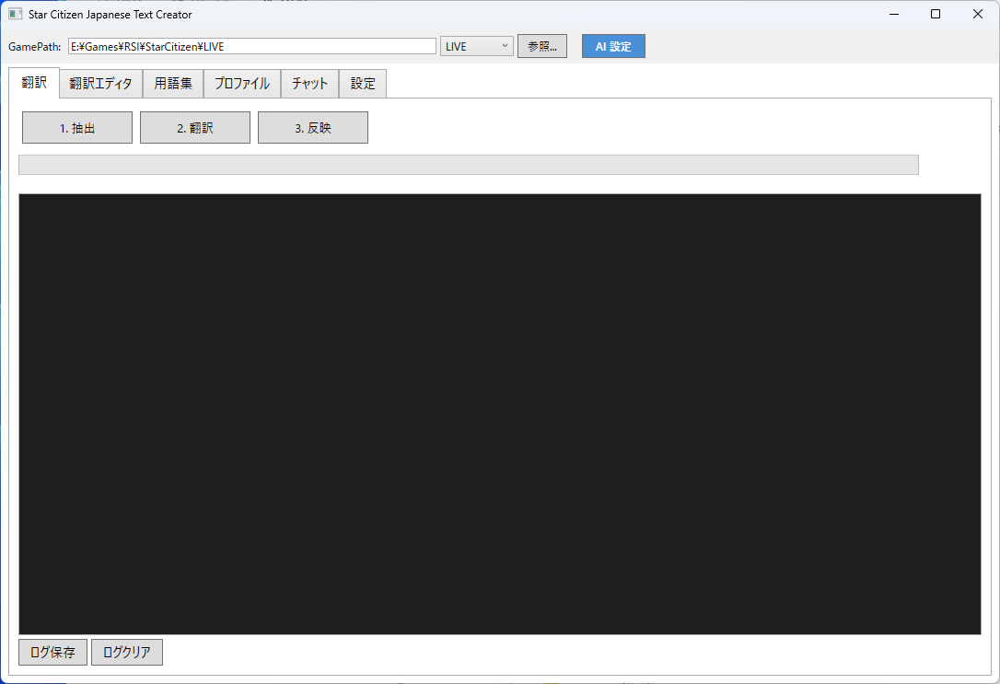

1. **GamePath** が正しいことを確認（自動検出済み）。チャンネル (PTU/LIVE) を選択
2. **[日本語化]** をクリック — 出てきた画面で、ゲーム内の名前に付けたいオプションにチェックを入れて **[実行]**
   - 装備名の後ろに分類を付ける　例：Bracer [軍1C]
   - ミッション名に派閥と貢献度を付ける　例：トラッカーライセンス認定資格 [バウンティーハンターズ・ギルド +50]
   - ミッション名に設計図を付ける　例：Orison救援：小規模製造依頼 [BP]
3. Star Citizen を起動すれば日本語テキストが適用されます

ゲームにパッチが来たら **[新しいパッチを読み取る]** → **[日本語化]**。未翻訳を自分で訳すときは間に **[AI翻訳]** を挟みます。ログは「ログ」タブで見られます。

---

### 2. AI 設定 — 翻訳バックエンドの設定

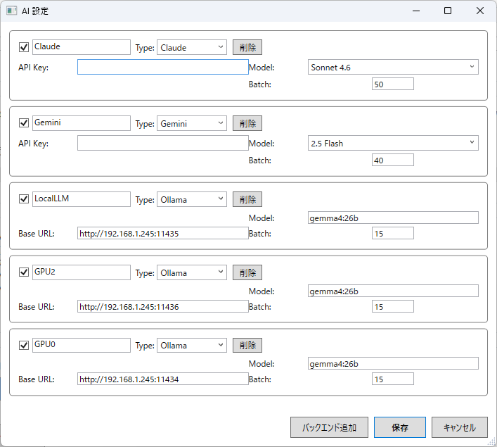

1. 画面右上の **[AI 設定]** ボタンをクリック
2. 各バックエンドの **チェックボックス** を有効にし、API キーやモデルを設定
3. **Batch** で一度に送る翻訳数を調整（VRAM やレート制限に応じて）
4. 複数バックエンドを有効にすると **並列翻訳** でスピードアップ
5. **[保存]** をクリック

> **チェックボックスは翻訳に使用するバックエンドの選択です。** チェックを入れたバックエンドが翻訳実行時に並列で使われます。
> **チャット (AI チャット / Web チャット) は別です。** 設定済みのバックエンドすべてがチャットタブのドロップダウンに表示され、その中から **1つを選んで** 使います。

#### バックエンドの追加

- **[バックエンド追加]** ボタンで同じプロバイダーを複数登録できます
- 例: OpenAI を 2 つ追加し、片方を `gpt-4.1-mini`（高速バッチ用）、もう片方を `gpt-4.1`（高品質用）に設定
- 異なる API キーを使い分けることで、レート制限を分散させることも可能です
- 不要なバックエンドは **[削除]** ボタンで削除できます

| バックエンド | 特徴 | 必要なもの |
|---|---|---|
| **Claude** (Anthropic) | 高品質な翻訳 | API キー ([取得方法](docs/API_Key_取得_Claude.md)) |
| **Gemini** (Google) | 高速・大量処理向き | API キー ([取得方法](docs/API_Key_取得_Gemini.md)) |
| **OpenAI** (ChatGPT) | 高品質・バランス型 | API キー ([取得方法](docs/API_Key_取得_OpenAI.md)) |
| **Ollama** (ローカル) | 無料・オフライン対応 | [Ollama](docs/Ollama_Install.md) + モデル |

---

### 3. 翻訳エディタ — 翻訳結果の確認・編集

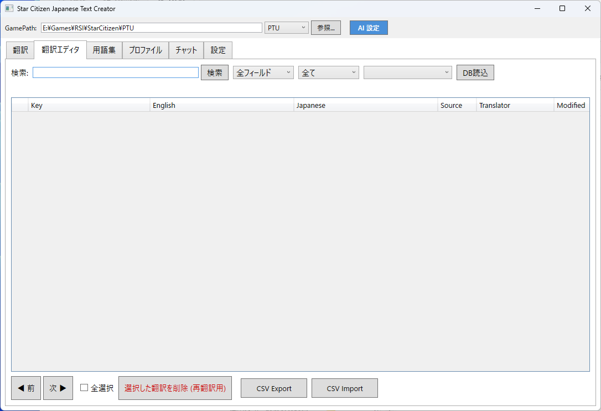

1. **翻訳エディタ** タブを開く（起動時にDBを自動読込）
2. **検索** バーでキーワード検索（ワイルドカード `*` `?` 対応）、**部分一致** チェックボックスで切替
3. **フィルタ** で Source (official/ai/manual/original) や Translator で絞り込み
4. **Japanese 列をダブルクリック** して翻訳を手動編集（手動修正は次回のDB読込でも保護されます）
5. 不満な翻訳はチェックボックスで選択 → **[選択した翻訳を削除]** で次回再翻訳
6. 船名・地名など英語のままにしたいキーは選択 → **[全て原文]** で英語原文を維持
7. **CSV Export / Import** で外部エディタとの連携も可能

---

### 4. 用語集 — 翻訳ルールの管理

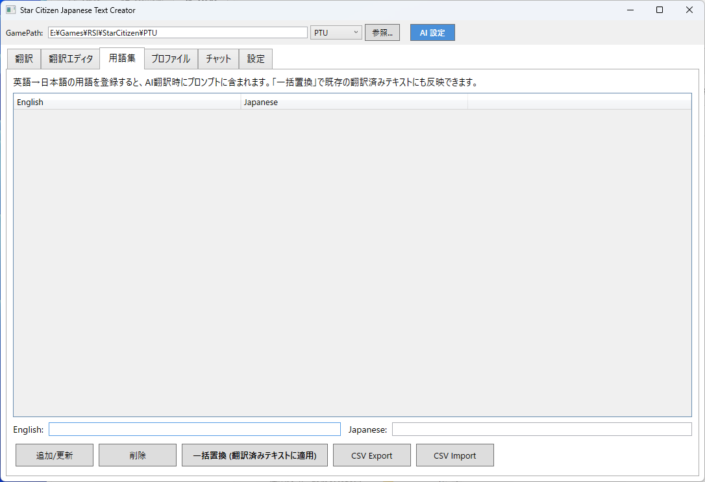

1. **用語集** タブを開く
2. 下部の **English** / **Japanese** フィールドに用語を入力
3. **[追加/更新]** をクリックして登録
4. 登録した用語は AI 翻訳時のプロンプトに自動挿入されます
5. **[一括置換]** で翻訳済みテキスト内の用語を正しい訳語に一括変換
6. チェックボックスで複数選択 → **[選択削除]** で一括削除
7. **CSV Export / Import** で用語集の一括管理も可能

> **誤訳の修正にも使えます。** 例えば AI が「Quantum Drive」を「量子ドライブ」と訳してしまった場合、English に `量子ドライブ`、Japanese に `クォンタムドライブ` と登録して **[一括置換]** を実行すると、翻訳済みテキスト内の誤訳がまとめて修正されます。カタカナを英語に戻したい場合も同様です。

---

### 5. プロファイル — バックアップ/リストア

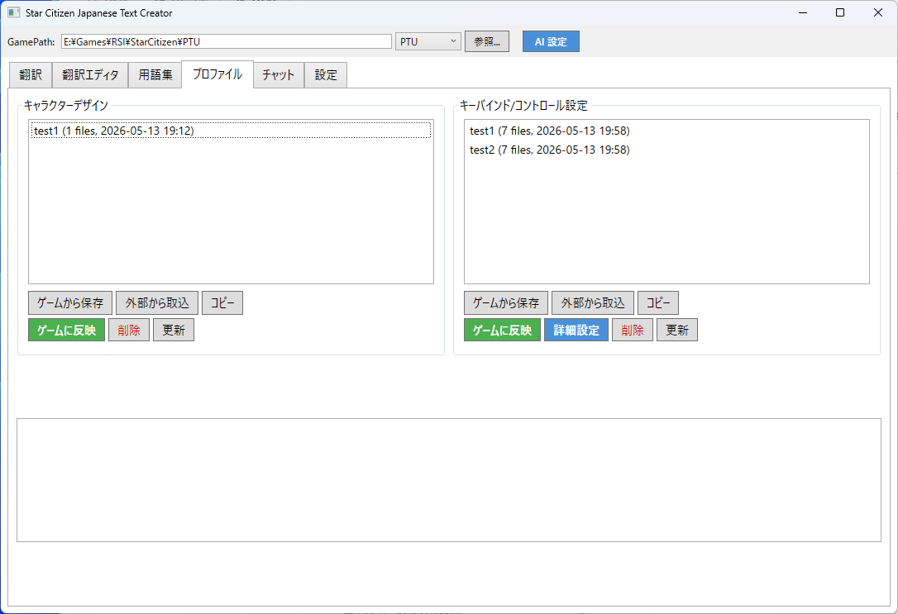

1. **プロファイル** タブを開く
2. **キャラクターデザイン** (左) と **キーバインド/コントロール設定** (右) を管理
3. **リストから復元したいプロファイルを1つ選択** してから操作します
4. **[ゲームから保存]** — 現在のゲーム設定をバックアップ
5. **[ゲームに反映]** — 選択したバックアップをゲームに復元
6. **[外部から取込]** — 他の人のファイルをインポート
7. **[詳細設定]** (コントロール側) — 選択したプロファイルのキーバインドエディタを開く

---

### 6. キーバインドエディタ — 機能別タブ

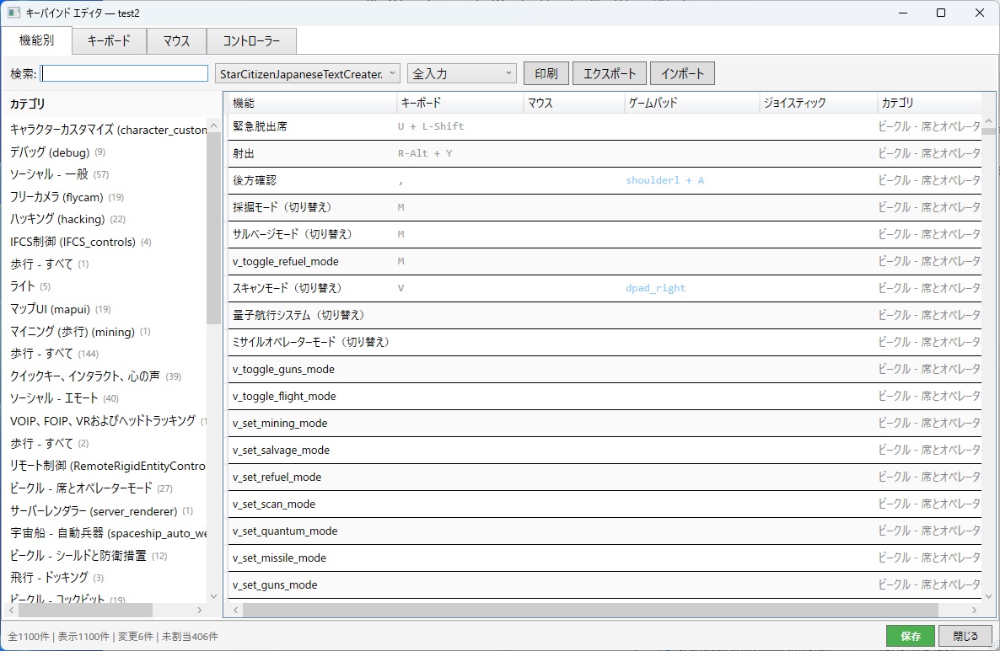

1. プロファイルタブでリストから保存済みプロファイルを **1つ選択** → **[詳細設定]** をクリック
2. **[機能別]** タブ: カテゴリ一覧（左）とバインド一覧（右）を表示
3. 左のカテゴリをクリックすると、そのカテゴリの機能に絞り込み
4. **検索** バーで機能名・キー名を検索
5. **入力フィルタ** でキーボード/マウス/ゲームパッド/未割当のみ等で絞り込み
6. 行をダブルクリックしてバインドを編集
7. 変更済みの行は黄色でハイライト、変更されたキーはオレンジ色で表示
8. **[エクスポート]** で XML / CSV に保存、**[インポート]** で読み込み

---

### 7. キーバインドエディタ — キーボード / マウス / ゲームパッド / HOTAS タブ

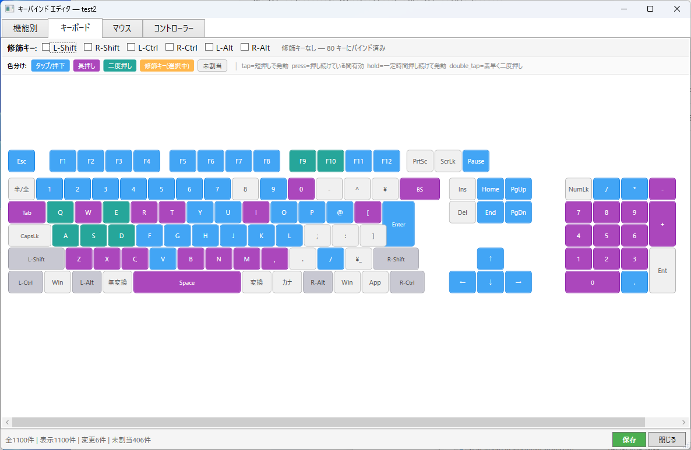

1. **[キーボード]** タブ: **日本語 109 キー配列** がビジュアル表示（テンキー付き）
2. **[マウス]** タブ: 左/右クリック・ホイール上下・中央・Mouse4/5・X/Y 軸をビジュアル表示。右側にマウスバインド全一覧
3. **[コントローラー]** タブ: Xbox コントローラーの A/B/X/Y・LB/RB・LT/RT・スティック・D-Pad をビジュアル表示。LB/RB 修飾ボタン対応
4. **[HOTAS]** タブ: VKB Gladiator NXT 左右の画像＋ボタングループ別バインドテーブル。画像クリックで拡大ビューア＋バインド編集パネル
5. **色分け** でバインドの種類が一目でわかります:
   - **青** = タップ / 押下中 (tap / press)
   - **紫** = 長押し (hold / delayed_hold)
   - **緑** = 二度押し (double_tap)
   - **オレンジ** = 修飾キー選択中
   - **グレー** = 未割当
6. **修飾キーのチェックボックス** をチェックすると、修飾キーとの組み合わせバインドを表示
7. ボタンに **マウスホバー** するとツールチップで割り当て済み機能一覧と activation mode を表示
8. ボタンを **クリック** すると割り当てダイアログが開き、機能を検索して割り当て/解除が可能
9. 機能名はゲーム内の **日本語翻訳データ (global.ini)** を参照して表示

---

### 8. AI チャット — ゲーム情報を日本語で質問

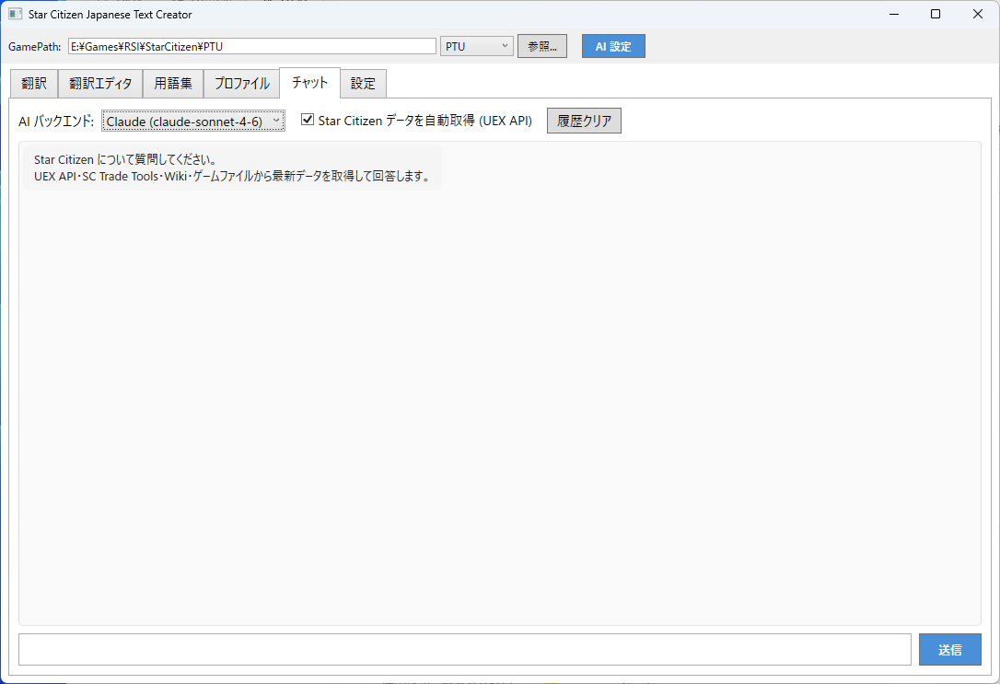

1. **チャット** タブを開く
2. **AI バックエンド** をドロップダウンで選択 (スキル対応バックエンド推奨)
3. テキストボックスに質問を入力して **[送信]**
4. AI が自動で必要なツール (スキル) を呼び出してデータを取得・回答
5. **[記憶管理]** ボタンでナレッジ管理ウィンドウを開く

#### AI 検索スキル (Tool Use)

| スキル | 検索できる内容 | 質問例 |
|---|---|---|
| **lookup** | 統合検索 (最初に呼ぶ) | 「ホーネットについて教えて」 |
| **search_location** | ステーション・施設 (精錬所・ハンガー等) | 「Everus Harbor の施設は？」 |
| **search_commodity** | 商品・資源＋場所別価格 | 「ラナイトの売値は？」 |
| **search_mission** | ミッション・契約 | 「賞金稼ぎのミッション一覧」 |
| **search_wiki** | Wiki からの詳細情報 | 「Carrack のスペックは？」 |
| **search_keybind** | キーバインド検索 | 「ドッキングのキーは何？」 |
| **remember** | ナレッジに情報を保存 | 「覚えて：○○はバグで動かない」 |
| **forget** | ナレッジから情報を削除 | 「直った：○○のバグ」 |

> 💡 バグ情報も AI に覚えさせると便利です。例:「覚えて：4.8 PTU で Lorville の Hangar エレベーターが動かない」→ 次に Lorville について質問したとき、AI が自動で注意してくれます。チームで DB を共有すれば全員が同じバグ情報を持てます。

---

### 9. Web チャット — ブラウザ・スマホから利用

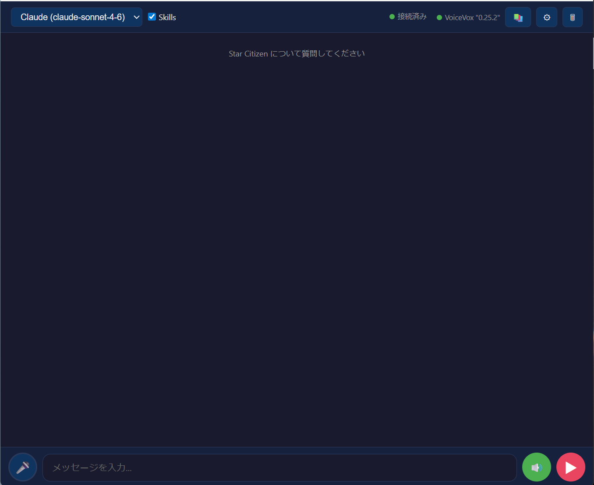

PC のブラウザやスマホから、AI チャットと VoiceVox 音声読み上げを利用できます。

#### 起動方法

1. **設定** タブで HTTP ポート (デフォルト: `8099`) と HTTPS ポート (デフォルト: `8100`) を確認
2. **[サーバー開始]** をクリック — HTTP と HTTPS が同時に起動します
3. 初回のみ **UAC プロンプト** が表示されます — **はい** をクリック (Windows ファイアウォールの開放とポート登録を自動で行います)
4. 以下の URL にアクセス:
   - **PC**: `http://localhost:8099/`
   - **LAN (他のデバイス)**: `http://192.168.x.x:8099/` (アプリに表示される URL)
   - **HTTPS PC**: `https://localhost:8100/`
   - **HTTPS LAN (マイク利用)**: `https://192.168.x.x:8100/` (スマホのマイクにはこちらが必要)

> **`192.168.x.x` の確認方法:** PC でコマンドプロンプトまたは PowerShell を開き `ipconfig` を実行します。「Wi-Fi」または「イーサネット」の **IPv4 アドレス** (例: `192.168.1.15`) がこの PC のアドレスです。スマホから同じ Wi-Fi に接続し、そのアドレスでアクセスしてください。

#### VoiceVox 音声読み上げ

- [VoiceVox](https://voicevox.hiroshiba.jp/) をローカルで起動しておく必要があります（無料）
- 画面右上の **緑のスピーカーボタン (🔊)** を押すと音声読み上げが **ON** になります（押さなければ読み上げません）
- ON の状態では: 質問送信時に「おまちください」、回答時に「お待たせしました」+ AI が生成した要約を読み上げ
- 歯車アイコンから話者 (キャラクター) を変更可能

#### スマホからの利用方法

スマホと PC が同じ Wi-Fi に接続されていれば、スマホのブラウザからチャットを利用できます。

**マイク (音声入力) を使わない場合:**

スマホのブラウザで `http://192.168.x.x:8099/` にアクセスするだけで利用できます。

**マイク (音声入力) を使う場合:**

Chrome はセキュリティ上、`localhost` 以外の HTTP ではマイクを許可しません。HTTPS が必要です。

1. アプリの **[サーバー開始]** をクリック — HTTP (8099) と HTTPS (8100) が同時に起動します
2. 初回のみ Windows の **UAC プロンプト** (管理者権限) が表示されます — **はい** をクリック (証明書のインストール、HTTPS ポートの登録、ファイアウォールの開放に必要)
3. 初回のみ Windows の **証明書インストール確認** が3回表示されます — すべて **はい** をクリック (自己署名証明書を PC の信頼済みストアに登録)
4. スマホのブラウザで `http://192.168.x.x:8099/cert` にアクセス
5. **[証明書をダウンロード]** をタップしてインストール:
   - **iPhone**: 設定 → 一般 → VPN とデバイス管理 → プロファイルをインストール → 設定 → 一般 → 情報 → 証明書信頼設定 → 有効化
   - **Android**: 設定 → セキュリティ → 証明書のインストール → CA 証明書 → ダウンロードしたファイルを選択
6. `https://192.168.x.x:8100/` にアクセス — マイクが使えるようになります

⚠️ **「この接続ではプライバシーが保護されません」と表示された場合:**

自己署名証明書を使用しているため、ブラウザが警告を表示することがあります。これは正常です。

- **PC (Chrome)**: **[詳細情報を表示しない]** をクリック → **[192.168.x.x にアクセスする（安全ではありません）]** をクリック
- **iPhone (Safari)**: **[詳細を表示]** → **[この Web サイトを閲覧]** をタップ
- **Android (Chrome)**: **[詳細設定]** → **[192.168.x.x にアクセスする（安全ではありません）]** をタップ

この警告は自宅 LAN 内の自己署名証明書によるものであり、通信自体は暗号化されています。一度アクセスを許可すれば、同じブラウザでは次回以降表示されません。

#### マイクが使えない場合 (Q&A)

**Q. マイクボタンを押しても反応しない / 「マイクの許可が必要です」と出る**

A. Chrome はセキュリティ上、`localhost` 以外では HTTPS 接続でないとマイクを許可しません。`https://192.168.x.x:8100/` でアクセスしてください (`http://` ではなく `https://`、ポートは `8100`)。

**Q. HTTPS でアクセスしてもマイクが使えない**

A. Chrome のアドレスバー左の鍵アイコン (または ⚠️ アイコン) をクリック → **マイク** の項目を確認してください。
- トグルが **OFF** になっている → **ON** に切り替え
- 「サイトアクセス時は常に許可」にチェックを入れると、次回以降の確認が不要になります
- 使用するマイクデバイスもここで選択できます

**Q. 「このサイトへの接続は保護されていません」と表示されるが問題ないか？**

A. 自己署名証明書を使っているため Chrome が警告を表示しますが、自宅 LAN 内の通信は暗号化されており問題ありません。マイクの利用には影響しません。

**Q. ゲーム用ヘッドセットなど、別のマイクを使いたい**

A. Chrome はデフォルトのマイクデバイスを使用します。切り替えるには:
1. アドレスバー左のアイコン (🔒 または ⚠️) をクリック
2. **マイク** の項目をクリック
3. ドロップダウンから使いたいマイクデバイスを選択
4. **「サイトアクセス時は常に許可」** にチェックを入れると次回以降の確認が不要になります

**Q. スマホでマイクが使えない**

A. 以下を確認してください:
1. `https://` でアクセスしているか (ポートは HTTPS 用の `8100`)
2. 証明書をスマホにインストール済みか (`http://192.168.x.x:8099/cert` からダウンロード)
3. ブラウザのマイク許可を求めるポップアップで **許可** を選択したか
4. スマホの設定 → アプリ → Chrome (または Safari) → マイクが有効か

> 証明書はこの PC 専用の自己署名証明書です。外部の認証局は使用しません。不要になったらスマホから削除してください。
>
> ファイアウォールは「SC Japanese Assistant HTTP」「SC Japanese Assistant HTTPS」というルール名で自動登録されます。アンインストール時は Windows Defender ファイアウォール → 受信の規則 から手動で削除してください。

---

### 10. ナレッジ (記憶) — AI にバグ情報や Tips を教える

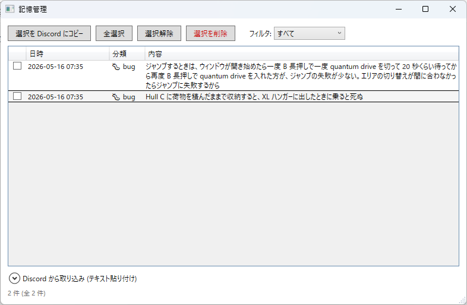

AI に情報を教えて記憶させることができます。保存した情報は毎回のチャットに自動で読み込まれます。

- **保存**: チャットで「覚えて：Hull C に荷物を積んだまま収納すると XL ハンガーで死ぬ」→ AI が SQLite に保存
- **削除**: 「直った：○○のバグ」「忘れて：○○」で削除
- **管理 UI**: アプリの **[記憶管理]** ボタン、または Web チャットのモーダルから一覧・編集・削除
- カテゴリ: バグ (bug)・用語 (term)・Tips (tip)・一般 (general)
- フィルタでカテゴリ別に表示、選択して一括削除も可能

#### Discord 連携

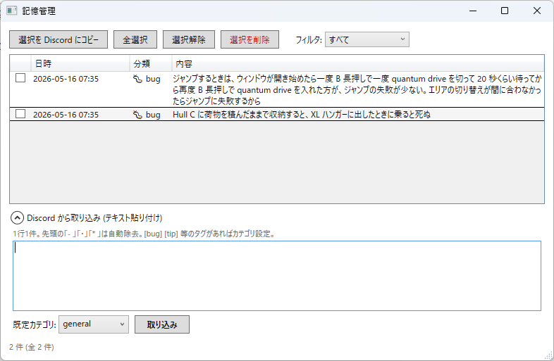

- **[選択を Discord にコピー]** — 選択したナレッジをカテゴリ別にまとめた Discord マークダウンとしてクリップボードにコピー
- **Discord から取り込み** (画面下部を展開) — Discord やテキストファイルからコピペで一括インポート。先頭の `- ` や `[bug]` タグを自動認識

---

### 11. 設定タブ — Web チャット・VoiceVox・データベース管理

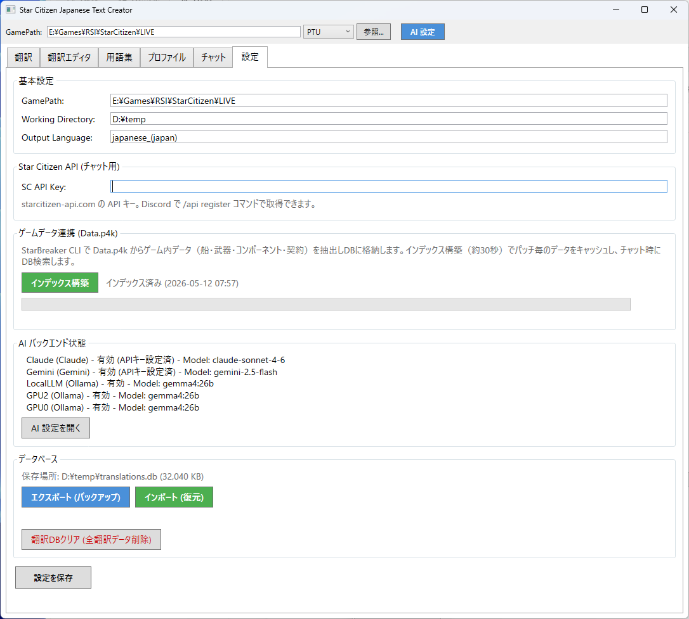

1. **基本設定**: GamePath・Working Directory・Output Language を確認・変更
2. **ゲームデータ連携**: **[インデックス構築]** で Data.p4k からゲームデータを抽出・キャッシュ
3. **Web チャット**: HTTP ポート (8099) と HTTPS ポート (8100) を設定し **[サーバー開始]** でブラウザ/スマホからアクセス可能に
4. **VoiceVox URL**: VoiceVox の接続先 (デフォルト: `http://localhost:50021`)、話者 ID を設定
5. **データベース**:
   - **[エクスポート (バックアップ)]** — 翻訳 DB・ナレッジを含む全データを ZIP で保存
   - **[インポート (復元)]** — バックアップ ZIP を読み込み (翻訳・用語集・インデックス・記憶データを選択可)
6. **[設定を保存]** で変更を反映

> **Working Directory に保存されるファイル:**
>
> | ファイル / フォルダ | 内容 |
> |---|---|
> | `translations.db` | 翻訳データベース (SQLite) — 翻訳テキスト・用語集 |
> | `gamedata_cache.db` | ゲームデータキャッシュ (SQLite) — インデックス・ナレッジ (記憶) |
> | `saves/characters/` | キャラクターデザインのバックアップ (`*.blob` ファイル) |
> | `saves/controls/` | キーバインド設定のバックアップ (`*.xml` ファイル) |
> | `output/global.ini` | 統合済み翻訳ファイル (ゲームに配置される) |
> | `chat_debug.log` | チャット機能のデバッグログ |

---

## Ollama + Gemma4 の設定方法

ローカル LLM を使えば **API キー不要・無料** で翻訳できます。

**1. Ollama をインストール** ([詳細ガイド](docs/Ollama_Install.md))

[ollama.com](https://ollama.com/) からインストーラーをダウンロード・実行します。

**2. 翻訳用モデルをダウンロード**

```bash
# 高品質モデル (VRAM 4GB 以上推奨)
ollama pull gemma4:4b

# 軽量モデル (VRAM 2GB でも動作)
ollama pull gemma4:2b
```

> VRAM に余裕があれば `gemma4:26b` (高精度) や `gemma4:12b` (バランス型) も使えます。

**3. AI 設定ダイアログで設定**

| 項目 | 設定値 | 説明 |
|---|---|---|
| **Type** | `Ollama` | ドロップダウンから選択 |
| **Base URL** | `http://localhost:11434` | Ollama のアドレス (別 PC の場合は IP を変更) |
| **Model** | `gemma4:4b` or `gemma4:2b` | ダウンロードしたモデル名を入力 |
| **Batch** | `15` | 一度に送る翻訳数 (VRAM に応じて調整) |

**4. Ollama のコンテキスト長を増やす (重要)**

Ollama のデフォルトコンテキスト長 (2048 トークン) では、翻訳プロンプト＋固有名詞リストが収まりきらずパースエラーになる場合があります。以下のいずれかで対処してください:

- **方法 A: 環境変数で設定** — Ollama 起動前に `OLLAMA_NUM_CTX=8192` を設定
- **方法 B: Modelfile でカスタムモデルを作成**:

  ```bash
  ollama create gemma4-8k -f - <<EOF
  FROM gemma4:4b
  PARAMETER num_ctx 8192
  EOF
  ```

  作成後、AI 設定の Model に `gemma4-8k` を指定

> **翻訳がパースエラーで失敗する場合**: ログに「パース失敗 (0行)」と表示される場合、コンテキスト長不足が原因の可能性があります。上記の方法でコンテキスト長を 8192 以上に増やしてください。Batch を減らす (1〜5) ことでも改善する場合があります。
>
> **VRAM に関する注意**: Ollama (Gemma4) はGPUのVRAMを使用します。Star Citizen もVRAMを大量に消費するため、**ゲームプレイ中に翻訳やチャットを実行するとVRAMが圧迫され、ゲームのパフォーマンスが低下する場合があります**。ゲーム中の使用を避けるか、軽量モデル (`gemma4:2b`) を使用するか、別PCのOllamaに接続することを推奨します。Claude / Gemini などのクラウドAPIを使用する場合はVRAMへの影響はありません。
>
> **VRAM 使用量の確認方法:**
> - **NVIDIA**: タスクマネージャー → パフォーマンス → GPU → 「専用 GPU メモリ使用量」を確認。またはコマンドで `nvidia-smi` を実行
> - **AMD**: タスクマネージャー → パフォーマンス → GPU → 「専用 GPU メモリ使用量」を確認。またはコマンドで `rocm-smi` を実行 (ROCm インストール時)
> - Star Citizen 起動中は通常 6〜10GB の VRAM を使用します。`gemma4:2b` は約 2GB、`gemma4:4b` は約 4GB の VRAM を追加消費します

---

## データ保存先

全てのデータは Working Directory (設定タブで変更可能) に保存されます。

| ファイル | 内容 |
|---|---|
| `translations.db` | 翻訳データベース (SQLite) — 翻訳テキスト・用語集 |
| `gamedata_cache.db` | ゲームデータキャッシュ (SQLite) — ゲームデータ・ナレッジ (記憶) |
| `saves/characters/` | キャラクターデザインのバックアップ |
| `saves/controls/` | キーバインド設定のバックアップ |
| `output/global.ini` | 統合済み翻訳ファイル |
| `chat_debug.log` | チャット機能のデバッグログ |

---

## ゲームデータ連携 (Data.p4k / StarBreaker)

設定タブの **「インデックス構築」** で、ローカルの Data.p4k からゲーム内データのインデックスを構築します。

- **StarBreaker CLI** (約 4MB) は初回実行時に自動ダウンロードされます
- インデックス構築は約 30 秒で完了します
- **ゲームパッチ適用後は必ずインデックスを再構築してください**
- チャットで質問すると、該当するエンティティの詳細をオンデマンドで取得します

---

## セットアップガイド

### API キー取得

| バックエンド | ガイド |
|---|---|
| **Claude** (Anthropic) | [API_Key_取得_Claude.md](docs/API_Key_取得_Claude.md) |
| **Gemini** (Google) | [API_Key_取得_Gemini.md](docs/API_Key_取得_Gemini.md) |
| **OpenAI** (ChatGPT) | [API_Key_取得_OpenAI.md](docs/API_Key_取得_OpenAI.md) |

### ローカル LLM (Ollama)

| ドキュメント | 内容 |
|---|---|
| [Ollama_Install.md](docs/Ollama_Install.md) | Ollama 本体のインストール |
| [Gemma4_e4b_Install.md](docs/Gemma4_e4b_Install.md) | 高品質モデル (4B) |
| [Gemma4_e2b_Install.md](docs/Gemma4_e2b_Install.md) | 軽量モデル (2B) |

---

## ビルド方法

```bash
git clone https://github.com/batake321/StarCitizenJapaneseTextCreater.git
cd StarCitizenJapaneseTextCreater
dotnet build -c Release
```

---

## 利用している外部サービス

| サービス | 用途 |
|---|---|
| **[StarBreaker](https://github.com/diogotr7/StarBreaker)** | Data.p4k DCB クエリ |
| **[UEX Corp](https://uexcorp.space/)** | 機体・商品・価格データ |
| **[Star Citizen Wiki API](https://api.star-citizen.wiki/)** | ステーション施設・アメニティ情報 |
| **[SC Trade Tools](https://sc-trade.tools/)** | アイテム詳細・取引ショップ |
| **[starcitizen.tools](https://starcitizen.tools/)** | Wiki (MediaWiki API) |
| **Anthropic Claude API** | AI 翻訳・チャット |
| **Google Gemini API** | AI 翻訳・チャット |
| **OpenAI API** | AI 翻訳・チャット |
| **[Ollama](https://ollama.com/)** | ローカル LLM |
| **[VoiceVox](https://voicevox.hiroshiba.jp/)** | 音声読み上げ (Web チャット) |

### 注意事項

- **Star Citizen** は Cloud Imperium Games (CIG) の著作物です
- ゲームデータの抽出・解析はファンによるローカライズ目的での利用を想定しています
- 各外部 API は非公式のコミュニティ運営サービスであり、サービスの可用性は保証されません

## ライセンス

MIT License
