# Star Citizen Japanese Text Creator

Star Citizen のゲーム内テキストを AI で日本語に翻訳し、ゲームに適用する Windows デスクトップアプリケーションです。
AI チャットによるゲーム情報検索、音声読み上げ、スマホからの利用にも対応しています。

> **📖 [図解つき 使い方マニュアル](https://batake321.github.io/StarCitizenJapaneseTextCreater/)** — インストールから翻訳の当て方、船舶管理・Web チャットまで一通り解説しています。初めての方はこちらから。

## 機能

- **Data.p4k 自動抽出** - ゲームの Data.p4k (ZIP64 + ZStd) から英語/日本語の global.ini を自動抽出
- **AI 翻訳** - Claude / Gemini / OpenAI / Ollama (ローカル LLM) の 4 バックエンドに対応、複数同時並列翻訳
- **翻訳エディタ** - AI 翻訳結果の確認・手動編集・検索 (ワイルドカード対応)・フィルタリング・原文維持
- **用語集** - 固有名詞の翻訳ルールを登録し、一括置換も可能。複数選択で一括削除
- **AI チャット + 音声読み上げ** - AI に Star Citizen の最新データを検索させて日本語で回答。VoiceVox による音声読み上げ対応
- **Web チャット (スマホ対応)** - ブラウザからチャット・音声入力が可能。HTTPS 対応でスマホのマイクも利用可
- **データ API (読み取り専用)** - Web チャットサーバーを起動している間、詳細タブ・交易・契約などのデータを JSON か HTML で読み出せます（下の「[データ API (読み取り専用)](#データ-api-読み取り専用)」）
- **ナレッジ (記憶)** - AI に情報を教えて記憶させる機能。バグ情報・用語・Tips を保存し、チャットに自動反映
- **ロケーション検索** - ステーション・都市の施設情報（精錬所・ハンガー・エレベーター等）を Star Citizen Wiki API + UEX から統合取得
- **コモディティ交易** - UEX 価格データから最適ルート自動計算、在庫・コンテナサイズ表示、所持船管理、AI チャット連携
- **価格キャプチャ** - ゲーム画面をキャプチャし、OCR で価格を読み取って UEX に送信します（PrintScreen のホットキー、手動キャプチャ、クリップボード・ファイルからの読み取り。設定タブの「UEX 価格送信 (Screen Capture)」に UEX API Key を入れます）
- **キーバインドエディタ** - キーボード・マウス・ゲームパッド (Xbox)・HOTAS (左右のスティック) のビジュアル表示、activation mode 色分け、翻訳連携。HOTAS・ゲームパッドのボタンを押して割り当てられます
- **契約一覧** - Data.p4k から全契約を抽出し、カテゴリ別に一覧表示。報酬・レピュテーション要件/報酬・前提契約・敵構成・制限時間など詳細情報を表示
  - **契約の地図**: 契約の詳細の後ろに「■ 地図」の節を出します。行き先の地図の場所が 10 か所以下なら、場所の名前（英語のまま）がリンクになります。押すと、その場所のステーションの 3D が出ます（別ウィンドウが開いていればそこに、無ければ［マップ］タブに）。11 か所以上なら「候補 N か所」と数だけ出します。まとめた行では、まとめた全部の契約の地図を合わせて出します（10 か所の決まりは合わせた数に当てます）
  - **※ 行き先の場所は、契約の条件（タグ）からアプリが探したものです。実際の行き先と違うことがあります。参考としてお使いください**
  - 場所の一覧に出ない場所（洞窟・残骸・墜落現場、星図に載っていない場所のうち床の形が無い場所）と、名前の無い場所へのリンクは出しません。出す場所が無い契約には「■ 地図」の節を出しません
  - 行き先の地図の表は、インデックス構築で作ります。前の版で作った DB でも、起動の後に裏で作ります（Data.p4k があるとき。作れなかったときは次の起動でまた作ります）
- **船舶戦闘・個人戦闘** - 武器のダメージ表です（1 発のダメージ・バーストDPS・平均DPS・弾速・店の最安値など）。各列で絞り込み（含む/含まない）と、Shift+クリックで複数列の並べ替えができます。個人武器はダウンまでの発数も出します。［個人戦闘］の「ダメージ判定」タブでは、銃にスコープ・マズル・アンダーバレル・マガジンを付けたときの DPS・1 発のダメージ・弾速・ダウンまでの発数を、付けないときと並べて出します（補正の重ね方は推定）
- **船舶装備・個人装備** - ［船舶装備］はパワープラント・クーラー・シールド・レーダー・量子ドライブを出力・冷却・HP・速度などで、［個人装備］はアーマー・服・道具などをダメージ軽減・温度・容量などで比べられます。［個人装備］タブの下には、所持している個人装備（銃・アーマー・弾倉・消耗品など）の一覧があります
- **詳細** - 名前で検索して、説明文・性能・販売場所などを表で出します（分類・種類・サイズで絞り込める一覧つき。各タブの表の名前をダブルクリックしても開きます）。星系 → 惑星 → ステーション → 店 → 売り物（価格）とリンクでたどれ、［戻る］で 10 件まで戻れます。鉱石は採掘できる場所・掘り方（船 / ROC / 手）・出やすさ、船・車両は既定の装備の表、銃は装着できるアタッチメントの一覧も出します。採掘できない資源は、種類が「コモディティ」と出ます（【採掘できる場所】の節は出しません）。3D の欄（船・車両、武器・装備）は、詳細の文との間の線を上下にドラッグして高さを変えられ、変えた高さは覚えます（別ウィンドウの 3D は、窓の大きさを変えて使います）
- **ゲームデータ連携** - Data.p4k の DCB データベースからオンデマンドで船・武器・コンポーネント情報を取得
- **船舶管理** - ［所持船］［アップグレード管理］［装備］［電力管理］のタブで、持っている船と装備を管理します
  - **所持船**: 所持船の一覧です。入手の種類（pledge / ゲーム内購入 / ミッション）と期限を持ち、ゲーム内で買った船とミッションで得た船は、ゲームログから自動で入ります（行の「取り消す」で戻せます）。［ワイプ］で、ゲーム内購入とミッションの船を選んでまとめて消せます
  - **アップグレード管理（My Hangar 同期）**: 内蔵ブラウザ (WebView2) で RSI にご自身でログインすると、保有 pledge・船・保険・アップグレード権利 (CCU) を取得します（読み取りのみ）。アップグレードのシミュレーション（Upgrade・Undo）、売却 (melt) の試算、RSI ストアの販売情報を出します
  - **装備**: 所持コンポーネントと、船ごとの現在の装備を設定できます（未設定のポートは初期装備を表示）。自作したコンポーネントの品質も入れられます（電力管理の計算に使います）
- **電力管理** - 船の部品（パワープラント・クーラー・シールド・武器など）のピップの割り当てを変えて、出力の残り・冷却・シールド再生量・武器のサステイン DPS を見られます。自作したコンポーネントの品質も計算に入ります
- **プロファイル管理** - キャラクターデザイン・キーバインド設定のバックアップ/リストア
- **ゲームパス自動検出** - RSI Launcher のログから Star Citizen のインストール先を自動検出
- **チャンネル切替** - PTU / LIVE / EPTU など複数チャンネルをワンクリックで切替
- **新しいパッチの検出** - 翻訳タブの読み取りボタンに版を出し（例「4.10.2 LIVE を読み取る」）、LIVE・PTU に新しい版があれば黄色にします
- **ブループリント (BP)** - ゲームデータから BP の一覧・材料・製作時間・入手経路を出し、鉱石の在庫で作れるかを照合。材料を複数選んで「その材料で作れる BP」を探せます。品や契約の詳細にも BP の情報を出します。［詳細］タブの鉱石（資源）の詳細の最後には「この資源を使う BP」の節（その資源を材料に使う BP のできる品・分類・枠・量・最低品質。原石は精錬後の資源として引きます）を出します。持っている BP には「所持」の印が付き（ゲームログの「設計図を受信しました」から自動で入り、表のボタンで手でも入切できます）、所持している BP だけに絞り込めます。所持の記録はバックアップと PC 間の同期の対象です。BP の分類は［BP］タブ・詳細の BP の節とも日本語で出します（例 FPSWeapons → 個人武器、VehicleComponentS2 → 船舶装備 S2）。［BP］タブの検索・絞り込みの窓の検索は、英語の分類の値（FPSWeapons など）でも当たります
- **鉱石** - 採掘・積み荷の資源の在庫を「資源 × 品質」ごとに持ちます。採掘の拾得・積み荷の購入で増え、売却・納品で減ります（手入力で追加・編集・削除もできます）。売買の記録には、先入れ先出しで計算した仕入れ・利益・利益率を出します。採掘の記録もあります
- **ゲームログ** - Game.log から、死亡・衝突、契約の受注・完了・失敗、購入・売買、量子ジャンプ、区域への出入り、船の呼び出し・格納、乗船・下船、採掘、貨物エレベーター、納品などを表で出します（過去のログもまとめて読みます）。内容をダブルクリックすると品・船を［詳細］で開き、購入・採掘・降ろした品の行は「所持」の欄のボタンで所持・在庫に入れる／取り消すができます
- **ゲームログの音・読み上げ** - Game.log を追い読みし、船を操縦中に休戦ゾーンに入ったとき・着陸場に到着したときに音を鳴らします（ハンガーリクエストが出せる合図。徒歩で休戦ゾーンに入ったとき、ジャンプポイントの休憩所では鳴らしません）。設定タブで「VOICEVOX で読み上げる」を選ぶと、乗船・操縦席を離れた・量子ジャンプ・契約完了・採掘などの場面ごとに、文と声（VOICEVOX の話者）を決めて読み上げられます（到着は「Lorvilleに到着しました。」のように場所の名前入り。名前が分からない場所は名前を省きます）。VOICEVOX につながらないときは、休戦ゾーンと到着だけ音のファイルを鳴らします。倒した相手はゲームのログに出ないので読み上げられません。設計図（BP）を受け取ると「BP受信」の行を出し（直前に完了した契約があれば契約名も添えます。内容のダブルクリックでできる品の［詳細］）、その BP を［BP］タブの所持に自動で入れます。死亡したときは「死亡」の行（場所。船に乗っていたときは船も、衝突で死んだときは「（衝突）」も添えます）を、その後に生き返ったときは「復活」の行（復活した場所）を出します
  - **乗り降り**: 読み上げの場面「操縦席を離れた」の既定の文は「{船}の操縦席を離れました。」です（船が分からないときは「船の操縦席を離れました。」）。保存してある文が前の既定の文（「{船}から降りました。」「操縦席を離れました。」）のままなら、新しい文で読みます（「下船」の文は変えません）。「下船」は、ゲームが船のチャンネルの退出の通知を出さないときも推定で出します。操縦席を離れた後、操縦席に戻らないまま、ハンガーのエレベーターを使った・休戦ゾーンに入った（歩いて船の外に出た）ときや、着陸場所の中で区域を移ったときに「下船」の行（内容に「（推定）」を添えます）を出して読み上げます。同じ降りる動きで後から退出の通知が来ても、2 回は出しません
  - **読み上げる文を外のアプリに渡す**: 設定タブの「ゲームログの音」の「読み上げる先」で「VOICEVOX だけ」（既定）「外のアプリだけ」「両方」を選べます（「VOICEVOX で読み上げる」が入っているときに使います）。外のアプリの呼び方は exe と API から選びます
  - exe: 「exe のパス」と「exe の引数」（例 `/say "{talk}"`）を入れます。API: 「API の URL」（例 `http://localhost:50080/talk?text={talk}`）、「API の方法」（GET / POST）、POST のときは「POST の本文」（例 `{"text":"{talk}","scene":"{scene}"}`）を入れます
  - 置き換える値: `{talk}` = 読み上げる文、`{scene}` = 場面（表の場面の欄の名前）、`{speaker}` = その場面の声の VOICEVOX の話者 ID
  - 置き換えの規則: exe の引数では値の中の `"` を `\"` にし、`"` の直前の `\` も Windows の引数の規則で崩れないように打ち消します（`{talk}{scene}` のように欄を続けて書いても、置き換えた後の並びで判断します。値に空白があるときは `"{talk}"` のように `"` で囲んでください）。URL では値を URL 用に打ち消します（`Uri.EscapeDataString`）。POST の本文では値を JSON の文字列の中身として打ち消します（引用符は付かないので `"{talk}"` のように囲んでください。Content-Type は `application/json; charset=utf-8`）
  - 呼ぶ時期: 読み上げの順番が来たとき、VOICEVOX で鳴らす前に呼びます。exe は起動したら終わるのを待ちません。API は 5 秒まで応答を待ち、2xx 以外は失敗としてログに出します（応答の本文は使いません）。「両方」では外のアプリが失敗しても VOICEVOX で読み上げます。「外のアプリだけ」では VOICEVOX も音のファイルも鳴らしません。exe のパスか URL が空のときは呼ばずに「[読み上げ] 外のアプリの設定が空です」をログに出します。読み上げる文が空のときも呼びません（「外のアプリだけ」では「[読み上げ] 読まない（場面）: 読み上げる文が空です」を出します）
  - ログに出る失敗: 「[読み上げ] 外のアプリを呼べませんでした（場面）: 理由」（「外のアプリだけ」では「[読み上げ] 読まない（場面）: 外のアプリを呼べませんでした: 理由」）を毎回、「[ゲームログ] 外のアプリを呼べませんでした: 理由」を直前と理由が違うときだけ出します（呼べたら、次の失敗でまた出します）
  - ［試す］で、今の入力（保存前）で外のアプリを 1 回呼べます（`{talk}` = 読み上げのテストです、`{scene}` = テスト、`{speaker}` = 既定の声の話者 ID）。呼んでいるあいだと結果のメッセージを閉じるまでは［試す］を押せません
- **船の 3D 表示** - ［詳細］タブで船・車両を出しているとき、その船の 3D モデルを見られます。モデルはゲームデータ（選択中のチャンネルの Data.p4k）から取り込みます（テクスチャ付き・船内込み）。取り込んでいない船は、ゲームデータから直接読んで表示します。表示には同梱の three.js 0.186.1（MIT）を使い、ネットからは読みません。仮のモデル（名前に demo が入った部品。リレーの箱）は描きません
  - ［詳細］の船の欄: ［読み込み］でゲームデータから取り込み、［3D 表示］で下の欄に、［別ウィンドウ］で別の窓に出します（詳細の欄は表に戻ります）。3D を出している間は［表に戻る］で詳細の表に戻ります。［3D 表示］［別ウィンドウ］は、取り込み済みならそのモデルを、取り込んでいない船はゲームデータから直接読んで出します（「3D モデルを保存しない」を入れていなければ、読んだものを置き場所に置いておきます）
  - ［読み込み］は、その船の最新のモデルが無いときだけ押せます（取り込み済み・取り込み中は押せません）。押すと予想時間と予想サイズを出して確かめてから、裏で取り込みます（その間もほかの操作・ほかの船の取り込みができます）。終わったら、押した画面がまだその船ならそのまま表示します
  - 別ウィンドウ: 上の欄で船を切り替えられます。名前（英語名の部分一致）・メーカー・種類・サイズで候補を絞り込み、選ぶとその船に切り替わります（↓ で候補へ、Enter で最初の船）。取り込み済みの船はそのモデルを（Data.p4k が変わっていれば照合してから）、取り込んでいない船はゲームデータから直接読んで出します（状態の欄に「キャッシュなし (開いたときにゲームデータから直接読みます)」）。上の欄の［読み込み］は、取り込んで置き場所に保存するボタンです（「3D モデルを保存しない」のときは使えません）
  - 操作: 左ドラッグで回転（船外は船のまわりを回る／船内は見回す）、右ドラッグで平行移動、ホイールで拡大縮小（船内では前後移動）、W/A/S/D で前後左右、↑/↓ で上下、Insert/Delete で拡大/縮小（船内では画角）、Home で初めの位置。［船外］の初めの位置は左斜め前方の上から船全体を見下ろす位置、［船内］の初めの位置は操縦席です。船内は壁を通り抜けて動けます
  - 右の「船内の位置」: 操縦席・エレベーター・貨物室・タレット・医療ベッドと、部屋（船内の区画）のうちデータにあるものを並べます。医療ベッドを押すと、ベッドの横からベッドを見下ろす位置に移ります。部屋の名前は日本語にします（例 ブリッジ・機関室・浴室 (左)・貨物室 (前部)・居住区。全船 279 隻の区画の名前から作った語の表による）。表で日本語にできない名前は、AI 設定で有効な最初の翻訳バックエンドで訳して作業フォルダの `ship3d_room_names.json` に覚えます（ボタンの説明に「AI 訳」と出ます。バックエンドが無ければデータの名前のまま）。中身の無い区画は場所が分からないので出しません。部屋の位置は区画の範囲の真ん中から決めるので、船体の継ぎ目の外になる部屋もあります。同じ種類が 2 つ以上あるときは「▼ タレット (20)」のようにまとめ、押すと広がります（▲ で閉じる）。押すとその位置に移ります（船内の表示になります）。どれに当たるかは GLB のノード名で決めています
  - 取り込みの時間と大きさ（作者の PC での実測）: 1 隻 数秒〜数十秒、数十 MB〜数百 MB（例 X1 5 秒・26MB、600i 9 秒・147MB、Polaris 約 10 秒・648MB）。1 本の取り込みでメモリを最大 約 1.4GB（600i）〜2.9GB（Polaris）使います
  - **全部の船を取り込んだとき（作者の PC での実測、2026-10 の LIVE）**: ［船舶・車両をまとめて取り込む］で入る全部（279 隻）で 合計 25.9GB（設定タブの使用量の表示）。時間は、始める前の見積もり（船ごとにゲームデータの構成を調べる。1 隻 約 2 秒を同時に）と取り込みの合計で、作者の PC（同時 6〜7 本）では 約 9 分（見積もり 約 2 分＋取り込み 約 7 分。147 隻 12.2GB を見積もり 1 分 2 秒・取り込み 3 分 15 秒で入れた実測から、大きさの比で引き延ばした値）。同時に動かせる数が少ない PC では長くなります（1 隻ずつなら 約 45 分の見込み）。全部取り込むには、設定タブの最大容量を 30,000 MB 程度に上げてください
  - 進み具合: 船ごとのバーと全体のバーで、％と残り時間を出します（［詳細］タブと設定タブの「3D モデル」の欄の両方）。ゲームデータの大きさから見積もった時間と取り込みの段階から求めた**予想にもとづく値**です（終わるまでは 99% で止まります）。船ごとに取り消せます。予想の係数は、ほかと並行せずに取り込んだときの実績で直していきます
  - 同時に取り込む数: 論理プロセッサ数の半分と、空きメモリ ÷ 3GB の小さいほう（最低 1）まで。PC 全体の CPU 使用率が 90% 以上のときは取り込みを始めず（［読み込み］［船舶・車両をまとめて取り込む］も押せません）、下がるまで待ちます。待っている理由は進み具合の欄に出ます
  - 設定タブの「3D モデル」: **置き場所**（既定は Windows の TEMP の中の `StarCitizenJapaneseTextCreater\ship3d`。完全なパスだけ指定できます）、置き場所のドライブの容量（全体と残り）、**最大容量**（MB。初期値は置き場所のドライブの残り容量の 1/3、ただし最大 2GB。残り容量より小さい値だけ指定できます）、今の使用量。最大容量を超えたら、取り込みが終わるたびに古いものから消します（表示中・取り込み中・今取り込んだものは消しません）
  - ［船舶・車両をまとめて取り込む］: 保有している船（所持船と Hangar 同期の船）を先に、その後に［詳細］の船の一覧の残りを取り込みます。始める前に隻数・予想時間・予想サイズを出して確かめます。予想サイズの合計が最大容量を超える手前で止めます（まとめて取り込むでは古いものを消して入れ替えません。予想より大きくて少し超えることはあります）。最新のモデルがある船は飛ばします。欄の置き場所・最大容量を変えて［設定を保存］を押さずに［船舶・車両をまとめて取り込む］を押したときは、先にその値を反映して保存します
  - まとめて取り込むのボタン: ［船舶・車両をまとめて取り込む］は、前にまとめて取り込んだときの対象が、今のゲームデータ（Data.p4k）で全部取り込み済みなら押せません（横に「船舶・車両は今のパッチでは全部取り込み済み」と出ます）。パッチでゲームデータが変わると、また押せます。前の版のアプリで取り込んだ船があるときも押せます。ボタンにマウスを乗せると、今のゲームデータで取り込んだ数と取り込んでいない数が出ます（今のゲームデータでまとめて取り込んだ記録が無いときは、そう出ます）。設定タブの「3D モデルを保存しない」を入れると、船の 3D を見るたびにゲームデータから直接読み、置き場所には保存しません（既定は保存します。このときはまとめて取り込むは使えません）
  - パッチの後: Data.p4k が変わると、その船の元データ（Data.p4k の中のファイルの大きさと、Data.p4k に記録された CRC、船の構成）を書き出したときの記録と照合し、変わっていなければそのまま使います。変わっていた（照合できなかった）船のモデルは、消さずに裏で 1 隻ずつ取り直します（起動の 60 秒後と Data.p4k が変わったときに照合。CPU 使用率 90% 以上のときは待ちます。取り直すまでは古いモデルを出さず「自動の取り直しの順番待ち」と出し、［読み込み］を押すとその船を先にします。取り直せなかった船（ゲームから消えた船など）は消します）。照合中は「照合中」と出ます
  - アプリは、自分で書いた印のあるファイルだけを扱います（置き場所にほかのファイルがあっても消したり数えたりしません。同じ名前のほかのファイルがあるときは取り込みません）
  - 取り込みのログ: 船の 3D モデルの取り込みでは、作業フォルダの app_log.txt に詳しい記録を出します（待ち行列の順番・段階ごとの時間。取り消し・失敗のときは、そのときの段階と経過時間）
  - 子の乗り物の中身とリフトの台: 取り付けられた子の乗り物の中身（例: Drake Ironclad の操縦席のある Command Module の床・壁・キャノピー）と、リフト・エレベーターのかご（台）も、船の 3D に出ます。前の版で取り込んだ船は、取り込み直さずに、足りない区画だけを 1 回取り出して重ねて出します
  - 船内を歩く: ［船内］にすると、左上の 2 段目に［歩くモード］［走る］［姿勢］［すり抜け］のボタンが出ます（［詳細］の下の欄でも別ウィンドウでも同じ。武器・装備の 3D には出ません）。［歩くモード］を押すと床に立ち（座席にいるときは、その座席の降りる所の床から）、ステーションの 3D の歩くモードと同じ動きで、床・壁・天井に当たりながら歩けます（歩く・走る・ジャンプ・しゃがむ・寝そべる・はしご・すり抜け）。船のまわりには見えない床があり、船の外も歩けて、乗り込み用のはしごで船に入れます。エレベーター・リフトは、乗り場に近づくと行き先の窓が出て、選ぶとその階に移ります（かごと扉の形は動きません）。無重力・録画・コメントはありません（使い方は下の「[使い方 13. 船の 3D の塗装](#13-船の-3d-の塗装)」の「船内を歩く」）
- **マップ（星系図・現在位置・量子ジャンプ）** - ［マップ］タブに Stanton・Pyro・Nyx の星系図を出し、［現在位置］で取った座標や Game.log からの推定で、今いる場所と量子ジャンプの線を描きます
  - **自動で現在位置を取る**: 「QT・着陸・ゲーム開始のときに自動で現在位置を取る」をオンにすると、量子ジャンプの目的地を選んだとき（すぐ）・移動中になってから 15 秒後と 45 秒後・目的地を選んだ後に離陸してステーションや着陸場の区域を出てから 15 秒後と 45 秒後・着いたとき・2 回に分けて跳ぶときの 1 回目が終わったとき・着陸場に着いたとき・ゲームの世界に出たとき（読み込み画面が閉じたとき・復活したとき）に自動で取ります（初めはオフ。ゲームの窓が前にあり、mobiGlas が閉じているときだけ。目的地を選んだとき・着いたときなどは、前に自動で取り始めてから 10 秒以内は取りません。15 秒後と 45 秒後の分にはこの決まりを当てません。`/showlocation` を送って座標が返らなかったときは、送り直しません）
  - **契約のビーコン**: 契約のビーコンへ跳ぶときは、そのビーコンと組になっている契約の目標の印（無ければ量子ビーコンに限り選ぶ前 10 分以内の印）から、契約の目標（惑星・衛星の地表、ラグランジュ点の区域など）へ線を引きます（Yela を囲む小惑星帯などの決まらない印は「不明（契約のビーコン）」のまま）
  - **到着予定**: 目的地を選んでから到着するまでに座標を取ると、「（到着予定 18:06:00 頃・推定）」を出します。乗っている船の初期の量子ドライブの性能（最高速と加速度）から、「加速 → 巡航 → 同じ加速度で減速」の式で出発してから進んだ距離から残り時間を出します。目的地を選んでから 20 秒以内に取った点（出発の点）があれば、跳んだ後の点 1 つで出せます。出発の点が無ければ、目的地に近づいた点が 2 つ要ります。実測の巡航の速さがドライブの値と 5% 以上違えば、実測の速さで計算します。船やドライブが分からないときは、出発の点と加速中の 2 点から出します。計算の結果が有り得ない時刻（最新の点を取った時刻より前や、最新の点から「残りの距離をドライブの速さ（分からなければ実測の最も速い速さ）の 1/10 で進む時間」と「その速さに達するまでの時間の 10 倍」を足したものより後）になったときは「（到着予定を出せません: 理由）」と出します
  - **2 回に分けて跳ぶとき**: 地表の場所へ 2 回に分けて跳ぶときは「途中で 1 回止まります」を添え、1 回目が終わると「区間 1 の終わり（もう一度 QT が必要）」と出します
  - **途中で停止**: 移動中に目的地とは別の区域に入って 15 秒たっても戻らないときは「途中で停止（もう一度 QT が必要）」と出します。ただし、到着予定の時刻を 15 秒過ぎるまでの間と、区域が変わった後に取った続きの 2 点で目的地までの距離が 1 Mm 以上縮んでいて新しいほうの点が 30 秒以内に取ったものであるときは、停止にせず「移動中」のままにします
  - **施設のアイコン・施設で探す**: 星系図の場所の名札の横に、精製所・乗り物サービス・積載ドックのアイコンを出します。「場所」の検索の横で施設を選ぶと、その施設のある場所だけを探せます。アイコンはゲームのものを、各自の Data.p4k から取り出して使います（アプリには入っていません。取り出すまでは文字で出します）
  - **現在位置の近く**: 「現在位置の近く」の一覧は、同じ名前・同じ種類の近い場所は 1 行にまとめて「×2」、親と子が同じ所にあるもの（Seraphim Station と Seraphim Clinic、Orison と Orison General など）は親の行にまとめ、▼ を開くと子が出ます。場所の［詳細］の【距離】の表も同じです（図は下の「[使い方 14. マップの現在位置の近く](#14-マップの現在位置の近く)」）
  - **現在位置のキー**: ［現在位置］ボタンと同じ処理を、キーで動かせます（既定は 右 Shift + 左 Alt + Insert。Ctrl・Shift・Alt は左右を区別します）。ゲームの窓が前にあるままで取れ、アプリの窓は前に出ません。押したキーは、ゲームにもほかのアプリにもそのまま届きます（アプリが取り上げません）。決めていない修飾キー（既定のときの Ctrl など）を一緒に押していると動きません。設定タブの「現在位置のキーとオーバーレイ」でキーを変えられ、使わないようにもできます
  - **今いる場所で採掘できる物のオーバーレイ**: ［マップ］の［現在位置］ボタン・現在位置のキー・ステーションの 3D の［現在位置］で座標が取れたときに、今いる場所（ガス雲・小惑星の集まりの中、近くの惑星・衛星、小惑星の場所、小惑星帯）で採掘できる物を、ゲームの画面の上に重ねて出します（既定はオフ）。掘り方（船・ROC・手）ごとに、岩・格・出やすさ・シグネチャー・岩の中の資源と割合・倍率を、その下に資源ごとの品質の範囲とばらつきを出します。表示する秒数を決められます（既定 10 秒、0 なら出したまま）。文字の大きさ・透明度・位置・大きさは、設定タブの「現在位置のキーとオーバーレイ」で決めます（［オーバーレイを表示して調整］で出したまま調整でき、変えるとすぐ反映して保存します）。文字は決めた大きさで出て、中身が窓に収まらないときだけ、切れないように縮めます。ふだんはクリックがゲームへ通り、左 Ctrl + 左 Shift + クリックでも位置と大きさを変えられます（図と使い方は下の「[使い方 14. マップの現在位置の近く](#14-マップの現在位置の近く)」）
- **日本語フォント (gfx)** - 字が足りず □ になる漢字を出すため、ゲームの日本語フォント (fonts_en.gfx) を、字がすべて入ったもの (Noto Sans JP) に置き換えたものを、設定タブの［フォントを置く］でゲームのフォルダに置きます（［元に戻す］で消せます）。CIG が公式に認めているのは global.ini と user.cfg だけで、gfx の置き換えは認められたものではありません。自己責任でお使いください
- **日本語化の範囲を選べる** - 翻訳タブの［日本語化］を押すと、先に「日本語化の適応範囲」の窓が出ます（図と使い方は下の「[使い方 1. 翻訳タブ](#1-翻訳タブ)」）
  - 全部を日本語にする「全て翻訳」（初めはこちら）か、14 種類の中からチェックで選ぶ「一部翻訳」を選びます。「一部翻訳」では、チェックを付けた種類だけを日本語にします（外した種類は、ゲームの中で英語の原文のまま）
  - 種類は 14 個: 品の名前／品の説明／コモディティの名前／コモディティの説明／船の説明／契約名／契約の説明／地名／契約の中の場所・品／人名・肩書き／台詞・字幕／画面の文字／派閥名／その他（初めは全部にチェック）
  - ［次へ］で、「日本語化」の窓（名前に付ける印のチェック）へ進み、［実行］で書き出します。選んだ範囲は［実行］を押したときに覚え、次も同じ状態で開きます
  - 名前に付ける印（[軍1C] など）は、名前を英語のままにしても付きます。変わるのはゲームに書き出す global.ini だけで、アプリの画面の表示は変わりません
  - 契約名・契約の説明・地名・派閥名は、ゲームデータのインデックス（設定タブの［インデックス構築］）で見分けます。インデックスが無いときは「その他」に入ります
- **船の 3D の塗装**（図と使い方は下の「[使い方 13. 船の 3D の塗装](#13-船の-3d-の塗装)」）
  - 船の 3D（［詳細］の下の表示・別ウィンドウ）の右端、「船内の位置」の欄の右に、塗装の一覧が縦に並びます。いちばん上が「標準」（既定で塗装の入った船には「塗装なし」も出ます）。押すと切り替わります。初めて選んだ塗装は作るのに数秒かかり、2 回目からはすぐです。見ている向き・拡大は変わりません
  - 出るのは、塗装の色（パレット）と船体の材質の設定です。武器・装備の 3D には出ません
  - ［船舶管理］→［所持船］の表に「塗装」の列: 候補は「標準」、持っている塗装（My Hangar の同期データと名前が合うもの。名前の前に ★）、ほかの付けられる塗装。選ぶとすぐ保存します
  - ［船舶管理］→［装備］の「現在の装備」の表のいちばん下に「塗装」の行（付けられる塗装がある船だけ）: 候補は「標準」と付けられる塗装。選ぶとすぐ保存します（［所持船］の「塗装」の列と同じ値）
  - 3D を開いたときの初めの塗装: ［所持船］の船名をダブルクリックして［詳細］から開いたときは、その所持船で選んだ塗装。それ以外は、その船で保存されている塗装（無ければ「標準」）。塗装を選び直しても、開いている 3D はすぐには変わりません（次に開いたときから。3D の右端の一覧で押せば、その場で切り替わります）
  - **※ 出ないもの: テクスチャの差し替え（エンブレムの絵など）、迷彩などの模様、デカールの色、形の違い。色のほかに描く部品も変える塗装（例: Origin M80 の Tetra Livery）は、その部品を作り直して出します。形のデータの並びまで変える塗装は出せません（選ぶと「…今の 3D 表示では出せません」と出て、その後は一覧で「(出せない)」が付いて押せなくなります。調べた範囲では 0 件）。別の型の塗装を持つ船（300 系・Hermes・Ballista など 47 隻）と、付けられる塗装が無い船には、一覧が出ません。付けられる塗装は、ゲームのデータのタグからの推定です**
- **設定「船・装備・武器の 3D の色付け」** - 設定タブの「3D モデル」の欄、「3D モデルを保存しない」の右。既定はオンです。切ると、船・装備・武器の 3D を、パレットの色を当てない姿（材質そのものの色）で出し、塗装の一覧も出しません（［詳細］の見出しの右の小さな絵も同じ）。ステーションの 3D の右上の「色付け」スイッチとは別です。［設定を保存］の後、次に 3D を開いたときから効きます
- **船・武器・装備の 3D のガラスの色** - ガラスは、色の付いたガラスはその色、色の無いガラスは薄い水色で描きます。取り込み済みの船・品も、取り込み直さずに今の色で出ます（古い取り出し方で保存した船は、初めて開いたときだけ数秒かかります）
- **ステーションの 3D** - ステーション・都市の地図を、ゲームの部品をそのまま描く 3D で出します（図と使い方は下の「[使い方 12. ステーションの 3D](#12-ステーションの-3d)」）
  - **※ 一部の床に穴がある場合があります。粗い形で抜けていた床（例: Orison のトラムの乗り場の階段の前）は補っていますが、ほかの理由の穴が残っているかもしれません。歩くモードでは、そこで落ちることがあります（すり抜けモードにするか、いちばん低い床で止まる決まりで対処しています）。ステーションなどの 3D は、まだ十分ではありません。参考としてお使いください**
  - **※ 残っていること: ハンガーの中での現在位置は、まだ出ません。建物の区画の中の点をハンガーの所と判定することがある場所があります（Distribution Centre など。そのときは［本体のこの位置を見る］で戻れます）。Levski の一部の店（Wear & Tear、Hats & More、Tools & Supplies、Teach's など）は、販売品が出ません。Orison の一部の看板は出ません（ゲームの指定どおりの材質に差し替えると、デカールとして扱われるため）。色の入れ替えの向きは、実際のデータからの推定です**
  - 出し方: 別ウィンドウが開いていればそこに、無ければ［マップ］タブに出します（［別ウィンドウ］のボタンで別ウィンドウ）。［マップ］タブでは、星系図で拡大し切るとその場所の 3D に入り、3D で引き切ると星系図に戻ります。［詳細］タブのステーション・都市・前哨基地・小惑星の欄の［3D 表示］、契約の「■ 地図」のリンクからも開けます。場所を開いた直後は、外から引いた位置から始まります
  - 開く場所: 星系図で、行き先（端末・店・乗り場・ハンガーなど）が 1 つも無い場所（ラグランジュ点 HUR L5 など）を押すと、その場所の範囲の中の、行き先のあるいちばん近い場所（HUR-L5 High Course Station など）を開き、状態の欄に知らせが出ます（範囲の中にステーションの無い場所は、その場所のまま）。ステーションの中の小さな場所（クリニック・都市の病院など）を開くと、親のステーションの 3D を、その場所の店へ飛んだ形で開きます
  - 取り込み: 前もって大きなデータを作りません。開いたときに、見る所のまわりの区画だけをゲームデータ（選択中のチャンネルの Data.p4k）から取り出して描きます。区画の置き方の一覧（view3d_layout.db）はアプリに同梱していて、パッチで合わなくなったら裏で作り直します。設定タブの［マップをまとめて取り込む］は、この区画の置き方の一覧を作り直すボタンです
  - 速さ: 取り出した区画と計算した結果をディスクに保存して、次からは速く出します。空いているときは近くの行き先を先に読みます。設定タブの「ステーション (GB)」で上限を決めます（0 で保存しない）
  - 読み直しとメモリ: 引いて全体を見ている間は読み直しません。取り出し中・作画中の表示は、右下の小さな形で出します。3D を閉じたとき・星系図に戻ったときに、メモリを返します。歩くモードの当たり判定は、読み込んだ範囲の全部について前もっては作らず、歩いて近づいた所の升だけを作ります
  - トラムのある場所（Orison・Lorville・Area18・New Babbage・GrimHEX・Levski・Orbituary など）を開いたとき、その場所の中の現在位置が取ってあれば、現在位置のまわりだけを読み込んで、そこから始まります（まだ何も操作していないとき）
  - 床の穴: ゲームの粗い形（LOD1）で抜けていた建物の床（幅 50 cm〜10 m の穴）を、細かい形（LOD0）から補います（区画の置き方の一覧 view3d_layout.db に場所ごとに入れて同梱。パッチで形が変わった場所だけ裏で作り直します）。Orison のトラム乗り場の階段の下の床（幅 10 m 以上の平らな床）も補います
  - 歩くモードの補い: 歩いているとき、まわり 10 m・足元 ±50 cm の範囲で粗い形に物体が無い所があれば、裏でその部品の細かい形を読んで、そこにある物体（床の代わりになる照明・パネル・チューブなども）を足します。足した物体は描かれ、当たり判定にも入ります。見つけた物体は 3D の置き場所の view3d_fill_walk.db に入れ、次に開くときから最初から入ります（同じ形の部品すべてに効きます）
  - テクスチャ: ゲームのテクスチャを貼ります（端末・ポスター・看板・壁・床。画像は利用者の Data.p4k から取り出して 3D の置き場所に保存し、2 回目からは使い回します）。設定タブの「ステーションのテクスチャ (px)」で画像の大きさを決めます（既定 512、0 で貼らない）。右上の「テクスチャ」を切ると灰色の単色です
  - 場所ごとの色: ゲームのデータにある場所・部品ごとの色（パレット）を付けます。部品ごとの材質の差し替え（例: Orison の木の葉、看板）も入れます。ガラスは、色の付いたガラスはその色、色の無いガラスは薄い水色です。右上の「色付け」で切れます（切ると色の違いで分かれる材質が減り、描く回数が減ります。性能の低い PC 向け。どの場所でも共通の 1 つの状態。切り替えると今の地点を読み直します。「テクスチャ」を切っている間は押せません）
  - フロアと無重力: フロアの切り替えは、床から 2 m より上を消し、ほかの階は薄く出します（どちらも値を変えられます）。Onyx Facility などの無重力の場所・上下が逆の通路にも対応しています（歩くモードで浮く・逆さに立つ）
  - 左の欄: まとまりごとに区切ってあり、見出しの ▼ で畳めます（飛ぶ先／読み込み／歩くモード／録画／文字の道案内／フロア／店の入口／表示する形／操作の説明。初めは、飛ぶ先・歩くモード・文字の道案内が開いています。畳んだ状態は覚えます）。文字の道案内は、ドロップダウンで選んだ 1 つだけを出します（飛ぶ先で押した先があれば合わせます。部品の名前などの細かい部分は、設定「マップのデバッグ表示」がオンのときだけ）。操作の説明は、操作ごとに 1 行の表と、▼ くわしい説明です
  - 飛ぶ先の一覧: 店・端末・admin・薬局・クリニック・再生端末・エレベーター・トラム・階段・ハンガー・ハンガーロビー（ハンガーへ行くエレベーターのロビー側の乗り場。「ハンガーロビー: ロビー ×6」の形。乗り場の名前が違う一部の場所には入りません）・クエストの扉やカード・パネル、罰金の支払い端末。名前は日本語で出します。選ぶと文字の道案内（いちばん近い乗り口など）を出します
  - 飛ぶ先で店を選んだとき: 端末があれば端末の前、無ければカウンターの前（客側）、どちらも無ければ店の位置に立ちます
  - 右上のスイッチ: 3D の右上に、スイッチが縦に並びます。上から「テクスチャ」「色付け」「現在位置」、見出し「印」（店・端末・エレベーター・トラム・クエストの扉・パネル・コメント）、見出し「キャプション」（着陸パッド・ドッキングポート・外部貨物エレベーター・ハンガー。それぞれ色の丸と数）。切り替えた状態は覚えていて、次に開いたときもその状態です。外から引いて全体を見ているときは「印」が押せなくなり「キャプション」が押せます。中で見ているときはその逆です
  - 札: 自分からの距離を出します。店は「店名（種類）」で出し、端末の無い店にも札を出します（長い名前は種類だけ）
  - 外から見たとき: 店・端末などの中の印と札、コメントの印、重力の範囲の箱を出しません（近づく・中に入ると出ます）。着陸パッド（Pad01 など番号つき）・ドッキングポート（番号つき）・外部貨物エレベーター（見出し「外部貨物EV」）・ハンガー（大きさ S・M・L・XL でまとめ）の引き出し線と見出しを出します（AI 専用のものは出しません）。ハンガーの印は屋根の扉の上に来ます
  - ［現在位置］: ゲームの /showlocation の位置に移ります
  - 現在位置の印: 3D に現在位置の印（水色の玉と、札「現在位置 時:分:秒」）を出します。外から見ているときも消えません。右上の「現在位置」で切れます。自転する場所では、ずれることがある旨が札に出ます。読み込んだ範囲の外にあるときは出ません。［マップ］タブの自動の取得で取った現在位置も、その場所の 3D を開いていれば印が出ます（見ている所は動きません）。［マップ］タブの［現在位置］ボタンで取れたとき、または星系図の現在位置の印・その文字・右の欄の「現在地: …」の文を押したとき（位置は取り直しません）は、ステーションなど建物の中（現在地が「〜 内」）でその場所の 3D があれば、その場所の 3D に切り替わり、歩くモードで現在位置の所に立ちます（ハンガーの所ならそのハンガーを開きます。建物の中でないとき・3D の無い場所では星系図のまま。出す先は、別ウィンドウが開いていればそこ、無ければ［マップ］タブ）
  - 現在位置がハンガーの所のとき: 3D の［現在位置］は、そのハンガー（その入口の大きさ）の 3D を開きます。自動の取得で取ったときは、勝手には開かず、知らせ「ハンガー（S）の所にいます…」と、［ハンガー（S）を開く］［本体のこの位置を見る］が出ます。ハンガーの中での位置は、まだ出ません（エレベーターの乗り場の前に立ちます）。［マップ］タブの現在地の文にも「・ハンガー（S）」が付きます
  - 自転する星のまわりの場所での位置は、その前に取った補正を使って直します
  - 歩くモード: WASD で歩き、走る・ジャンプ・よじ登り・はしご・しゃがむ・寝そべる・すり抜けができます。エレベーターとトラムは、パネルや乗り口で行き先の一覧を出して移ります。マイハンガー（S・M・L・XL）の中も 3D で見られます。歩いた道の録画・再生と、コメント（ゲーム内の手順を残せます）があります
  - 歩くモードのコメント: Enter のコメントは録画中でなくても付けられ、決めた瞬間に印が出ます。印は 3D の置き場所の view3d_notes.db に保存し、次に開いても出ます（印を押すと消せます）
  - 歩くモードの手すり: 階段の手すりには乗りません（0.35 m を超える段差は、面の真下との差が 0.6 m を超える「手すりの高さ」なら上がりません）。横の当たりには縦の線もあり、細いバーをすり抜けません
  - エレベーター: 同じ高さにある別の行き先（Seraphim の貨物センターなど）も一覧に出ます。降りる側は扉の向きで決め、降りたら、行き先の扉の外の床の側で、扉に背を向けて立ちます
  - ハンガーのエレベーター: Lorville・New Babbage・Area18・GrimHEX のハンガー行きのエレベーターでも「マイハンガー（S・M・L・XL）」が出ます。マイハンガーの中のエレベーターの窓に、入るときに乗った路線の行き先（ロビー・着陸パッド・ドッキングポートなど）と、ほかの大きさのマイハンガー、「ステーションへ戻る」が出ます。操作盤・黄色の玉を押すと窓が開きます。データの無い大きさは出ません
  - シャトル・トラムの乗り場: 10 m 以内で行き先の窓が出ます
  - 右ドラッグ: 見るときの右ドラッグ・Shift＋左ドラッグは、マウスを上へ動かすと、見ている所が下へ動きます。歩くモードの右ドラッグは、上下の向きが左ドラッグと逆です
  - 店: 店の端末を押すと、販売品と値段を出します。枠はホイールでスクロールでき、見出しと ✕ は上に残ります
  - 店の販売品の枠: 品名の一部で絞り込む欄、表示する種類のチェック（種類ごとの数、［全部］で戻す。外した種類は次も同じ）、並び替え（元の順・品名・価格・種類、昇順・降順。次も同じ）があります
  - 3D の表示には同梱の three.js を使い、ネットからは読みません。ゲームの形・画像は配布せず、利用者の Data.p4k から取り出して使います
- **武器・装備の 3D** - ［詳細］タブで武器・装備（船の武器・部品、個人の武器、アーマー、ヘルメットなど）を開くと、名前のすぐ右に斜めの小さな絵が出て、押すと下の欄に 3D が出ます（回す・拡大縮小。品では船外／船内の切り替えを出しません。3D の右上の赤い ✕ で閉じます）。アーマー（胴・腕・脚）・アンダースーツ・服（シャツ・上着・ズボン・靴・帽子・手袋）は、置いたときの箱ではなく品の形で出ます。小さい品（手りゅう弾・マガジンなど）は、枠に合わせて大きく出ます。形の無い品は「形がありません」と出ます。テクスチャの無い白い面は灰色で出します
- **設定「マップのデバッグ表示」** - 設定タブの「3D モデル」の欄、「ステーションのテクスチャ (px)」の行の右。既定はオフです。オフのときは、ステーションの 3D で形を押したときに下に出る細かい文（部品の名前・判定など）と、文字の道案内の細かい部分を出しません。［設定を保存］の後、次に 3D を開いたときから効きます
- **ゲームデータの取り出し** - ゲームデータの取り出しは、すべてアプリの中の処理で行います（StarBreaker は使いません。StarBreaker と同じ結果になることを確かめてあります）。取り出しの時間は、作者の PC での実測で、Orison の区画 40 個で 3.8 秒、船の 3D は Polaris で 約 10 秒です。前の版が置いた手元の starbreaker.exe は、船の 3D を取り直したときに消します
- **採掘のシグネチャー** - ［鉱石］タブで、スキャナーの RS の数字から、鉱石の種類・岩の数・格・その場所で出る割合を出します（数字 = 1 個の値 × 岩の数 は推定です）
- **［詳細］の施設・MAP** - 場所の【基本】の上に施設のアイコンを並べ、【基本】に精製所・乗り物サービス・積載ドックの「あり／なし」を出します（ゲームの施設の一覧に無くても、取り込んだ地図に精錬の端末・外の貨物エレベーターがあれば「あり（推測）」）。場所の【お店】や品物の「購入」の表の店名の右の［MAP］で、［マップ］タブにその店の位置を出します。名前で探したときの候補は、星図の親子（HUR L2 と HUR L2-A、ステーションとクリニックなど）を ▼ でまとめます
- **お店の表の作り直し** - 起動後に裏で星図の場所・店の表を作るとき、今の形で作れなかったとき（作業の空きが足りない・失敗・取り消し・0 行で前の形の表が残った）は、次の起動でまた作ります（ログに「[お店] … 次の起動でまた作ります」と出ます）
- **自動更新** - 起動したとき（画面が出て 20 秒後）と毎日の時刻（既定 08:00）に新しい版を確かめ、新しい版があれば右下の窓で知らせます。［終了して更新］で、変わったファイルだけを取って入れ替えます（作業フォルダの DB と個人データには触りません）。設定タブの「自動更新」で入切・時刻を決められ、［更新を確認］でいつでも確かめられます
  - **データベースだけの更新**: アプリの版が同じままでも、配っているデータベース（翻訳・ゲームデータ・装備の購入場所・ステーションの 3D）が新しくなると、「データベースの更新があります」の窓で知らせ、前の版からの差分で取ります（差分が使えないときは丸ごと）。入れた後は、翻訳タブの［日本語化］→［次へ］→［実行］でゲームに反映します
- **PC 間の同期** - 設定タブで共有フォルダを指定すると、個人のデータ（所持船・My Hangar・所持コンポーネント・所持個人装備・鉱石の在庫・売買と採掘の記録・ゲームログの記録・装備の構成・手動の訳と用語集・チャットの記憶）を書き出し、別の PC の書き出しに新しいものがあれば取り込みます。アプリの起動・ゲームの起動・ゲーム中 10 分ごと・ゲームの終了・アプリの終了のときに自動で行い、「今すぐ書き出す」「今すぐ取り込む」のボタンもあります。2 台で同時に遊んで別々に変えた場合は、古いほうの変更が消えます
- **バックアップ（エクスポート / インポート）** - 設定タブの「データベース」で、翻訳 DB・ナレッジなどのデータを ZIP に書き出し、読み込めます。インポートでは、ゲームやネットから取ったデータはバックアップの内容に置き換え、自分で登録したもの（手動の訳・用語集・記憶・所持船など）は今のものを残して、バックアップにだけあるものを足します
- **タブの並べ替え** - タブをドラッグで並べ替えられます。並び順と最後に見ていたタブを覚えます

## ダウンロード

> **[StarCitizenJapaneseTextCreater-v2.6.9-win-x64.zip (最新 v2.6.9 / 翻訳DB同梱)](https://github.com/batake321/StarCitizenJapaneseTextCreater/releases/download/v2.6.9/StarCitizenJapaneseTextCreater-v2.6.9-win-x64.zip)**
>
> zip の中の exe を実行しても、zip の中の `SCJPTextCreator-v2.6.9-Setup.exe` でインストールしても動きます。インストーラーでは作業ディレクトリ (一時ファイルの場所) を選べて、無ければ作成します。exe を直接使う場合は、起動後に設定タブで設定してください。
>
> **[sc_japanese_backup.zip (翻訳データベース 4.10.2 対応 2026/10/21 更新)](https://github.com/batake321/StarCitizenJapaneseTextCreater/releases/download/v2.2.0/sc_japanese_backup.zip)** — アプリの「インポート (復元)」から取り込めます。

> **💡 アプリ更新後は翻訳タブの [日本語化] → [次へ] → [実行] を行ってください。**

### 🔰 翻訳だけ使うなら

翻訳だけ使うなら、簡単に使えます。翻訳済みのデータベースが初めから入れてあるので、翻訳タブの **[日本語化]** ボタンを押して、日本語にする範囲を選んで **[次へ]**（全部を日本語にするなら「全て翻訳」、14 種類の中からチェックで選ぶなら「一部翻訳」）、ゲーム内で表示される名前に便利なオプションを付けるか選んで **[実行]** ボタンを押すだけです。

### 📦 翻訳DBについて

アプリ本体に翻訳データベースが同梱されています。別途バックアップをインポートする必要はありません。

- **初回インストール**: ダウンロードして展開するだけで翻訳データが使えます
- **アプリ更新時**: 同梱DBが新しくなっていれば、起動時に同梱DBを元に作り直します。自分で入力したもの（手動・CSV・用語集で入れた訳、用語集、チャットの記憶）は今のDBから引き継ぎます。ゲームやネットから取ったデータは同梱DBのものになります。作業フォルダのDBが空・壊れている・無いときも、起動時に同梱DBから作り直します
- **翻訳データをリセットしたい場合**: WorkDir 内の以下のファイルを削除してからアプリを起動してください。同梱DBがコピーされクリーンな状態になります
  - `translations.db` — 翻訳データ
  - `gamedata_cache.db` — ゲームデータインデックス（ミッション・船・アイテム等）
  - WorkDir の既定値は `C:\temp` です（設定タブで変更可能）

**新しい翻訳データベースが出たら、それを入れるだけで済みます。** 新しいパッチに対応した分の翻訳データベースが公開されたら、自分で [AI翻訳] をしなくても、アプリのバージョンアップを待たなくても、その更新を入れれば日本語が新しくなります。

- **自動更新で受け取る**: アプリの版が同じままでも、配っているデータベースが新しくなると、自動更新が「データベースの更新があります」の窓で知らせます。［終了して更新］を押すと、アプリが閉じ、データベースを入れ替えて、起動し直します
- **手で取り込む**: 上の `sc_japanese_backup.zip` をダウンロードし（展開はしません）、設定タブの「データベース」の [インポート (復元)] でその zip を選び、「翻訳データ」にチェックを入れて [インポート] を押します
- どちらも、その後に翻訳タブで [日本語化] → [次へ] → [実行] を行うと、ゲームに反映されます（ゲームには自動で書きません）
- 手で直した訳・CSV で入れた訳・用語集は残ります。自分で [AI翻訳] した行と、[全て原文] にした行は、配ったデータベースの内容に替わります
- 詳しくは **[使い方マニュアルの「新しい翻訳データベースが出たら」](https://batake321.github.io/StarCitizenJapaneseTextCreater/#translate-newdb)**

### 前の版から更新するとき

- **v2.1.1 以前からは、手で入れてください。** 自動更新で入れられるのは、v2.1.2 以降から上げるときです
- **v2.6.2 以前から更新したとき**: 初めて起動したとき、ゲームデータの読み直しが 1 回走ります（数分〜10 分ほど）。ステーションの 3D の地点は取り出し直しになります（保存済みの地点は使い回しません）
- **v2.5.x 以前から更新したとき**: 前の版で取り込んだ 2D のステーションの地図・古い方式のステーションの 3D のファイルは、起動の後に自動で消します
- **PC 間の同期を使っている方は、どちらの PC も v2.1.0 以降にしてください**（それより前の版の PC からも品質は消えないようにしてありますが、それより前の版のバックアップの書き出しは `-wal` の中身を入れません）
- **v2.0.11 以前から更新したとき**: 更新後に［装備データを再抽出］を 1 回実行してください

> 版ごとの更新内容は、この README の最後の「[更新内容](#更新内容)」にあります。

### 動作要件

- Windows 10 / 11
- [.NET 10.0 Desktop Runtime](https://dotnet.microsoft.com/download/dotnet/10.0) (x64) — インストーラーなら無ければ自動で入ります。zip の exe は、.NET 10 が無ければ起動時にダウンロードの案内が出ます
- Star Citizen がインストール済みであること
- AI 翻訳を利用する場合 (いずれか1つ以上):
  - [Claude API キー](docs/API_Key_取得_Claude.md)
  - [Gemini API キー](docs/API_Key_取得_Gemini.md)
  - [OpenAI (ChatGPT) API キー](docs/API_Key_取得_OpenAI.md)
  - [Ollama](docs/Ollama_Install.md) + [Gemma e4b](docs/Gemma4_e4b_Install.md) or [e2b](docs/Gemma4_e2b_Install.md) (ローカル・無料)
- 音声読み上げを利用する場合 (任意):
  - [VoiceVox](https://voicevox.hiroshiba.jp/) — 無料の音声合成エンジン。Web チャットで AI の回答を音声で読み上げます
- WebView2 ランタイム (Evergreen) — Windows 10/11 には通常インストール済みです（My Hangar 同期・［詳細］タブの表・3D 表示などで使います）

---

## 使い方 (スクリーンショット付き)

> より詳しい手順と図解は **[使い方マニュアル](https://batake321.github.io/StarCitizenJapaneseTextCreater/)** にまとめています（コモディティ・船舶管理・価格キャプチャ・契約の説明もこちらにあります）。

### 1. 翻訳タブ

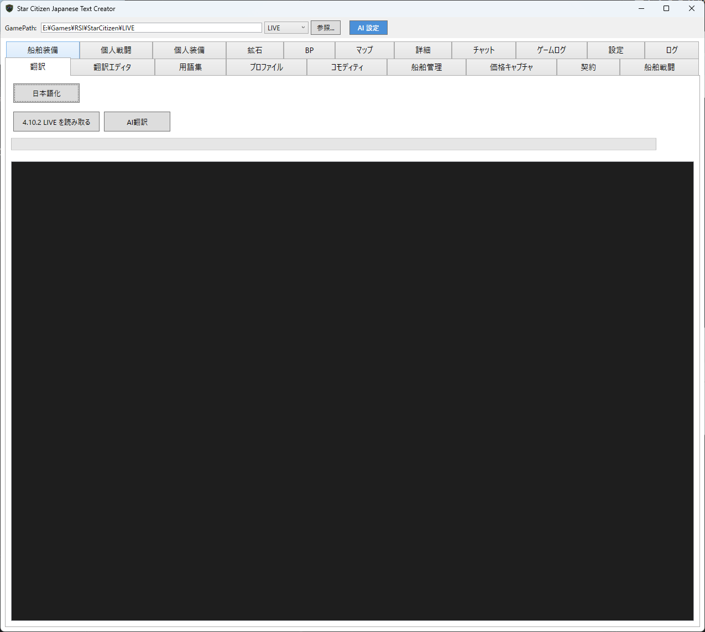

1. **GamePath** が正しいことを確認（自動検出済み）。チャンネル (PTU/LIVE) を選択
2. **[日本語化]** をクリック — 先に「日本語化の適応範囲」の窓が出ます（下の図）。日本語にする範囲を選んで **[次へ]**（全部を日本語にするなら「全て翻訳」、14 種類の中からチェックで選ぶなら「一部翻訳」）
3. 次の画面で、ゲーム内の名前に付けたいオプションにチェックを入れて **[実行]**
   - 装備名の後ろに分類を付ける　例：Bracer [軍1C]
   - 契約名に派閥と貢献度を付ける　例：トラッカーライセンス認定資格 [バウンティーハンターズ・ギルド +50]
   - 契約名に設計図を付ける　例：Orison救援：小規模製造依頼 [BP]
4. Star Citizen を起動すれば日本語テキストが適用されます

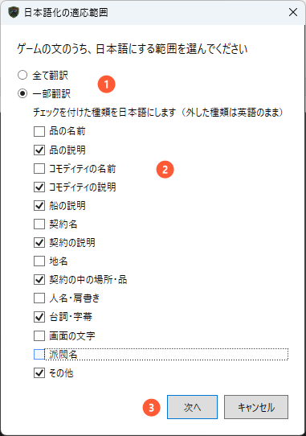

*「一部翻訳」を選び、チェックをいくつか外した例です。番号は下の表。*

| 番号 | ところ | すること |
|---|---|---|
| ① | **全て翻訳** / **一部翻訳** | 全て翻訳は全部を日本語にします（このときチェックは押せません）。一部翻訳にすると、下のチェックで種類を選べます。初めは全て翻訳です |
| ② | 種類のチェック（14 個） | チェックを付けた種類を日本語にします（外した種類は英語のまま）。品の名前／品の説明／コモディティの名前／コモディティの説明／船の説明／契約名／契約の説明／地名／契約の中の場所・品／人名・肩書き／台詞・字幕／画面の文字／派閥名／その他。初めは全部にチェックが付いています |
| ③ | **[次へ]** | 名前に付ける印を選ぶ窓（「日本語化」の窓）へ進みます |
| 次の窓 | 「日本語化」の窓 | 装備名の分類・契約名の派閥と貢献度・設計図の印を選びます |
| 次の窓 | **[実行]** | 選んだ範囲と印で、ゲームに書き出します。選んだ範囲は印と一緒に覚え、次も同じ状態で開きます |

- 外した種類は、ゲームの中で英語の原文のままになります。名前に付ける印（[軍1C] など）は、名前を英語のままにしても付きます
- 変わるのはゲームに書き出す global.ini だけです。アプリの画面の表示は変わりません

ゲームにパッチが来たら **[新しいパッチを読み取る]**（ゲームの版が読めたときは、ボタンに「4.10.2 LIVE を読み取る」のように版とチャンネルが出ます。新しい版があるときはボタンが黄色になります）→ **[日本語化]**。未翻訳を自分で訳すときは間に **[AI翻訳]** を挟みます。ログは「ログ」タブで見られます。

---

### 2. AI 設定 — 翻訳バックエンドの設定

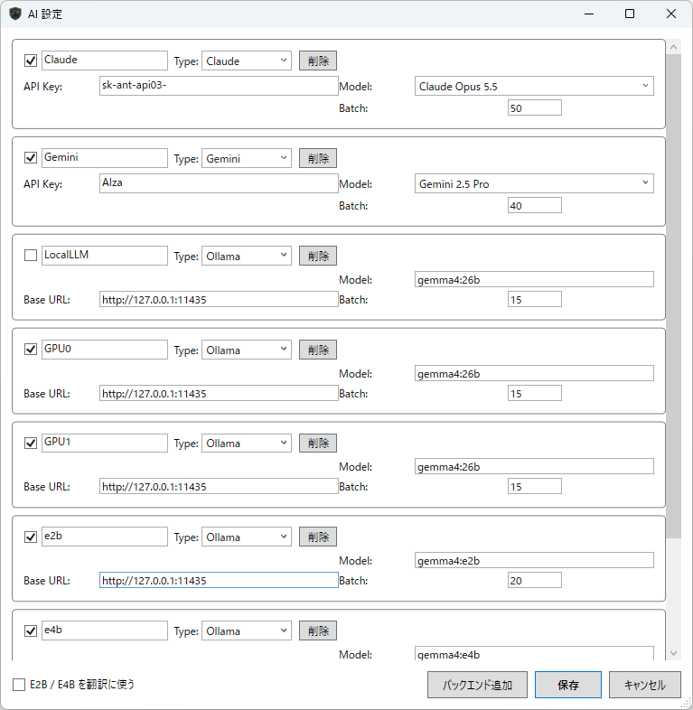

1. 画面右上の **[AI 設定]** ボタンをクリック
2. 各バックエンドの **チェックボックス** を有効にし、API キーやモデルを設定
3. **Batch** で一度に送る翻訳数を調整（VRAM やレート制限に応じて）
4. 複数バックエンドを有効にすると **並列翻訳** でスピードアップ
5. **[保存]** をクリック

> **チェックボックスは翻訳に使用するバックエンドの選択です。** チェックを入れたバックエンドが翻訳実行時に並列で使われます。
> **チャット (AI チャット / Web チャット) は別です。** 設定済みのバックエンドすべてがチャットタブのドロップダウンに表示され、その中から **1つを選んで** 使います。

#### バックエンドの追加

- **[バックエンド追加]** ボタンで同じプロバイダーを複数登録できます
- 例: OpenAI を 2 つ追加し、片方を `gpt-4.1-mini`（高速バッチ用）、もう片方を `gpt-4.1`（高品質用）に設定
- 異なる API キーを使い分けることで、レート制限を分散させることも可能です
- 不要なバックエンドは **[削除]** ボタンで削除できます

| バックエンド | 特徴 | 必要なもの |
|---|---|---|
| **Claude** (Anthropic) | 高品質な翻訳 | API キー ([取得方法](docs/API_Key_取得_Claude.md)) |
| **Gemini** (Google) | 高速・大量処理向き | API キー ([取得方法](docs/API_Key_取得_Gemini.md)) |
| **OpenAI** (ChatGPT) | 高品質・バランス型 | API キー ([取得方法](docs/API_Key_取得_OpenAI.md)) |
| **Ollama** (ローカル) | 無料・オフライン対応 | [Ollama](docs/Ollama_Install.md) + モデル |

---

### 3. 翻訳エディタ — 翻訳結果の確認・編集

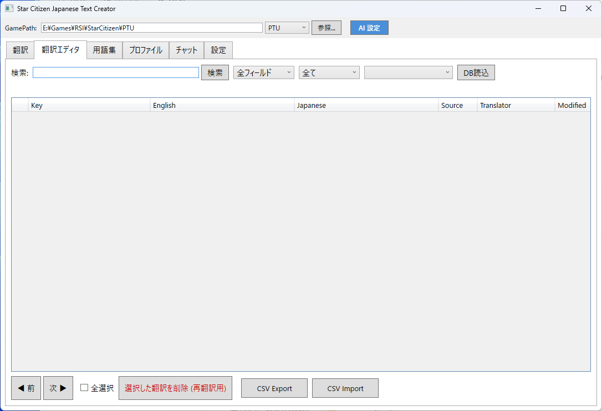

1. **翻訳エディタ** タブを開く（起動時にDBを自動読込）
2. **検索** バーでキーワード検索（ワイルドカード `*` `?` 対応）、**部分一致** チェックボックスで切替
3. **フィルタ** で Source (official/ai/manual/original) や Translator で絞り込み
4. **Japanese 列をダブルクリック** して翻訳を手動編集（手動修正は次回のDB読込でも保護されます）
5. 不満な翻訳はチェックボックスで選択 → **[選択した翻訳を削除]** で次回再翻訳
6. 船名・地名など英語のままにしたいキーは選択 → **[全て原文]** で英語原文を維持
7. **CSV Export / Import** で外部エディタとの連携も可能

---

### 4. 用語集 — 翻訳ルールの管理

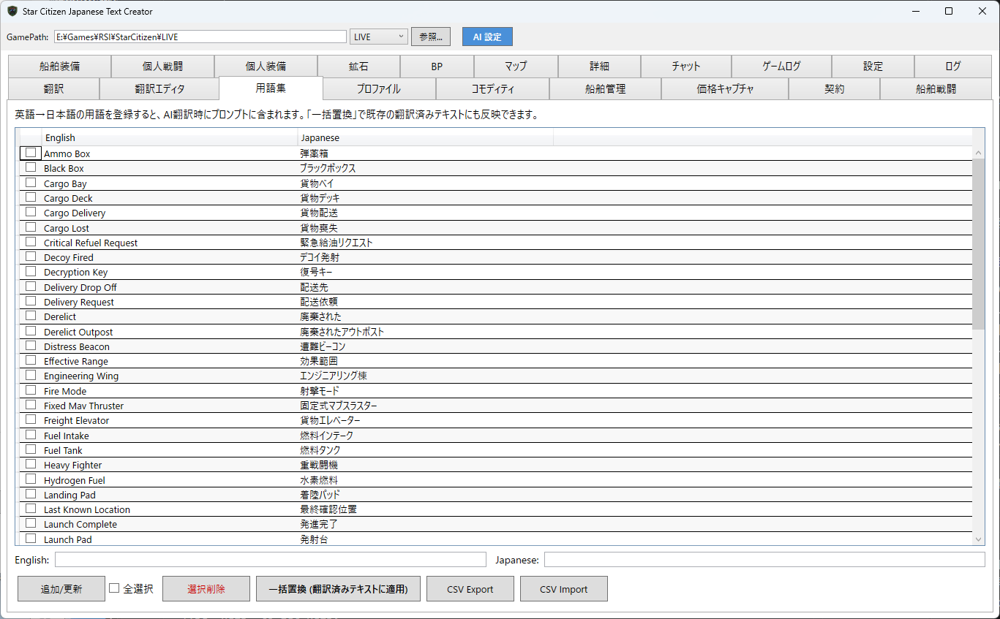

1. **用語集** タブを開く
2. 下部の **English** / **Japanese** フィールドに用語を入力
3. **[追加/更新]** をクリックして登録
4. 登録した用語は AI 翻訳時のプロンプトに自動挿入されます
5. **[一括置換]** で翻訳済みテキスト内の用語を正しい訳語に一括変換
6. チェックボックスで複数選択 → **[選択削除]** で一括削除
7. **CSV Export / Import** で用語集の一括管理も可能

> **誤訳の修正にも使えます。** 例えば AI が「Quantum Drive」を「量子ドライブ」と訳してしまった場合、English に `量子ドライブ`、Japanese に `クォンタムドライブ` と登録して **[一括置換]** を実行すると、翻訳済みテキスト内の誤訳がまとめて修正されます。カタカナを英語に戻したい場合も同様です。

---

### 5. プロファイル — バックアップ/リストア

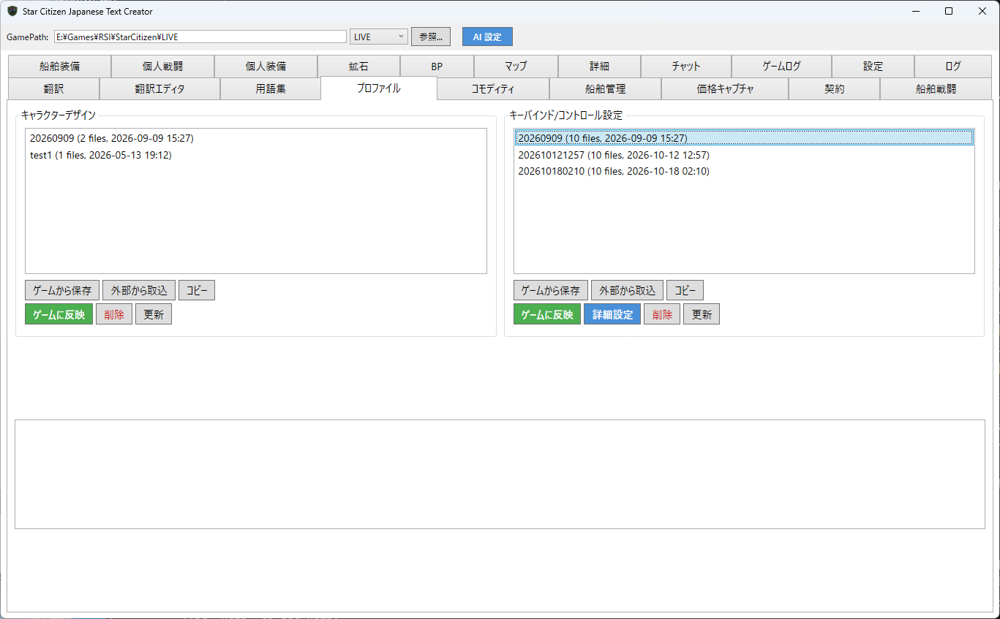

1. **プロファイル** タブを開く
2. **キャラクターデザイン** (左) と **キーバインド/コントロール設定** (右) を管理
3. **リストから復元したいプロファイルを1つ選択** してから操作します
4. **[ゲームから保存]** — 現在のゲーム設定をバックアップ
5. **[ゲームに反映]** — 選択したバックアップをゲームに復元
6. **[外部から取込]** — 他の人のファイルをインポート
7. **[詳細設定]** (コントロール側) — 選択したプロファイルのキーバインドエディタを開く

---

### 6. キーバインドエディタ — 機能別タブ

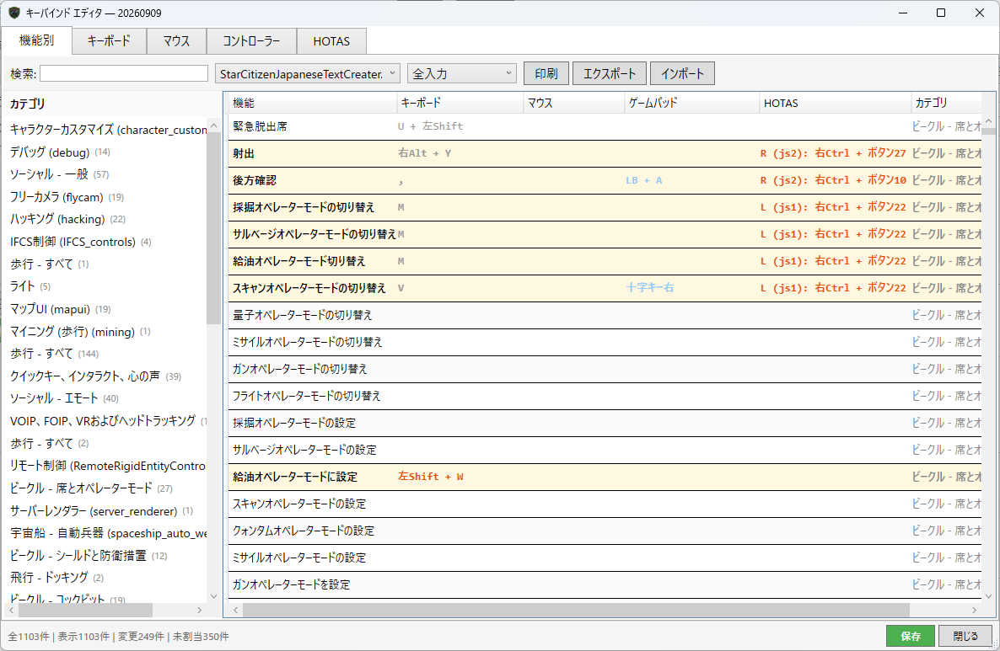

1. プロファイルタブでリストから保存済みプロファイルを **1つ選択** → **[詳細設定]** をクリック
2. **[機能別]** タブ: カテゴリ一覧（左）とバインド一覧（右）を表示
3. 左のカテゴリをクリックすると、そのカテゴリの機能に絞り込み
4. **検索** バーで機能名・キー名を検索
5. **入力フィルタ** でキーボード/マウス/ゲームパッド/未割当のみ等で絞り込み
6. 行をダブルクリックしてバインドを編集
7. 変更済みの行は黄色でハイライト、変更されたキーはオレンジ色で表示
8. **[エクスポート]** で XML / CSV に保存、**[インポート]** で読み込み

---

### 7. キーバインドエディタ — キーボード / マウス / ゲームパッド / HOTAS タブ

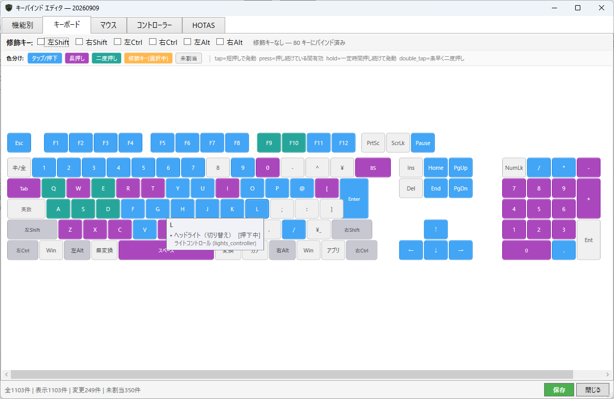

1. **[キーボード]** タブ: **日本語 109 キー配列** がビジュアル表示（テンキー付き）
2. **[マウス]** タブ: 左/右クリック・ホイール上下・中央・Mouse4/5・X/Y 軸をビジュアル表示。右側にマウスバインド全一覧

   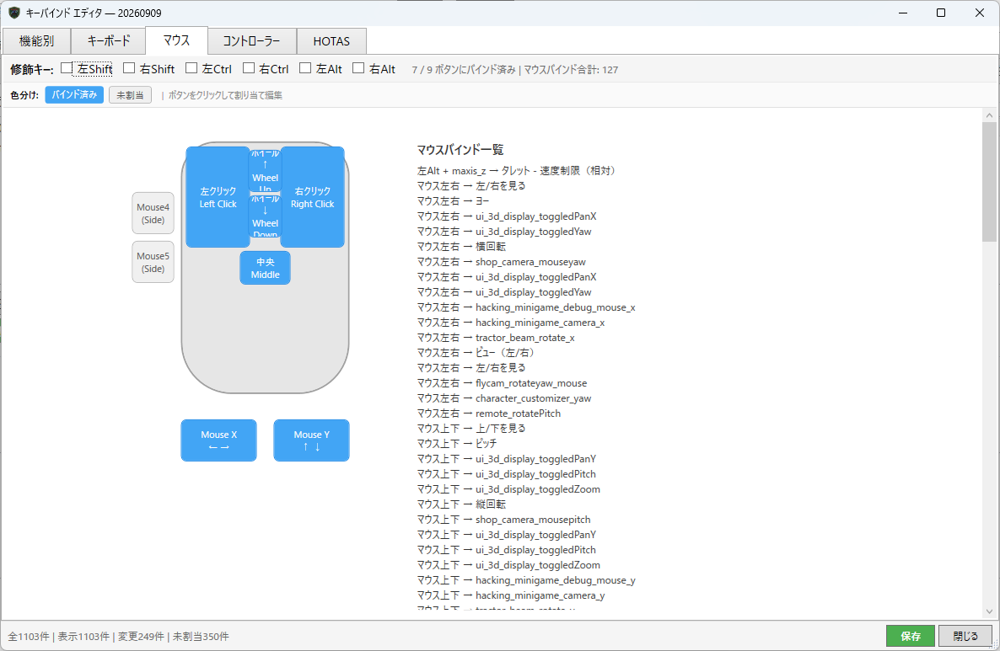

3. **[コントローラー]** タブ: Xbox コントローラーの A/B/X/Y・LB/RB・LT/RT・スティック・D-Pad をビジュアル表示。LB/RB 修飾ボタン対応

   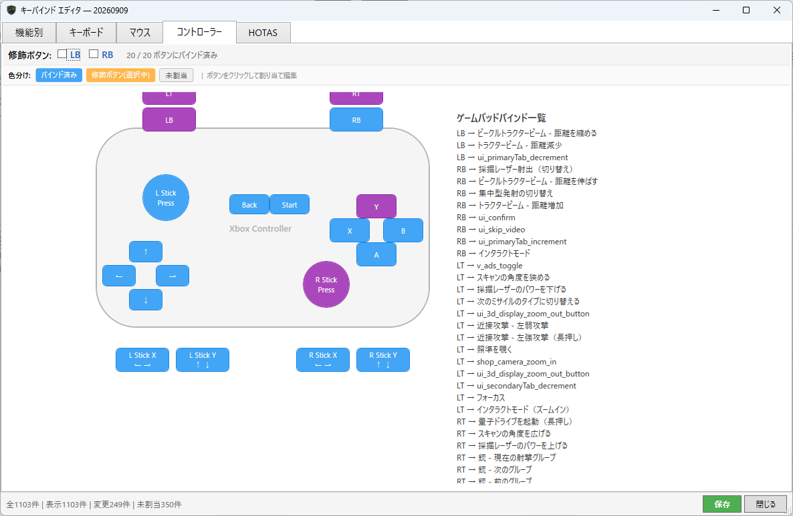

4. **[HOTAS]** タブ: VKB Gladiator NXT 左右の画像＋ボタングループ別バインドテーブル。画像クリックで拡大ビューア＋バインド編集パネル
   - 上の［左右を設定…］で、左右のスティックのボタンを押して HOTAS の左右を設定し直せます。［表示の入れ替え］は表示の左右だけを入れ替えます（ファイルは変わりません）。［js1/js2 の入れ替え］は、全ての機能の js1 と js2 の割り当てを入れ替えます

   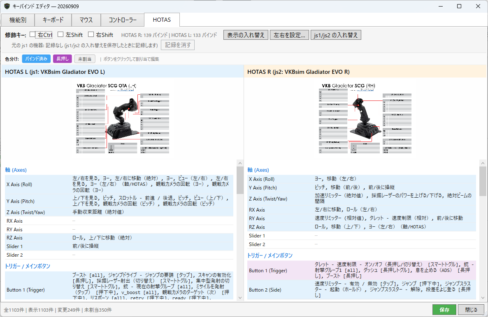

   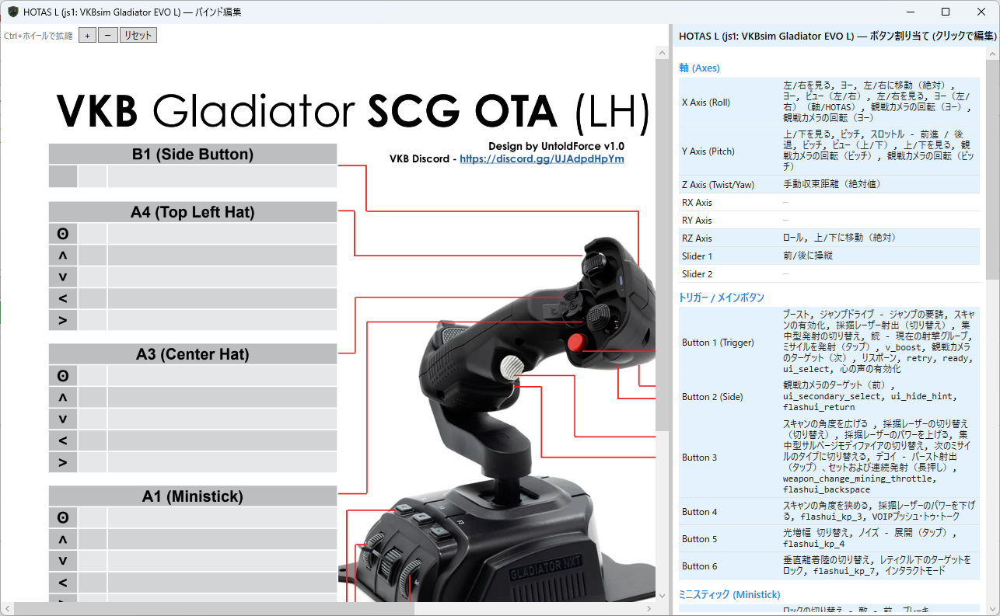

5. **色分け** でバインドの種類が一目でわかります:
   - **青** = タップ / 押下中 (tap / press)
   - **紫** = 長押し (hold / delayed_hold)
   - **緑** = 二度押し (double_tap)
   - **オレンジ** = 修飾キー選択中
   - **グレー** = 未割当
6. **修飾キーのチェックボックス** をチェックすると、修飾キーとの組み合わせバインドを表示
7. ボタンに **マウスホバー** するとツールチップで割り当て済み機能一覧と activation mode を表示
8. ボタンを **クリック** すると割り当てダイアログが開き、機能を検索して割り当て/解除が可能
9. 機能名はゲーム内の **日本語翻訳データ (global.ini)** を参照して表示

---

### 8. AI チャット — ゲーム情報を日本語で質問

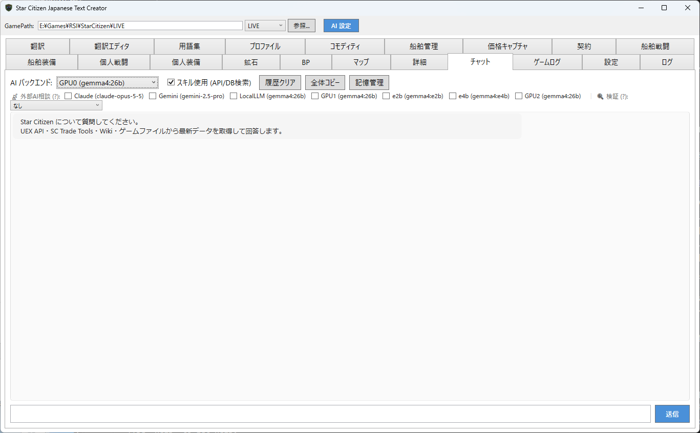

1. **チャット** タブを開く
2. **AI バックエンド** をドロップダウンで選択 (スキル対応バックエンド推奨)
3. テキストボックスに質問を入力して **[送信]**
4. AI が自動で必要なツール (スキル) を呼び出してデータを取得・回答
5. **[記憶管理]** ボタンでナレッジ管理ウィンドウを開く

#### AI 検索スキル (Tool Use)

| スキル | 検索できる内容 | 質問例 |
|---|---|---|
| **lookup** | 統合検索 (最初に呼ぶ) | 「ホーネットについて教えて」 |
| **search_location** | ステーション・施設 (精錬所・ハンガー等) | 「Everus Harbor の施設は？」 |
| **search_commodity** | 商品・資源＋場所別価格 | 「ラナイトの売値は？」 |
| **search_mission** | ミッション・契約 | 「賞金稼ぎのミッション一覧」 |
| **search_wiki** | Wiki からの詳細情報 | 「Carrack のスペックは？」 |
| **search_keybind** | キーバインド検索 | 「ドッキングのキーは何？」 |
| **remember** | ナレッジに情報を保存 | 「覚えて：○○はバグで動かない」 |
| **forget** | ナレッジから情報を削除 | 「直った：○○のバグ」 |

> 💡 バグ情報も AI に覚えさせると便利です。例:「覚えて：4.8 PTU で Lorville の Hangar エレベーターが動かない」→ 次に Lorville について質問したとき、AI が自動で注意してくれます。チームで DB を共有すれば全員が同じバグ情報を持てます。

---

### 9. Web チャット — ブラウザ・スマホから利用

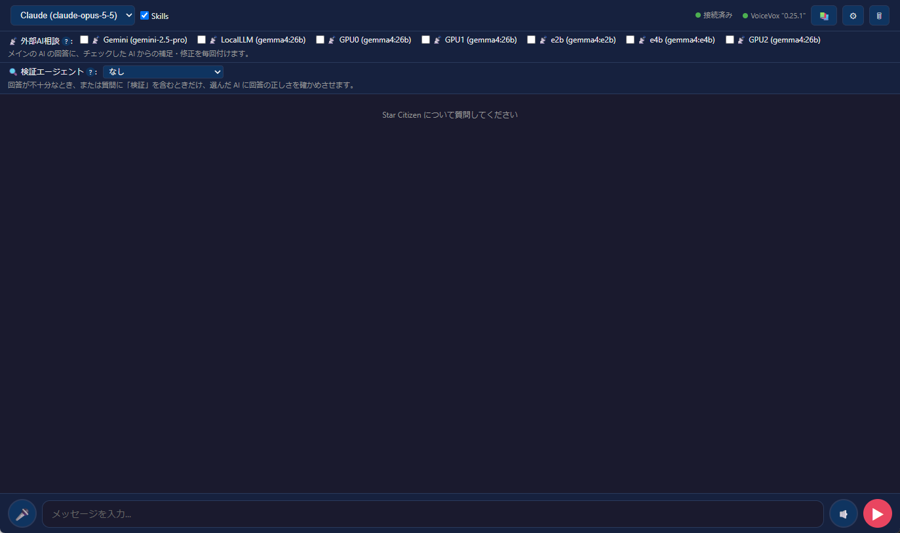

PC のブラウザやスマホから、AI チャットと VoiceVox 音声読み上げを利用できます。

#### 起動方法

1. **設定** タブで HTTP ポート (デフォルト: `8099`) と HTTPS ポート (デフォルト: `8100`) を確認
2. **[サーバー起動]** をクリック — HTTP と HTTPS が同時に起動します
3. 初回のみ **UAC プロンプト** が表示されます — **はい** をクリック (Windows ファイアウォールの開放とポート登録を自動で行います)
4. 以下の URL にアクセス:
   - **PC**: `http://localhost:8099/`
   - **LAN (他のデバイス)**: `http://192.168.x.x:8099/` (アプリに表示される URL)
   - **HTTPS PC**: `https://localhost:8100/`
   - **HTTPS LAN (マイク利用)**: `https://192.168.x.x:8100/` (スマホのマイクにはこちらが必要)

> **`192.168.x.x` の確認方法:** PC でコマンドプロンプトまたは PowerShell を開き `ipconfig` を実行します。「Wi-Fi」または「イーサネット」の **IPv4 アドレス** (例: `192.168.1.15`) がこの PC のアドレスです。スマホから同じ Wi-Fi に接続し、そのアドレスでアクセスしてください。

#### VoiceVox 音声読み上げ

- [VoiceVox](https://voicevox.hiroshiba.jp/) をローカルで起動しておく必要があります（無料）
- 入力欄の右の **スピーカーのボタン**（送信ボタンの左）を押すと音声読み上げが **ON** になり、ボタンが緑になります（押さなければ読み上げません）
- ON の状態では: 質問送信時に「おまちください」、回答時に「お待たせしました」+ AI が生成した要約を読み上げ
- 画面右上の歯車アイコンから話者 (キャラクター) を変更可能

#### スマホからの利用方法

スマホと PC が同じ Wi-Fi に接続されていれば、スマホのブラウザからチャットを利用できます。

**マイク (音声入力) を使わない場合:**

スマホのブラウザで `http://192.168.x.x:8099/` にアクセスするだけで利用できます。

**マイク (音声入力) を使う場合:**

Chrome はセキュリティ上、`localhost` 以外の HTTP ではマイクを許可しません。HTTPS が必要です。

1. アプリの **[サーバー起動]** をクリック — HTTP (8099) と HTTPS (8100) が同時に起動します
2. 初回のみ Windows の **UAC プロンプト** (管理者権限) が表示されます — **はい** をクリック (証明書のインストール、HTTPS ポートの登録、ファイアウォールの開放に必要)
3. 初回のみ Windows の **証明書インストール確認** が3回表示されます — すべて **はい** をクリック (自己署名証明書を PC の信頼済みストアに登録)
4. スマホのブラウザで `http://192.168.x.x:8099/cert` にアクセス
5. **[証明書をダウンロード]** をタップしてインストール:
   - **iPhone**: 設定 → 一般 → VPN とデバイス管理 → プロファイルをインストール → 設定 → 一般 → 情報 → 証明書信頼設定 → 有効化
   - **Android**: 設定 → セキュリティ → 証明書のインストール → CA 証明書 → ダウンロードしたファイルを選択
6. `https://192.168.x.x:8100/` にアクセス — マイクが使えるようになります

⚠️ **「この接続ではプライバシーが保護されません」と表示された場合:**

自己署名証明書を使用しているため、ブラウザが警告を表示することがあります。これは正常です。

- **PC (Chrome)**: **[詳細情報を表示しない]** をクリック → **[192.168.x.x にアクセスする（安全ではありません）]** をクリック
- **iPhone (Safari)**: **[詳細を表示]** → **[この Web サイトを閲覧]** をタップ
- **Android (Chrome)**: **[詳細設定]** → **[192.168.x.x にアクセスする（安全ではありません）]** をタップ

この警告は自宅 LAN 内の自己署名証明書によるものであり、通信自体は暗号化されています。一度アクセスを許可すれば、同じブラウザでは次回以降表示されません。

#### マイクが使えない場合 (Q&A)

**Q. マイクボタンを押しても反応しない / 「マイクの許可が必要です」と出る**

A. Chrome はセキュリティ上、`localhost` 以外では HTTPS 接続でないとマイクを許可しません。`https://192.168.x.x:8100/` でアクセスしてください (`http://` ではなく `https://`、ポートは `8100`)。

**Q. HTTPS でアクセスしてもマイクが使えない**

A. Chrome のアドレスバー左の鍵アイコン (または ⚠️ アイコン) をクリック → **マイク** の項目を確認してください。
- トグルが **OFF** になっている → **ON** に切り替え
- 「サイトアクセス時は常に許可」にチェックを入れると、次回以降の確認が不要になります
- 使用するマイクデバイスもここで選択できます

**Q. 「このサイトへの接続は保護されていません」と表示されるが問題ないか？**

A. 自己署名証明書を使っているため Chrome が警告を表示しますが、自宅 LAN 内の通信は暗号化されており問題ありません。マイクの利用には影響しません。

**Q. ゲーム用ヘッドセットなど、別のマイクを使いたい**

A. Chrome はデフォルトのマイクデバイスを使用します。切り替えるには:
1. アドレスバー左のアイコン (🔒 または ⚠️) をクリック
2. **マイク** の項目をクリック
3. ドロップダウンから使いたいマイクデバイスを選択
4. **「サイトアクセス時は常に許可」** にチェックを入れると次回以降の確認が不要になります

**Q. スマホでマイクが使えない**

A. 以下を確認してください:
1. `https://` でアクセスしているか (ポートは HTTPS 用の `8100`)
2. 証明書をスマホにインストール済みか (`http://192.168.x.x:8099/cert` からダウンロード)
3. ブラウザのマイク許可を求めるポップアップで **許可** を選択したか
4. スマホの設定 → アプリ → Chrome (または Safari) → マイクが有効か

> 証明書はこの PC 専用の自己署名証明書です。外部の認証局は使用しません。不要になったらスマホから削除してください。
>
> ファイアウォールは「SC Japanese Assistant HTTP」「SC Japanese Assistant HTTPS」というルール名で自動登録されます。アンインストール時は Windows Defender ファイアウォール → 受信の規則 から手動で削除してください。

#### データ API (読み取り専用)

> **Web チャットサーバーを起動していないと、データ API は使えません。** **設定** タブの **[サーバー起動]** を押してから呼んでください。アプリを起動したときに自動で起動させるには **[自動起動]** にチェックを入れます。

Web サーバーを起動している間は、詳細タブ・交易・契約などのデータを JSON か HTML で読み出せます。ほかのツールやスクリプトから使うためのもので、**すべて GET の読み取り専用**です (DB には書き込みません)。データは画面と同じ読み方で出します。

- **ポート**: Web チャットと同じです。`http://localhost:8099/api/…`、HTTPS なら `https://localhost:8100/api/…` (LAN の他の機械からは `192.168.x.x`)
- **形式**: `format=json` (既定) か `format=html`。それ以外は 400 になります
  - JSON の**一覧**は `{ "total": 全体の件数, "count": 返した件数, "items": [ … ] }` です。`total` は `limit`・`offset` を通す前の件数、`count` は返した件数です
  - JSON の**詳細**は `{ "record", "name", "text" }` です。項目はアプリの中のデータの項目名のままです
  - HTML の一覧は表、詳細は詳細タブと同じ見た目のページです。詳細の中のリンクは `/api/detail?record=…&format=html` に移ります
- **件数**: 一覧には `limit` (最大件数。1 以上の整数) と `offset` (飛ばす件数。0 以上の整数) を付けられます。付けなければ全件です。`/api/search` の `limit` だけは 1〜1000 です
- **生の JSON**: 契約の一覧の `RawJson` (ゲームデータの生の JSON。とても大きい) は、既定では出しません。`raw=1` を付けたときだけ出します
- **個人のデータ** (パスが `/api/my/` で始まるもの) は **この PC から**呼んだときだけ返します。要求元がこの PC (ループバック) で、しかも `Host` ヘッダーのホスト名が `localhost`・`127.0.0.1`・`[::1]` のどれか (ポートは問わない) のときだけです。それ以外は 403 になります。個人のデータの応答には CORS のヘッダーを付けません
- **ゲームのデータのルートに混ざる個人のデータ** (`/api/blueprints` の所持 `Owned`・在庫 `StockText` `stockText`・手持ち `haves`、`/api/detail` と `/api/missions/detail` の【ブループリント】の節の「在庫」「所持」の行と「手持ち」の欄) も、`/api/my/` と同じ条件 (この PC から、`Host` が `localhost`・`127.0.0.1`・`[::1]`) のときだけ画面と同じに出し、そのときの応答には CORS のヘッダーを付けません。条件に合わない要求 (LAN の他の機械から・`Host` が違う) には、個人のデータを出さずに CORS のヘッダーを付けて返します。ほかのゲームのデータのルートは、いつも CORS のヘッダーを付けます
- **エラー**は形式にかかわらず `{ "error": "…" }` で返します。引数の誤りは 400、個人のデータをこの PC 以外から読もうとしたときは 403、見つからないとき・`/api/` で始まる知らないパスは 404、GET 以外は 405、データがまだ無いときは 503、アプリの中の失敗は 500 (`"内部エラー"`。中身はアプリのログ `app_log.txt` に残します)

| パス | 中身 | 応答の形 | 主な引数 |
|---|---|---|---|
| `/api` | API の一覧 | 一覧 (`path`・`description`・`parameters`・`personal`) と `formats` | |
| `/api/search` | 詳細タブの検索 (星系・場所・お店・資源・品目) | 一覧 (`total` は見つかった候補の数) | `q` 名前、`limit` 品目の候補の最大件数 (1〜1000。既定 40) |
| `/api/detail` | 詳細タブの詳細 (品目・資源・お店・場所・星系) | 詳細 | `record` (必須) |
| `/api/ships` `/api/ship-weapons` `/api/ship-gear` | 詳細タブの分類「船舶」「船舶武器」「船舶装備」 | 一覧 | `kind` 種類、`size` サイズ (`3` か `S3`)、`name` 名前の一部 |
| `/api/personal-weapons` `/api/personal-gear` `/api/ores` | 詳細タブの分類「個人武器」「個人装備」「鉱石」 | 一覧 | `kind`、`name` |
| `/api/shops` `/api/stations` `/api/systems` | 詳細タブの分類「お店」「ステーション」「星系」 | 一覧 | `kind`、`name` |
| `/api/trade/commodities` `/api/trade/terminals` | 交易のコモディティ・端末 | 一覧 | |
| `/api/trade/prices` | 端末で買える物・売れる物 | `{ "terminal", "buy": 一覧, "sell": 一覧 }` (`limit`・`offset` はそれぞれに) | `terminal` 端末名 (必須) |
| `/api/trade/routes` | 交易ルートの検索 | 一覧 (`CommodityDisplayName` は画面と同じ「日本語 (英語)」) | `budget` 予算 (画面と同じ書き方: `1000000`・`1M`・`500k`・`3.5m`)・`scu` 積載量 (必須)、`buySystem` `sellSystem` (既定 全て)、`excludeOutposts` `loadingDockOnly` `excludeLowStock` (true/false)、`commodities` (カンマ区切り)、`top` (既定 20) |
| `/api/missions/categories` | 契約の分類 | 一覧 | |
| `/api/missions` | 契約の一覧 | 一覧 (`RawJson` は `raw=1` のときだけ) | `category` か `q` のどちらか一方 (`q` が空なら全部)、`raw` |
| `/api/missions/detail` | 契約の詳細と納品物 (Wikelo の契約) | 詳細と `deliverables` (`item`・`sources` 入手場所の文) | `record` (必須) |
| `/api/blueprints` | ブループリント | `record` 無し: 一覧 (BP タブの表の行)。`record` 付き: `{ "record", "total", "count", "items": [{ "item", "stockText", "haves" }], "text" }` (`text` は詳細タブの【ブループリント】の節)。品目が無ければ 404 | `record` できる品の record 名 (省略可) |
| `/api/starmap` | 星図の星系・場所 | 一覧 | |
| `/api/my/ships` | 所持船 | 一覧 | |
| `/api/my/components` `/api/my/gear` | 所持コンポーネント・所持している個人装備 | 一覧 (同じ品の行は画面と同じく 1 行にまとめた形) | |
| `/api/my/blueprints` | 所持している BP | 一覧 (`Uuid` と BP の名前 `Name`) | |
| `/api/my/hangar/pledges` `/api/my/hangar/ships` `/api/my/hangar/ccus` | Hangar の pledge・保有船・CCU | 一覧 | |
| `/api/my/loadout` | 保有船の今の装備と付け替えの候補 (装備タブの表と同じ) | 一覧 (行に `Candidates` 候補・`SelectedChoice` 今の選択) と `ship`・`name`・`record` | `ship` 保有船の InstanceKey (`/api/my/hangar/ships` の値) か `my\|所持船の Id` (必須) |
| `/api/my/gamelog` | ゲームログの残してある行 | 一覧と `broken` (読めなかった行の数) | |
| `/api/my/mining` `/api/my/ore-stock` `/api/my/commodity-trades` | 採掘の記録・鉱石の在庫・商品売買の記録 | 一覧 | |

例:

```
http://localhost:8099/api/search?q=Arrow
http://localhost:8099/api/detail?record=EntityClassDefinition.xxx&format=html
http://localhost:8099/api/ship-weapons?size=S3&limit=20
http://localhost:8099/api/trade/routes?budget=1M&scu=96&buySystem=Stanton
http://localhost:8099/api/missions?q=&limit=10&raw=1
http://localhost:8099/api/my/hangar/ships
```

> 交易の API は、交易タブで価格を読み込んだあとに使えます (まだなら 503)。種類 (`kind`) の値は詳細タブの「種類」の欄と同じ文字です (個人装備のアーマー・服は「アーマー (ヘルメット)」のように部位まで)。`kind`・`name`・`size` などの絞り込みは前後の空白を除き、空なら絞り込みません。

---

### 10. ナレッジ (記憶) — AI にバグ情報や Tips を教える

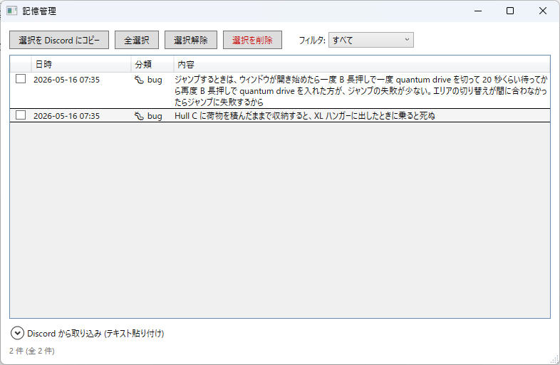

AI に情報を教えて記憶させることができます。保存した情報は毎回のチャットに自動で読み込まれます。

- **保存**: チャットで「覚えて：Hull C に荷物を積んだまま収納すると XL ハンガーで死ぬ」→ AI が SQLite に保存
- **削除**: 「直った：○○のバグ」「忘れて：○○」で削除
- **管理 UI**: アプリの **[記憶管理]** ボタン、または Web チャットのモーダルから一覧・編集・削除
- カテゴリ: バグ (bug)・用語 (term)・Tips (tip)・一般 (general)
- フィルタでカテゴリ別に表示、選択して一括削除も可能

#### Discord 連携

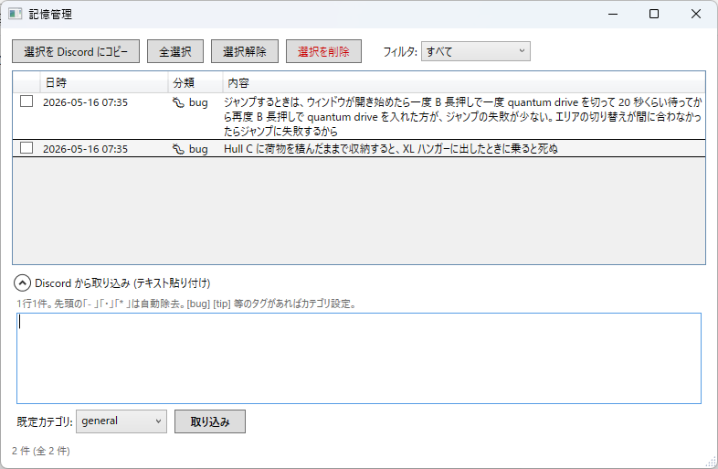

- **[選択を Discord にコピー]** — 選択したナレッジをカテゴリ別にまとめた Discord マークダウンとしてクリップボードにコピー
- **Discord から取り込み** (画面下部を展開) — Discord やテキストファイルからコピペで一括インポート。先頭の `- ` や `[bug]` タグを自動認識

---

### 11. 設定タブ — Web チャット・VoiceVox・データベース管理

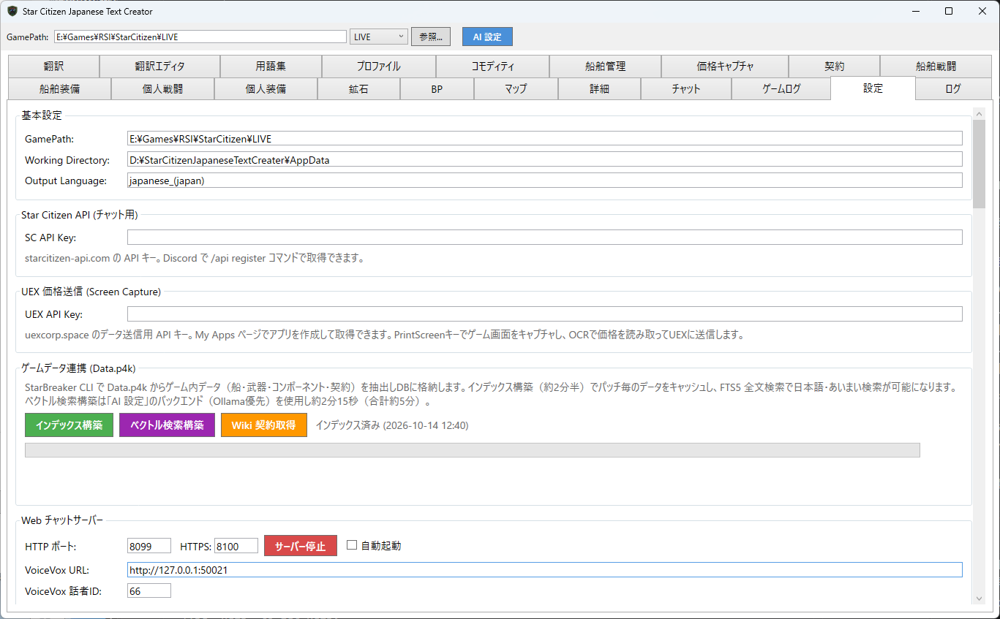

*設定タブの上の部分です。絵の「ゲームデータ連携 (Data.p4k)」の説明文は「StarBreaker CLI で…」ですが、今の版では「アプリの中の処理で…」です。*

1. **基本設定**: GamePath・Working Directory・Output Language を確認・変更
2. **ゲームデータ連携**: **[インデックス構築]** で Data.p4k からゲームデータを抽出・キャッシュ
3. **Web チャット**: HTTP ポート (8099) と HTTPS ポート (8100) を設定し **[サーバー起動]** でブラウザ/スマホからアクセス可能に
4. **VoiceVox URL**: VoiceVox の接続先 (デフォルト: `http://localhost:50021`)、話者 ID、速度 (0.5〜2.0 倍。Web チャットとゲームログの読み上げの両方) を設定
5. **データベース**:
   - **[エクスポート (バックアップ)]** — 翻訳 DB・ナレッジを含む全データを ZIP で保存
   - **[インポート (復元)]** — バックアップ ZIP を読み込み (翻訳データ・用語集・ゲームデータインデックス・記憶データ・交易データを選択可)
   - **個人データを含める** — エクスポートに、所持船などの個人データを入れるかを選びます
   - **[翻訳DBクリア (全翻訳データ削除)]** — 翻訳データを全部消します
6. **日本語フォント (gfx)**: 字が足りず □ になる漢字を出すため、ゲームの日本語フォント (fonts_en.gfx) を、字がすべて入ったもの (Noto Sans JP) に置き換えます
   - **[フォントを置く]** — 最新の公開物 (GitHub のリリースの添付 `fonts_en.gfx`) を取り、大きさと SHA-256 を確かめてから `<GamePath>\data\Localization\japanese_(japan)\UI\fonts\Shared\fonts_en.gfx` に置きます。効くのはゲームを起動し直してからです
   - Data.p4k の中の元のフォントが、このフォントを作ったときと変わっている（パッチで変わった）とき、または確かめられないときは、置く前に「それでも置きますか？」と聞きます
   - 置いたら、置いたファイルの SHA-256 を印のファイル `fonts_en.gfx.scjptc`（置き先と同じフォルダ）に書きます。置き先のファイルの SHA-256 が最新の公開物の記録か印の値と同じなら、このアプリが置いたものとみなして、控えを取らずに置き換えます
   - 置き先にこのアプリが置いたもの以外のファイルがあれば `fonts_en.gfx.bak` に移しておきます。`fonts_en.gfx.bak` がもうあるときは上書きせず、`fonts_en.gfx.bak.<yyyyMMddHHmmss>`（移した日時）に移して残します（［元に戻す］で戻すのは `fonts_en.gfx.bak` だけです）
   - **[元に戻す]** — 置いたフォントを「消しますか？」と聞いてから消し、印も消します（控えがあれば戻します）。このアプリが置いたものか確かめられないとき（公開物の記録とも印とも一致しない、またはネットにつながらず印も無い）は、そう書いた確認を出し、［はい］なら消します。控えが無ければ、消したあとゲームは Data.p4k の中の元のフォントを使います
   - ゲームの起動中は置けません（戻せません）。押したときと、置く（消す）直前の 2 回確かめます。Output Language が `japanese_(japan)` でないときは置きません
   - CIG が公式に認めているのは global.ini と user.cfg だけです。gfx の置き換えは認められたものではありません。**自己責任でお使いください**
7. **マップのデバッグ表示**: 「3D モデル」の欄の「ステーションのテクスチャ (px)」の行の右。既定はオフです。入れると、ステーションの 3D で形を押したときに、画面の下部に押した部品の名前・判定の面・押した所の高さなどの細かい文を出します（文字の道案内の細かい部分も、オンのときだけ出します）。［設定を保存］の後、次に 3D を開いたときから効きます
8. **船・装備・武器の 3D の色付け**: 「3D モデル」の欄の「3D モデルを保存しない」の右。既定はオンです。切ると、船・装備・武器の 3D をパレットの色を付けずに材質そのものの色で出し、塗装の一覧は出しません（取り込んだ 3D モデルは作り直しません）。ステーションの 3D の「色付け」スイッチとは別です。［設定を保存］の後、次に 3D を開いたときから効きます

   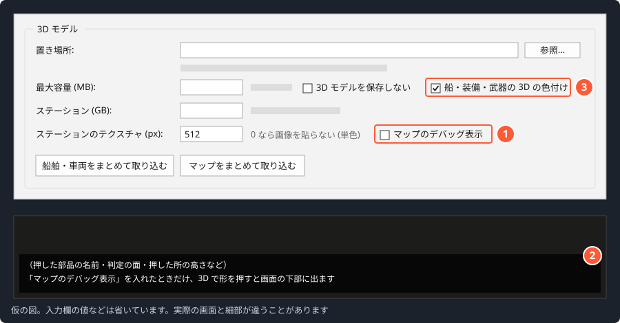

   *仮の図です。実際の画面と細部が違うことがあります。* ① マップのデバッグ表示のチェック（既定はオフ） ② 入れたときだけ、3D で形を押すと下部に出る細かい文 ③ 船・装備・武器の 3D の色付けのチェック（既定はオン）
9. **[設定を保存]** で変更を反映

設定タブには、ほかに次の欄があります。

- **Star Citizen API (チャット用)**: SC API Key（starcitizen-api.com の API キー。Discord で /api register コマンドで取得できます）
- **UEX 価格送信 (Screen Capture)**: UEX API Key（uexcorp.space のデータ送信用 API キー。My Apps ページでアプリを作成して取得できます）。［価格キャプチャ］タブの送信に使います
- **ゲームデータ連携 (Data.p4k)** のほかのボタン: ［ベクトル検索構築］［Wiki 契約取得］［価格の取得を中止］
- **Web チャットサーバー**: ［サーバー起動］の横の「自動起動」を入れると、アプリを起動したときに Web チャットサーバーも起動します
- **ゲームログの音**: 「VOICEVOX で読み上げる」、既定の声、読み上げる先（VOICEVOX だけ／外のアプリだけ／両方）、場面ごとの「読む」・読み上げる文・声、「休戦ゾーンに進入」「到着」の音のファイル（上の「機能」の「ゲームログの音・読み上げ」）
- **AI バックエンド状態**: ［AI 設定を開く］で AI 設定の窓を開きます
- **表示設定**: 契約詳細フォントサイズ（既定 14 pt）
- **PC 間の同期**: 共有フォルダと、［今すぐ書き出す］［今すぐ取り込む］（上の「機能」の「PC 間の同期」）
- **3D モデル**: 置き場所、最大容量 (MB)、「3D モデルを保存しない」、ステーション (GB)、ステーションのテクスチャ (px)、［船舶・車両をまとめて取り込む］［マップをまとめて取り込む］（上の「機能」の「船の 3D 表示」「ステーションの 3D」）
- **現在位置のキーとオーバーレイ**: 「キーで現在位置を取る」と「キー:」、「現在位置を取ったら、その場所で採掘できる物をゲームの画面に重ねて出す」と「表示する秒数:」、オーバーレイの文字の大きさ・透明度・位置（数値と ←→↑↓ のボタン）・大きさ（幅・高さの数値と ＋・− のボタン）、［オーバーレイを表示して調整］［既定に戻す］（下の「14. マップの現在位置の近く」の「現在位置のキー」「今いる場所で採掘できる物のオーバーレイ」）
- **自動更新**: 「自動更新」のチェック、毎日の時刻、［更新を確認］（上の「機能」の「自動更新」）

> **Working Directory に保存されるファイル:**
>
> | ファイル / フォルダ | 内容 |
> |---|---|
> | `translations.db` | 翻訳データベース (SQLite) — 翻訳テキスト・用語集 |
> | `gamedata_cache.db` | ゲームデータキャッシュ (SQLite) — インデックス・ナレッジ (記憶) |
> | `saves/characters/` | キャラクターデザインのバックアップ (`*.blob` ファイル) |
> | `saves/controls/` | キーバインド設定のバックアップ (`*.xml` ファイル) |
> | `output/global.ini` | 統合済み翻訳ファイル (ゲームに配置される) |
> | `chat_debug.log` | チャット機能のデバッグログ |

---

### 12. ステーションの 3D

［マップ］タブで星系図を拡大し切ると、その場所の 3D に入ります（［別ウィンドウ］、［詳細］タブの［3D 表示］、契約の「■ 地図」のリンクからも開けます）。詳しくは **[使い方マニュアルの「ステーションの 3D」](https://batake321.github.io/StarCitizenJapaneseTextCreater/#detail-station)** にまとめています。下の絵は Seraphim Station の画面です。「仮の図」と書いた絵は、実際の画面と細部が違うことがあります（名前・数・値段・時刻は例です）。

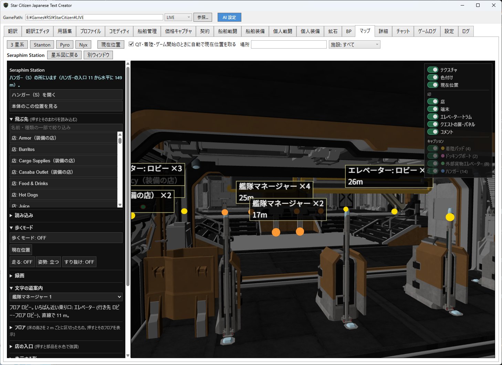

*［マップ］タブの中に出したステーションの 3D です（Seraphim Station の中。左が左の欄、右上がスイッチ）。*

#### 左の欄

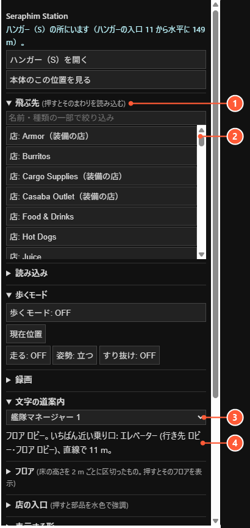

*左の欄の上の部分です（番号 ①〜④ は下の表）。*

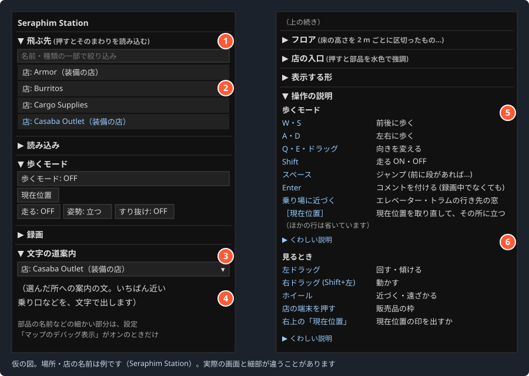

*左の欄の全体です（仮の図。上の部分と下の部分を並べています。⑤・⑥ の「操作の説明」は、この図の右の下の部分にあります）。*

| 番号 | ところ | 内容 |
|---|---|---|
| ① | まとまりの見出し（▼ / ▶） | 押すと開く・畳む。まとまりは 飛ぶ先／読み込み／歩くモード／録画／文字の道案内／フロア／店の入口／表示する形／操作の説明。初めは、飛ぶ先・歩くモード・文字の道案内が開いています。畳んだ状態は覚えます |
| ② | **飛ぶ先** | 店・端末・乗り場・ハンガーロビー（ハンガーへ行くエレベーターのロビー側の乗り場）などの一覧。名前・種類の一部で絞り込めます。押すとそのまわりを読み込み、そこを中心にします |
| ③ | 文字の道案内のドロップダウン | 道案内を出す先を 1 つ選びます。飛ぶ先で押した先があれば、それに合わせます |
| ④ | 案内の文 | 選んだ 1 つだけを出します。部品の名前などの細かい部分は、設定「マップのデバッグ表示」がオンのときだけ |
| ⑤ | 操作の説明の表 | 歩くモードと見るときの操作を、操作ごとに 1 行で並べます |
| ⑥ | ▶ くわしい説明 | 押すと、くわしい説明が開きます |

#### 右上のスイッチ（中で見ているとき）

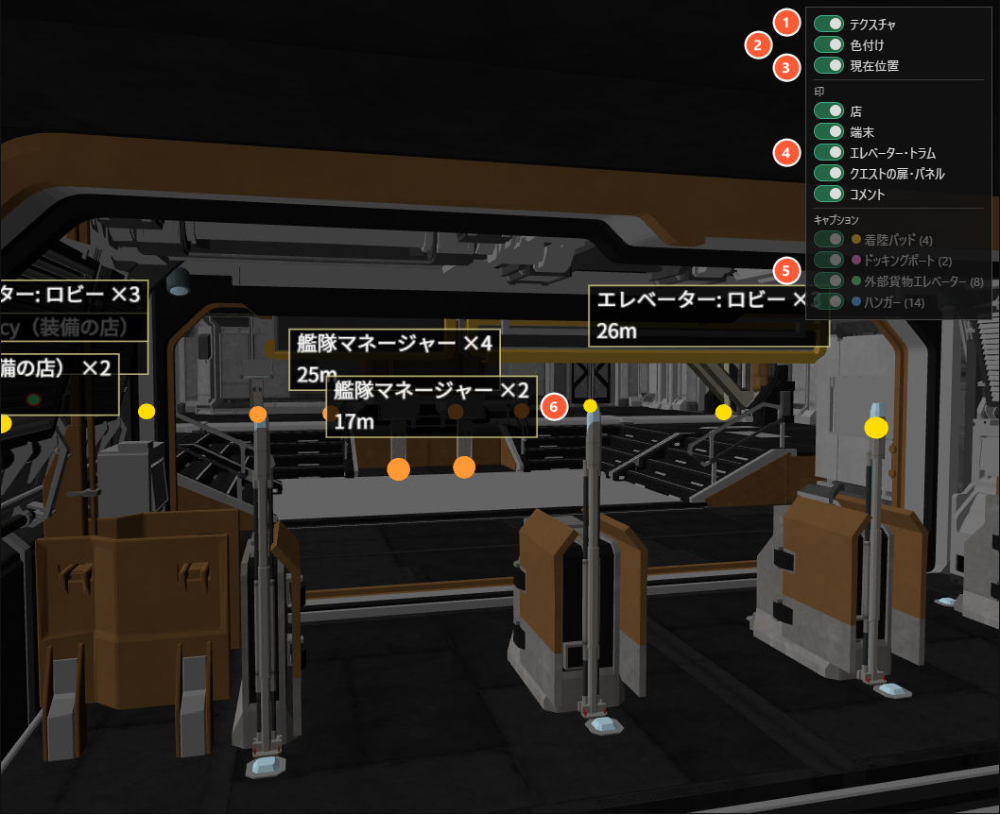

*中で見ているときの右上のスイッチと札です（3D の部分だけを写しています。番号は下の表）。*

| 番号 | スイッチ | 動き |
|---|---|---|
| ① | **テクスチャ** | ゲームの画像を貼ります。切ると灰色の単色です |
| ② | **色付け** | 場所ごとの色（パレット）を付けます。切ると色の違いで分かれる材質が減り、描く回数が減ります（性能の低い PC 向け）。切り替えると今の地点を読み直します。どの場所でも共通の 1 つの状態です。「テクスチャ」を切っている間は押せません |
| ③ | **現在位置** | 現在位置の印（水色の玉と札）を出すか。外から見ているときも出ます |
| ④ | 見出し「**印**」 | 店・端末・エレベーター・トラム・クエストの扉・パネル・コメントの印と札を、種類ごとに出す・消す。中で見ているときだけ押せます |
| ⑤ | 見出し「**キャプション**」 | 着陸パッド・ドッキングポート・外部貨物エレベーター・ハンガーの引き出し線と見出しを、種類ごとに出す・消す（色の丸は見出しの色、（ ）は数）。外から引いて全体を見ているときだけ押せます。数が 0 の種類は押せません |
| ⑥ | 札 | 端末・乗り口の札には、自分からの距離を最後の行に出します。店の端末は「店名（種類）」です |
| — | 現在位置の印 | 水色の玉と、札「現在位置 時:分:秒」（図には出ていません。下の「現在位置」） |

- 切り替えたスイッチの状態は覚えていて、次に開いたときもその状態で始まります
- 見るときの右ドラッグ（Shift＋左ドラッグ）は、マウスを上へ動かすと、見ている所が下へ動きます

#### 外から見たとき

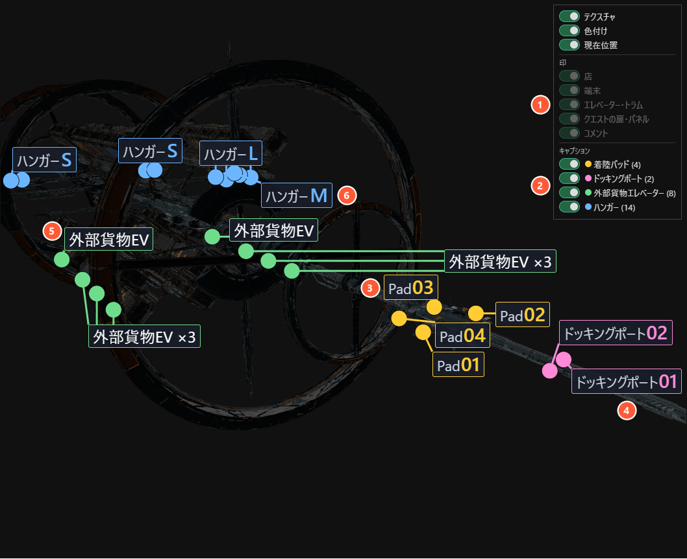

*外から引いて全体を見ているときです（3D の部分だけを写しています。番号は下の表）。*

| 番号 | ところ | 内容 |
|---|---|---|
| ① | 「印」のスイッチ | 押せなくなります。中の印と札、コメントの印、重力の範囲の箱は出しません（近づく・中に入ると出ます） |
| ② | 「キャプション」のスイッチ | 押せるようになります |
| ③ | 着陸パッド（黄） | 「Pad01」のように番号で 1 つずつ |
| ④ | ドッキングポート（桃） | 「ドッキングポート01」のように番号で 1 つずつ |
| ⑤ | 外部貨物エレベーター（緑） | 見出しは「外部貨物EV」 |
| ⑥ | ハンガー（青） | 大きさ（S・M・L・XL）ごとに、近いものを 1 つの見出しにまとめます。印は屋根の扉の上 |
| — | 現在位置の印 | 外から見ているときも消えません（図には出ていません） |

#### 現在位置

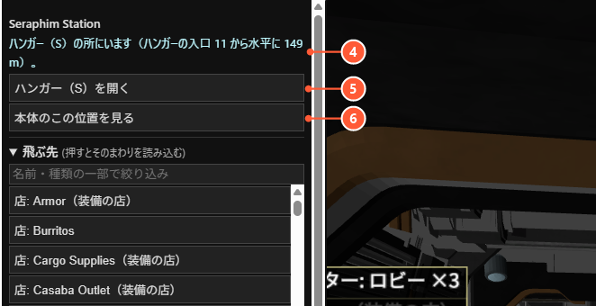

*ハンガーの所にいるときの知らせとボタンです（番号 ④〜⑥ は下の表。③ の「現在位置」のスイッチは、上の「右上のスイッチ」の絵の ③ です）。*

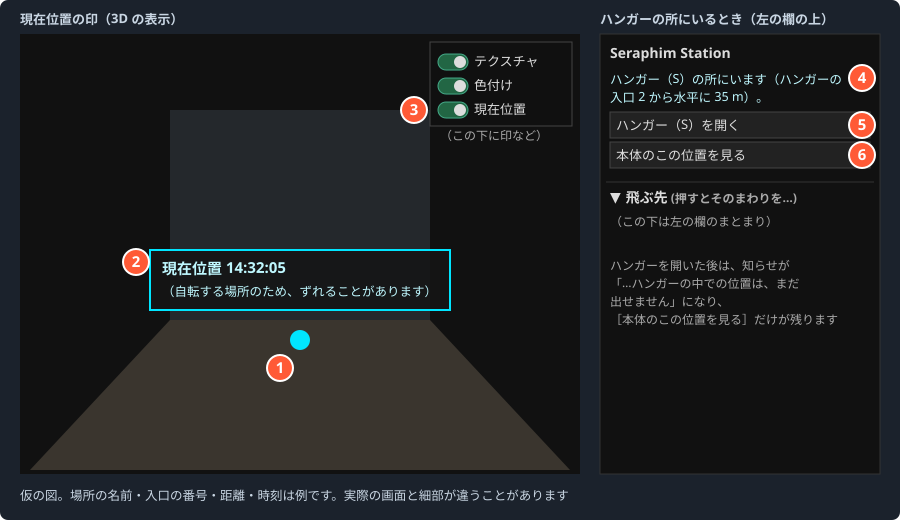

*現在位置の印（① 水色の玉・② 札）と、ハンガーの所にいるときの知らせです（仮の図。場所の名前・入口の番号・距離・時刻は例です）。*

| 番号 | ところ | 内容 |
|---|---|---|
| ① | 水色の玉 | 現在位置。［マップ］タブのボタン・自動の取得・3D の［現在位置］で取った位置に出します（取るたびに置き直します。自動の取得では見ている所は動きません） |
| ② | 札 | 「現在位置 時:分:秒」。自転する場所では「（自転する場所のため、ずれることがあります）」も出ます |
| ③ | 右上の「現在位置」 | 印を出す・出さない |
| ④ | 知らせ | 取った位置がハンガーの所のとき、左の欄の上に「ハンガー（S）の所にいます（ハンガーの入口 … から水平に … m）。」 |
| ⑤ | ［ハンガー（S）を開く］ | そのハンガー（その入口の大きさ）の 3D を開きます。ハンガーの中での位置はまだ出せないので、エレベーターの乗り場の前に立ちます |
| ⑥ | ［本体のこの位置を見る］ | ハンガーを開かずに、ステーション本体のその位置に立ちます |

- 印は、読み込んでいる範囲の中の点だけに出します。マイハンガーの中では出しません
- ［マップ］タブの［現在位置］ボタンで取れたとき、星系図の現在位置の印・その文字・右の欄の「現在地: …」の文を押したとき（取り直しません）は、建物の中（現在地が「〜 内」）でその場所の 3D があれば、その場所の 3D に切り替わって現在位置の所に立ちます。建物の中でなくても、3D のあるステーションから 50 km 以内で、そのステーションから出てきた後でなければ、そのステーションの 3D を外から見た形で出します（着陸パッド・ハンガー・ドッキングポートの印が見えます）。どちらでもないとき（宇宙空間など）に、［マップ］タブに 3D が出ていれば、星系図に戻ります。自動の取得では、3D を新しく出しません（出ている 3D が今いる位置に合わなくなったときに、星系図に戻るだけです）。Game.log で着陸場に着いたとき（ゲームログの「到着」と同じとき）は、座標を取らなくても、着いたステーションの 3D を外から見た形で出します
- 3D の［現在位置］・［マップ］タブからの切り替えでハンガーの所だったときは、そのままそのハンガーを開きます。自動の取得で取ったときは勝手に開かず、④〜⑥ を出します
- トラムのある場所（Orison・Lorville など）は、今の現在位置がその場所の中なら、開いたときに現在位置のまわりだけを読み込んで、そこから始めます（まだ何も操作していないとき）

#### 店の販売品の枠

店の端末を押すと出ます。✕ か Esc で閉じます。

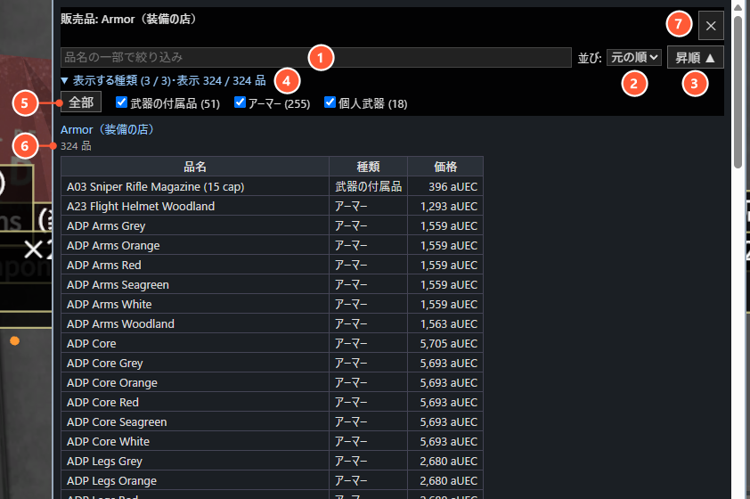

*販売品の枠です（Seraphim Station の Armor（装備の店）。枠の上の部分を写しています。番号は下の表）。*

| 番号 | ところ | 動き |
|---|---|---|
| ① | 品名の一部で絞り込み | 品名（ゲームの英語の名前）に打った文字を含む品だけにします |
| ② | 並び | 元の順・品名・価格・種類（価格では、金額の無い品はいつも後ろ） |
| ③ | 昇順 ▲ / 降順 ▼ | 向きを変えます（元の順のときは押せません） |
| ④ | 表示する種類 | 種類ごとのチェックと数。外した種類は出しません |
| ⑤ | 全部 | その店の種類を全部出す形に戻します |
| ⑥ | 品の数 | 全部出しているときは「324 品」、絞り込んでいるときは「出している品 / 全部の品」の形です |
| ⑦ | ✕ | 閉じます |

- 外した種類と並びは、別の店・次に開いたときも同じです

#### 歩くモードと無重力

左の欄の「歩くモード」のまとまりの［歩くモード: OFF］を押すと、今見ている所の真下の床に立って歩けます。

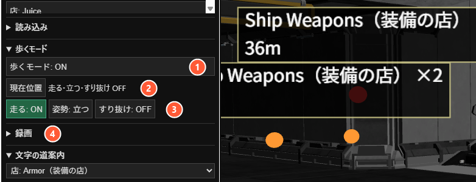

*歩くモードにしているときです（走る: ON。番号 ①〜④ は下の表）。*

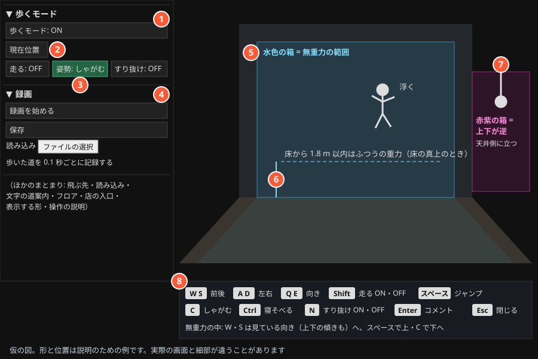

*歩くモードと重力の範囲です（仮の図。⑤〜⑦ の重力の範囲の箱と ⑧ のキーは、この図にあります。形と位置は説明のための例です）。*

| 番号 | ところ | 動き |
|---|---|---|
| ① | ［歩くモード: OFF］/［歩くモード: ON］ | 歩くモードの入・切 |
| ② | ［現在位置］ | 現在位置を取り直して、その所の床に立ちます（ハンガーの所なら、そのハンガーを開きます） |
| ③ | ［走る］［姿勢］［すり抜け］ | キーと同じ切り替え（姿勢は押すたびに 立つ → しゃがむ → 寝そべる） |
| ④ | 「録画」のまとまり: ［録画を始める］［保存］読み込み | 歩いた道を 0.1 秒ごとに記録し、JSON のファイルに保存・読み込んで再生します |
| ⑤ | 水色の箱 | **無重力**の範囲です。落ちずに浮きます。W・S は見ている向き（上下の傾きも）に進み、スペースで上、C で下へ動きます（浮いている間は床の判定と壁を見ません） |
| ⑥ | 床から 1.8 m | 無重力の範囲の中でも、床の真上で床から 1.8 m 以内はふつうの重力です（床の上は歩けます） |
| ⑦ | 赤紫の箱 | 重力が**上向き**（上下が逆）の範囲です。頭の上の面を床にして立ち、上へ落ちます。画面も上下が逆になります |
| ⑧ | キー | W・S 前後／A・D 左右／Q・E・ドラッグ 向き／Shift 走る ON・OFF／スペース ジャンプ（前 0.7 m に 2.52 m までの段があれば、よじ登る）／C しゃがむ／Ctrl 寝そべる／N すり抜け ON・OFF／はしごのそばで W／Enter コメント／Esc 窓を閉じる |

- 重力の範囲の箱は、外から引いて全体を見ているときは出しません。範囲が重なる所は、いちばん小さい範囲の種類にします（大きな無重力の範囲の中の、重力のある通路・上下が逆の通路を先にします）
- 立つ 1.8 m・しゃがむ 1.2 m（速さ半分）・寝そべる 0.5 m（速さ 1/4）。体の高さより低い所は通れません。0.6 m までの段は上り下りできます。歩く 2.8 m/秒・走る 10 m/秒
- 歩くモードの右ドラッグは、上下の向きが左ドラッグと逆です
- エレベーターの乗り場の 2 m 以内（トラムの乗り場は 10 m 以内）で行き先の窓が出ます（選ぶと移る）。エレベーターの操作盤・乗り場の黄色の玉を押しても開きます
- ハンガーのエレベーター（Lorville・New Babbage・Area18・GrimHEX のハンガー行きも）では「マイハンガー（S）」などを選ぶと、マイハンガーの中を見られます。マイハンガーの中のエレベーターの窓には、入るときに乗った路線の行き先（選ぶと本体のその乗り場へ戻る）・ほかの大きさのマイハンガー・「ステーションへ戻る」が出ます。データの無い大きさは出ません
- Enter のコメントは録画中でなくても付けられ、保存して次に開いたときも出します（保存したコメントの札を押すと、確かめてから消します）

---

### 13. 船の 3D の塗装

［詳細］タブで船の 3D（［3D 表示］・［別ウィンドウ］）を出すと、右端に塗装の一覧が出ます。下の絵の船は Drake Ironclad Assault です。「仮の図」と書いた絵は、実際の画面と細部が違うことがあります（船 AEGS Gladius と塗装の名前は例です）。

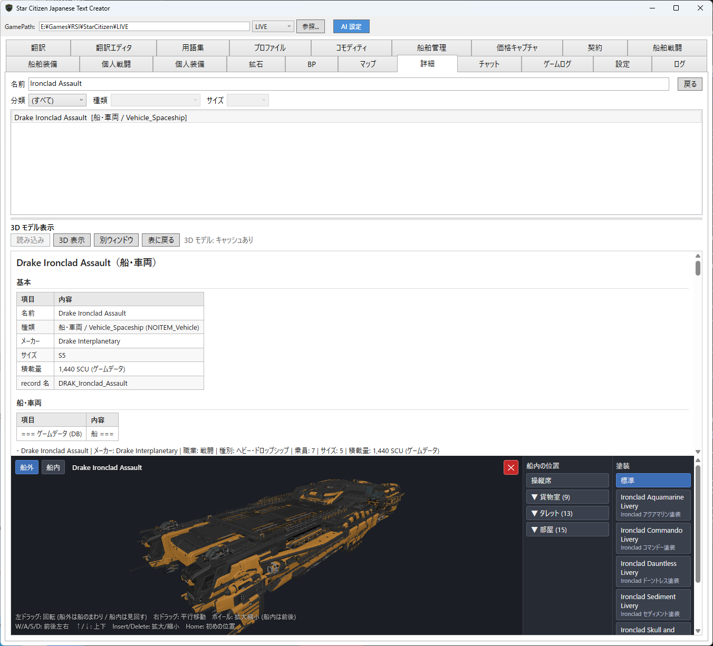

*［詳細］タブで船の詳細を出し、［3D 表示］で下の欄に 3D を出したところです（船外）。*

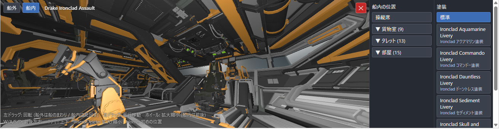

*左上の［船内］を押して、船の中から見たところです（3D の部分だけを写しています）。*

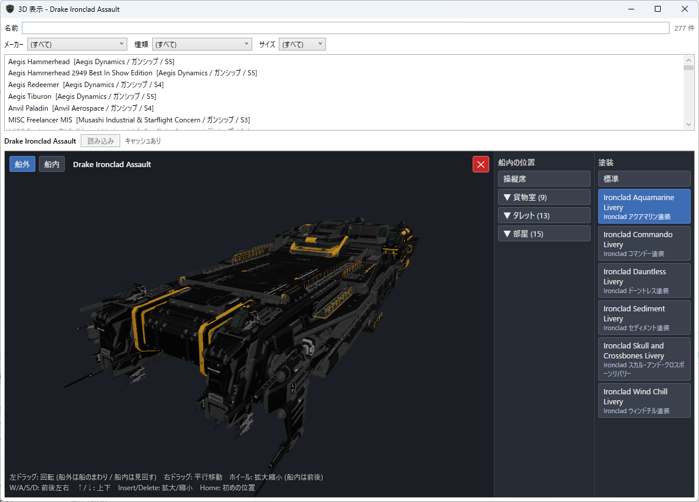

*塗装を切り替えたところです（船の 3D の別ウィンドウ。右端の「塗装」の欄で Ironclad Aquamarine Livery を選んでいます。船は Drake Ironclad Assault）。*

| ところ | 内容 |
|---|---|
| 右端の「塗装」の欄 | 「船内の位置」の欄の右に縦に並びます。その船に付けられる塗装（名前はゲーム中と同じ英語。日本語名があれば下に小さく添えます） |
| いちばん上の「標準」 | 既定の姿です（既定で塗装の入った船には、その下に「塗装なし」も出ます） |
| 青いボタン | 今の塗装です（絵では Ironclad Aquamarine Livery）。押すと切り替わります。見ている向き・拡大は変わりません |
| 作っている知らせ | 初めて選んだ塗装は、作るのに数秒かかります（絵には出ていません）。2 回目からはすぐです |
| その左の「船内の位置」の欄 | 操縦席・貨物室などの位置へ移る欄です |

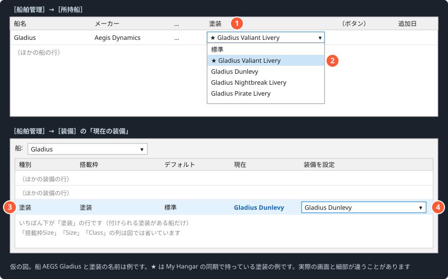

*仮の図です。船と塗装の名前は例です。*

| 番号 | ところ | 内容 |
|---|---|---|
| ① | ［船舶管理］→［所持船］の「塗装」の列 | 選ぶとすぐ保存し、次にこの船の 3D を開いたときの初めの塗装になります |
| ② | 候補 | 「標準」、持っている塗装（My Hangar の同期データと名前が合うもの。名前の前に ★）、ほかの付けられる塗装 |
| ③ | ［船舶管理］→［装備］の「塗装」の行 | 「現在の装備」の表のいちばん下（付けられる塗装がある船だけ） |
| ④ | 装備を設定の候補 | 「標準」と付けられる塗装。選ぶとすぐ保存します（［所持船］の「塗装」の列と同じ値） |

- ［所持船］の船名をダブルクリックして［詳細］から 3D を開いたときは、その所持船で選んだ塗装で始まります。それ以外は、その船で保存されている塗装（無ければ「標準」）です
- 塗装を選び直しても、開いている 3D はすぐには変わりません（次に開いたときから。3D の右端の一覧で押せば、その場で切り替わります）
- 設定「船・装備・武器の 3D の色付け」を切っているときは、一覧は出ません
- **※ 出ないもの: テクスチャの差し替え（エンブレムの絵など）、迷彩などの模様、デカールの色、形の違い。色のほかに描く部品も変える塗装は、その部品を作り直して出します。形のデータの並びまで変える塗装は出せません（選ぶと知らせが出て、その後は一覧で「(出せない)」が付いて押せなくなります）。別の型の塗装を持つ船（300 系・Hermes・Ballista など 47 隻）と、付けられる塗装が無い船には、一覧が出ません。武器・装備の 3D には出ません**

#### 船内を歩く

船の 3D で［船内］にすると、左上の 2 段目にボタンと状態の文が出ます（［詳細］の下の欄でも別ウィンドウでも同じです。武器・装備の 3D には出ません）。

| ボタン | 動き |
|---|---|
| ［歩くモード: OFF］/［歩くモード: ON］ | 床に立って歩きます。座席にいるとき（操縦席・タレットなど）に押すと、その座席の降りる所（ゲームのデータの乗り降りの点）の床から始まります。座席にいないときは、今いる所の真下の床です。ステーションの 3D の歩くモードと同じ動きで、床・壁・天井に当たります |
| ［走る: OFF］/［走る: ON］ | 走るの入・切 |
| ［姿勢: 立つ］ | 立つ・しゃがむ・寝そべる |
| ［すり抜け: OFF］/［すり抜け: ON］ | すり抜けの入・切 |

- キー: W・S 前後／A・D 左右／Q・E・ドラッグ 向き／Shift 走る ON・OFF／スペース ジャンプ（前に上がれる段があれば、よじ登る）／C しゃがむ／Ctrl 寝そべる／N すり抜け ON・OFF／はしごのそばで W で上る・S で下りる／はしごの上でスペース 見ている向きの近くの床へ降りる
- 船の外: 船のまわりに見えない床があり、船の外も歩けます。［歩くモード］は［船内］のときに押します。自由な動きで船の外へ出てから押すと、外の見えない床に立って始まります
- はしご: 船内のはしご（階の間）は、ゲームのデータのはしごの位置と高さを使います（このデータは配るデータベースに入っていて、船の取り込み直しは要りません）。乗り込み用のはしご（例: Drake Ironclad の左右の側面と屋根のハッチ）は、3D モデルに入っている乗り降りの点から作り、地面（見えない床）から上って船内へ入れます
- エレベーター・リフト: 乗り場に近づく（水平 2 m 以内）と行き先の窓が出て、行き先を選ぶとその階に移ります（ステーションのエレベーターと同じ使い方です）。今の階の行か Esc で閉じます。着いた乗り場・閉じた乗り場では、3 m 離れるまで窓は出ません。かご・扉の形は動きません。乗り場と行き先は、ゲームのデータのものです（配るデータベースに入っていて、船の取り込み直しは要りません）
- 船内のドアは閉じた形のまま出ますが、歩いて抜けられます
- できないこと: エレベーター・リフトのかごと扉の形は動きません（乗り場で行き先を選んで移ります）。無重力・録画・コメントはありません。歩くモード中は、「船内の位置」・Home・ホイール・↑↓ は効きません

---

### 14. マップの現在位置の近く

［マップ］タブの【現在位置の近く】の一覧は、似たものを並べずにまとめます。場所の［詳細］の【距離】の表も同じまとめ方です。

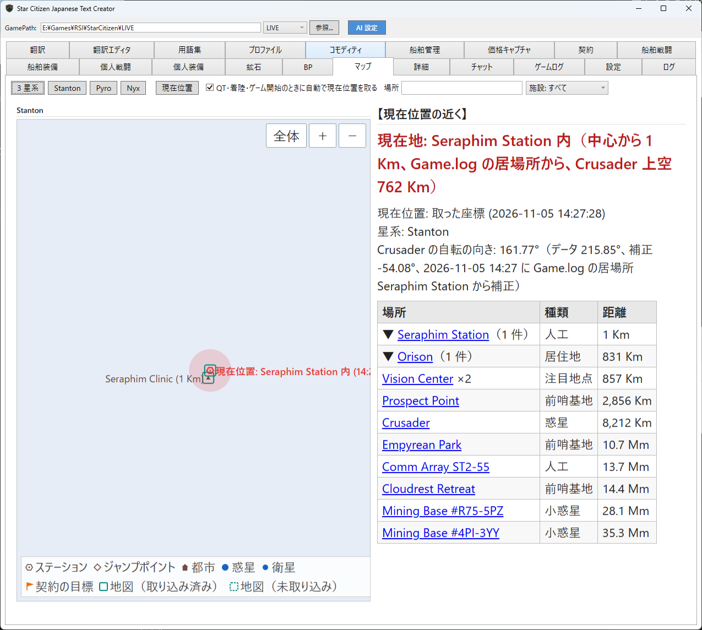

*［マップ］タブです。右の欄が【現在位置の近く】で、▼ の付いた親の行と「×2」の行が出ています。*

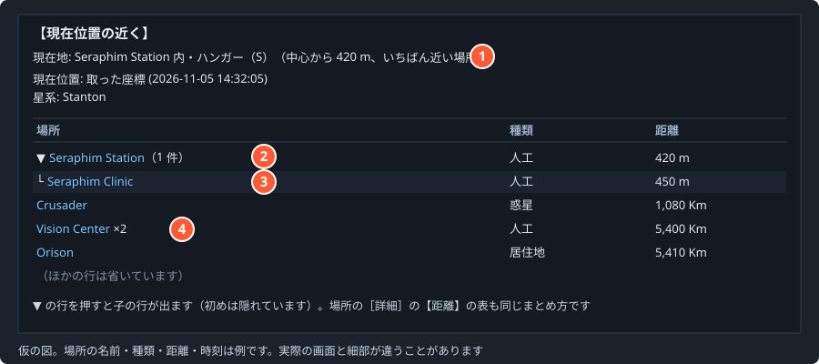

*仮の図です。場所の名前・種類・距離・時刻は例です。実際の画面と細部が違うことがあります。*

| 番号 | ところ | 内容 |
|---|---|---|
| ① | 「・ハンガー（S）」 | 取った座標がその場所のハンガーの所のとき、現在地の文に付きます（自分のハンガーかどうかは見分けません） |
| ② | ▼ 親の行（N 件） | 親と子が同じ所にあるもの（Seraphim Station と Seraphim Clinic、Orison と Orison General など）を親の行にまとめます。押すと子の行が開きます |
| ③ | └ 子の行 | 開いたときに出ます（初めは隠れています） |
| ④ | ×2 | 同じ名前・同じ種類の近い場所を 1 行にまとめた数です |

- ［現在位置］ボタンで取れたとき、または星系図の現在位置の印・その文字・この欄の「現在地: …」の文を押したとき（位置は取り直しません）は、ステーションなど建物の中（現在地が「〜 内」）でその場所の 3D があれば、その場所の 3D に切り替わって現在位置の所を出します。自動の取得では、3D を新しく出しません（出ている 3D が今いる位置に合わなくなったときに、星系図に戻るだけです）。Game.log で着陸場に着いたとき（ゲームログの「到着」と同じとき）は、座標を取らなくても、着いたステーションの 3D を外から見た形で出します。建物の中でなくても、3D のあるステーションから 50 km 以内で、そのステーションから出てきた後でなければ、そのステーションの 3D を外から見た形で出します（着陸パッド・ハンガー・ドッキングポートの印が見えます）。どちらでもないときは星系図のままです（［マップ］タブに 3D が出ていれば、星系図に戻ります）

#### 現在位置のキー

［現在位置］ボタンと同じ処理を、キーで動かせます。**既定のキーは 右 Shift + 左 Alt + Insert** です。ゲームの窓が前にあるままで取れ、アプリの窓や 3D の別ウィンドウは前に出ません。

- Ctrl・Shift・Alt は左右を区別します（既定のキーは、右 Alt・右 Shift で押しても動きません）
- 押したキーは、ゲームにもほかのアプリにもそのまま届きます（アプリが取り上げません）。決めていない修飾キー（既定のときの Ctrl など）を一緒に押していると動きません
- キーを変える・使わない: 設定タブの「現在位置のキーとオーバーレイ」の「キーで現在位置を取る」のチェック（既定は入っています）と「キー:」の欄です。欄を選んで割り当てるキーを押し、**[設定を保存]** で有効になります
- 詳しくは **[使い方マニュアルの「現在位置のキー」](https://batake321.github.io/StarCitizenJapaneseTextCreater/#map-hotkey)**

#### 今いる場所で採掘できる物のオーバーレイ

［マップ］の［現在位置］ボタン・上のキー・ステーションの 3D の［現在位置］で座標が取れたときに、今いる場所（ガス雲・小惑星の集まりの中、近くの惑星・衛星、小惑星の場所、小惑星帯）で採掘できる物を、ゲームの画面の上に重ねて出せます。**既定はオフ**です。設定タブの「現在位置のキーとオーバーレイ」の「現在位置を取ったら、その場所で採掘できる物をゲームの画面に重ねて出す」にチェックを入れて、**[設定を保存]** を押すと出るようになります。

> **※ ゲームはボーダーレス（枠なしのウィンドウ）で使ってください。** 全画面の排他モードのゲームの上には、オーバーレイが出ないことがあります（確かめていません）。

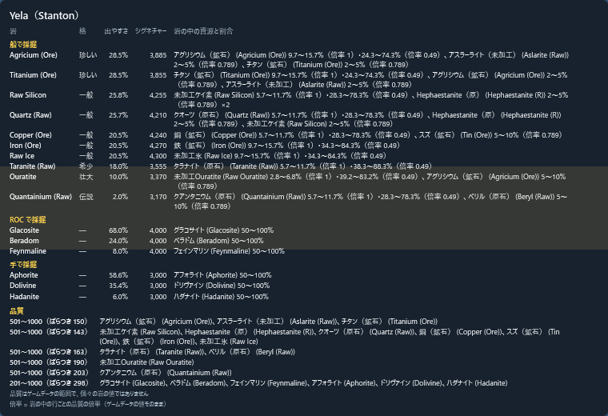

*オーバーレイの中身です（アプリの描いた絵で、ゲームの画面に重ねた所ではありません。背景の暗い色と明るい帯は、ゲームの画面の代わりに敷いた色です。場所は Yela の例）。*

| ところ | 内容 |
|---|---|
| 見出し | 場所の名前（星系）。例「Yela（Stanton）」 |
| 掘り方ごとの行 | 船で採掘・ROC で採掘・手で採掘 の順に、岩 1 つを 1 行で出します。列は 岩・格・出やすさ・シグネチャー・岩の中の資源と割合 です |
| 岩の中の資源と割合 | その岩に入っている資源と、割合の範囲です。「（倍率 0.49）」は、岩の中の行ごとの品質の倍率です（ゲームデータの値そのまま） |
| 品質 | 資源ごとの品質の範囲とばらつきです（例「501〜1000（ばらつき 150）」） |
| どの採掘の場所の中でもないとき | 「近くの採掘の場所」として、今いる位置から近い順に、QT できる採掘の場所を 3 か所まで出します（名前・距離・岩の名前）。1 か所も無ければ「ここで採掘できる物のデータはありません」と出ます |

- 「表示する秒数:」（既定 10）で、出してから消えるまでの秒数を決めます。0 なら出したままです。もう一度現在位置を取ると数え直します
- QT・着陸・ゲーム開始のときの自動の取得では出しません
- **位置・大きさ・文字の大きさ・透明度は、設定タブの「現在位置のキーとオーバーレイ」で決めます**（ゲームの中ではマウスがゲームに取られていて、オーバーレイを押せないためです）。文字の大きさ、透明度、位置（数値と ←→↑↓ のボタン）、大きさ（幅・高さの数値と ＋・− のボタン）があり、変えるとすぐ反映して、その場で保存します。［オーバーレイを表示して調整］を押すと、時間で消えずに出たままになり、マウスでそのまま動かせます（現在位置が無いときは見本の中身を出します）。［既定に戻す］で元に戻せます
- 文字は決めた大きさで出ます。中身が窓に収まらないときだけ、切れないように縮めます
- オーバーレイは、ふだんはクリックを下のゲームへ通します。**左 Ctrl + 左 Shift + クリック**でも変更中になり（黄色の枠・つまみ・右上の ✕ が出ます）、ドラッグで移動、端・角のドラッグで大きさを変え、動かさずにクリックすると確定します。✕ は確定せずに閉じます

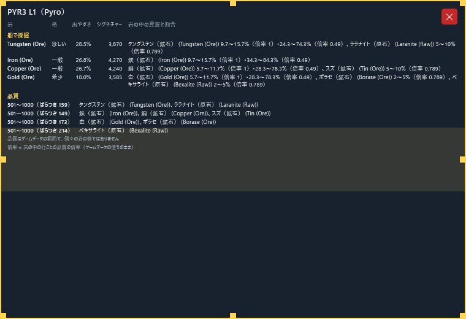

*変更中のオーバーレイです（アプリの描いた絵で、ゲームの画面に重ねた所ではありません。場所は PYR3 L1 の例）。*

- 詳しくは **[使い方マニュアルの「今いる場所で採掘できる物のオーバーレイ」](https://batake321.github.io/StarCitizenJapaneseTextCreater/#map-overlay)**

---

### 15. 武器・装備の 3D

［詳細］タブで武器・装備を開くと、名前のすぐ右に斜めの小さな絵が出ます。押すと、下の欄に 3D が出ます（回す・拡大縮小。右上の赤い ✕ で閉じます）。

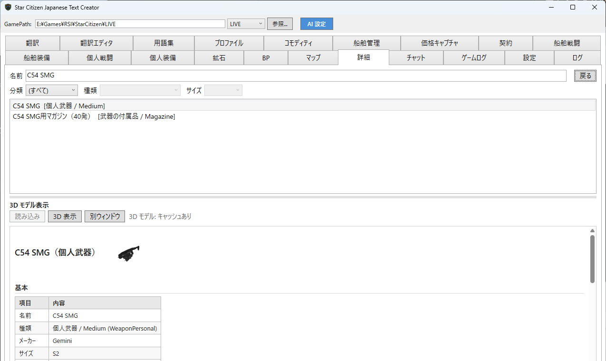

*C54 SMG の詳細です。見出し「C54 SMG（個人武器）」のすぐ右に、斜めの小さな絵が出ています。*

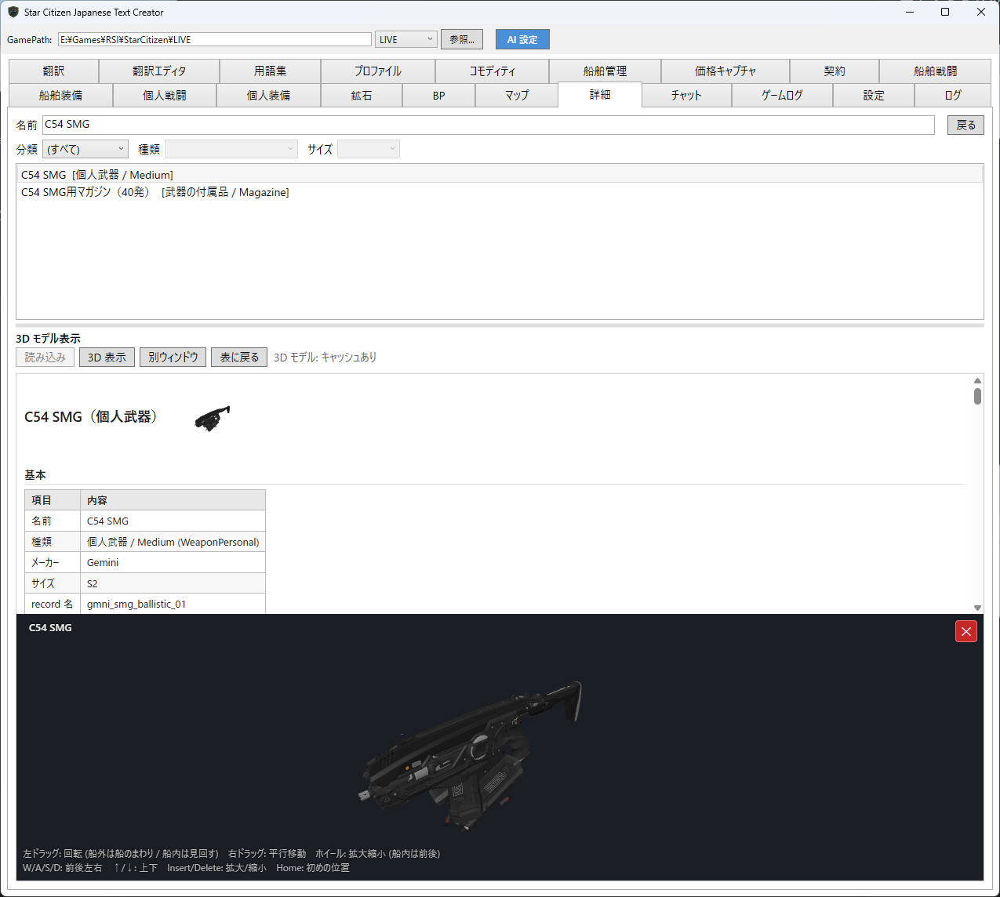

*小さな絵を押して、下の欄に 3D を出したところです。*

- アーマー（胴・腕・脚）・アンダースーツ・服（シャツ・上着・ズボン・靴・帽子・手袋）は、置いたときの箱ではなく品の形で出ます。小さい品（手りゅう弾・マガジンなど）は、枠に合わせて大きく出ます
- 3D の欄の高さは、詳細の文との間の線を上下にドラッグして変えられます。変えた高さは覚えます（船・車両の 3D も同じ欄です。別ウィンドウの 3D は、窓の大きさを変えて使います）

---

### 16. 船舶管理

［船舶管理］タブには、［所持船］［アップグレード管理］［装備］［電力管理］の 4 つのタブがあります（詳しい手順は **[使い方マニュアル](https://batake321.github.io/StarCitizenJapaneseTextCreater/)**）。

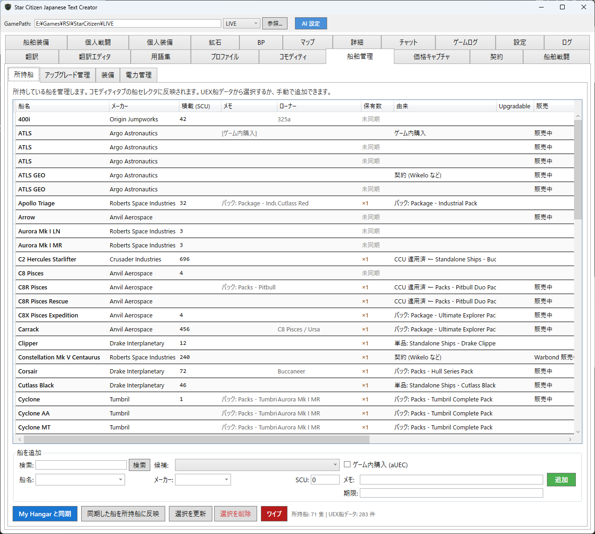

*［所持船］: 所持船の一覧です。下の「船を追加」で足し、［My Hangar と同期］［同期した船を所持船に反映］［選択を更新］［選択を削除］［ワイプ］のボタンがあります。*

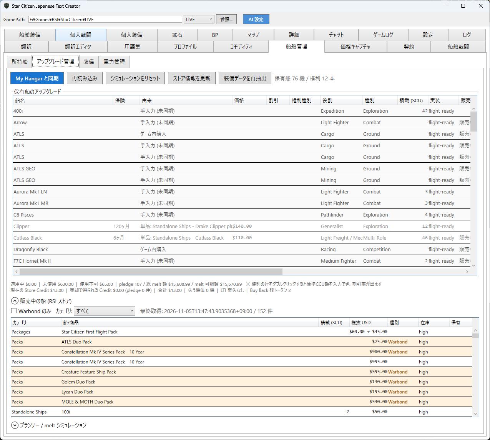

*［アップグレード管理］: ［My Hangar と同期］で取った保有船とアップグレードの権利、その下に「販売中の船 (RSI ストア)」と「プランナー / melt シミュレーション」が出ます。*

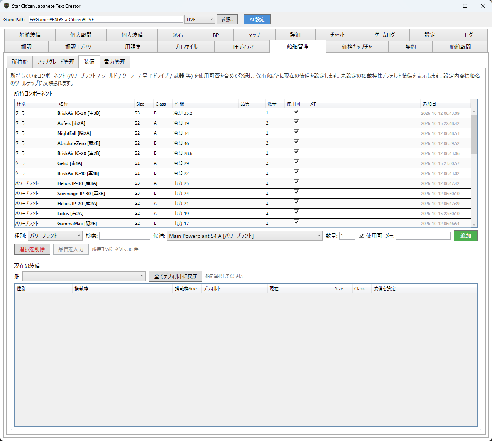

*［装備］: 上が「所持コンポーネント」の表（［品質を入力］で自作したコンポーネントの品質を入れます）、下が船ごとの「現在の装備」の表です。*

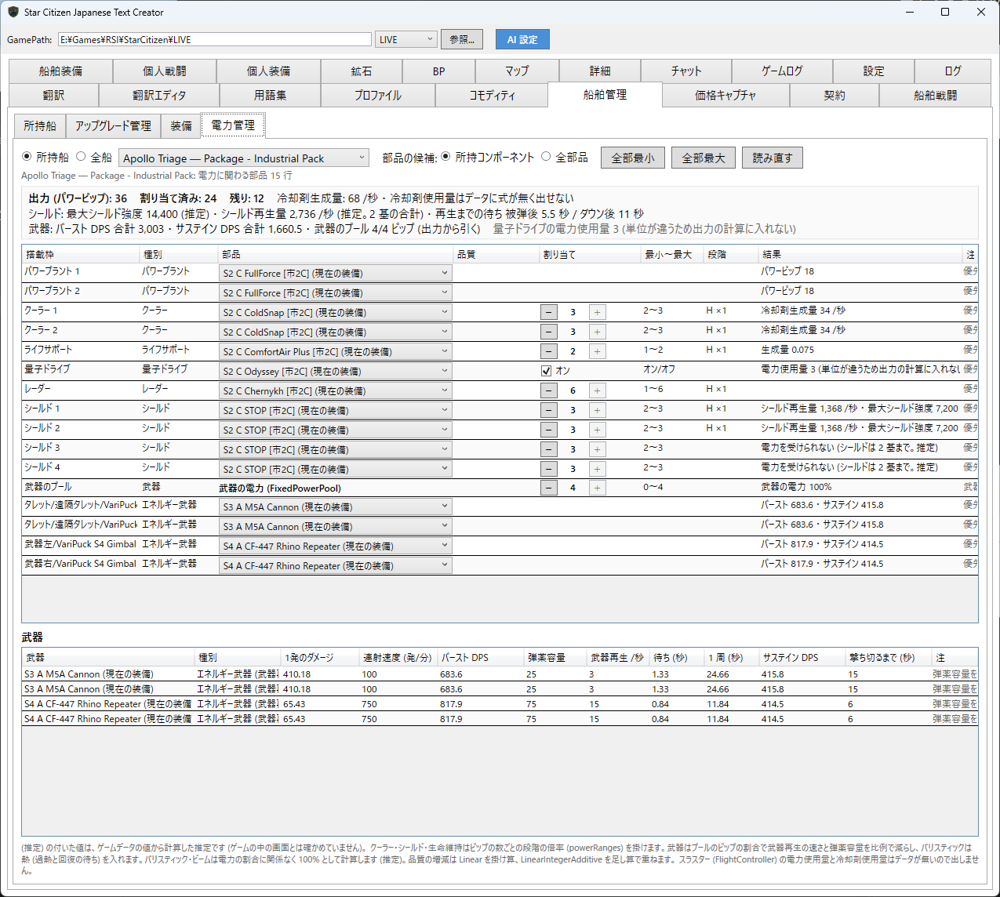

*［電力管理］: 船と部品を選び、ピップの割り当てを変えると、出力の残り・冷却剤生成量・シールド再生量・武器のバースト DPS / サステイン DPS が出ます。*

---

## Ollama + Gemma4 の設定方法

ローカル LLM を使えば **API キー不要・無料** で翻訳できます。

**1. Ollama をインストール** ([詳細ガイド](docs/Ollama_Install.md))

[ollama.com](https://ollama.com/) からインストーラーをダウンロード・実行します。

**2. 翻訳用モデルをダウンロード**

```bash
# 高品質モデル (VRAM 4GB 以上推奨)
ollama pull gemma4:4b

# 軽量モデル (VRAM 2GB でも動作)
ollama pull gemma4:2b
```

> VRAM に余裕があれば `gemma4:26b` (高精度) や `gemma4:12b` (バランス型) も使えます。

**3. AI 設定ダイアログで設定**

| 項目 | 設定値 | 説明 |
|---|---|---|
| **Type** | `Ollama` | ドロップダウンから選択 |
| **Base URL** | `http://localhost:11434` | Ollama のアドレス (別 PC の場合は IP を変更) |
| **Model** | `gemma4:4b` or `gemma4:2b` | ダウンロードしたモデル名を入力 |
| **Batch** | `15` | 一度に送る翻訳数 (VRAM に応じて調整) |

**4. Ollama のコンテキスト長を増やす (重要)**

Ollama のデフォルトコンテキスト長 (2048 トークン) では、翻訳プロンプト＋固有名詞リストが収まりきらずパースエラーになる場合があります。以下のいずれかで対処してください:

- **方法 A: 環境変数で設定** — Ollama 起動前に `OLLAMA_NUM_CTX=8192` を設定
- **方法 B: Modelfile でカスタムモデルを作成**:

  ```bash
  ollama create gemma4-8k -f - <<EOF
  FROM gemma4:4b
  PARAMETER num_ctx 8192
  EOF
  ```

  作成後、AI 設定の Model に `gemma4-8k` を指定

> **翻訳がパースエラーで失敗する場合**: ログに「パース失敗 (0行)」と表示される場合、コンテキスト長不足が原因の可能性があります。上記の方法でコンテキスト長を 8192 以上に増やしてください。Batch を減らす (1〜5) ことでも改善する場合があります。
>
> **VRAM に関する注意**: Ollama (Gemma4) はGPUのVRAMを使用します。Star Citizen もVRAMを大量に消費するため、**ゲームプレイ中に翻訳やチャットを実行するとVRAMが圧迫され、ゲームのパフォーマンスが低下する場合があります**。ゲーム中の使用を避けるか、軽量モデル (`gemma4:2b`) を使用するか、別PCのOllamaに接続することを推奨します。Claude / Gemini などのクラウドAPIを使用する場合はVRAMへの影響はありません。
>
> **VRAM 使用量の確認方法:**
> - **NVIDIA**: タスクマネージャー → パフォーマンス → GPU → 「専用 GPU メモリ使用量」を確認。またはコマンドで `nvidia-smi` を実行
> - **AMD**: タスクマネージャー → パフォーマンス → GPU → 「専用 GPU メモリ使用量」を確認。またはコマンドで `rocm-smi` を実行 (ROCm インストール時)
> - Star Citizen 起動中は通常 6〜10GB の VRAM を使用します。`gemma4:2b` は約 2GB、`gemma4:4b` は約 4GB の VRAM を追加消費します

---

## データ保存先

全てのデータは Working Directory (設定タブで変更可能) に保存されます。

| ファイル | 内容 |
|---|---|
| `translations.db` | 翻訳データベース (SQLite) — 翻訳テキスト・用語集 |
| `gamedata_cache.db` | ゲームデータキャッシュ (SQLite) — ゲームデータ・ナレッジ (記憶) |
| `saves/characters/` | キャラクターデザインのバックアップ |
| `saves/controls/` | キーバインド設定のバックアップ |
| `output/global.ini` | 統合済み翻訳ファイル |
| `chat_debug.log` | チャット機能のデバッグログ |

> 作業フォルダの DB の横に `-wal`・`-shm` のファイルができますが、消さないでください（アプリを閉じると中身は DB に書き戻されます）。

---

## ゲームデータ連携 (Data.p4k)

設定タブの **「インデックス構築」** で、ローカルの Data.p4k からゲーム内データのインデックスを構築します。

- インデックス構築は数分かかります
- **ゲームパッチ適用後は必ずインデックスを再構築してください**
- チャットで質問すると、該当するエンティティの詳細をオンデマンドで取得します

---

## セットアップガイド

### API キー取得

| バックエンド | ガイド |
|---|---|
| **Claude** (Anthropic) | [API_Key_取得_Claude.md](docs/API_Key_取得_Claude.md) |
| **Gemini** (Google) | [API_Key_取得_Gemini.md](docs/API_Key_取得_Gemini.md) |
| **OpenAI** (ChatGPT) | [API_Key_取得_OpenAI.md](docs/API_Key_取得_OpenAI.md) |

### ローカル LLM (Ollama)

| ドキュメント | 内容 |
|---|---|
| [Ollama_Install.md](docs/Ollama_Install.md) | Ollama 本体のインストール |
| [Gemma4_e4b_Install.md](docs/Gemma4_e4b_Install.md) | 高品質モデル (4B) |
| [Gemma4_e2b_Install.md](docs/Gemma4_e2b_Install.md) | 軽量モデル (2B) |

---

## ビルド方法

```bash
git clone https://github.com/batake321/StarCitizenJapaneseTextCreater.git
cd StarCitizenJapaneseTextCreater
dotnet build -c Release
```

---

## 利用している外部サービス

| サービス | 用途 |
|---|---|
| **[UEX Corp](https://uexcorp.space/)** | 機体・商品・価格データ |
| **[Star Citizen Wiki API](https://api.star-citizen.wiki/)** | ステーション施設・アメニティ情報 |
| **[SC Trade Tools](https://sc-trade.tools/)** | アイテム詳細・取引ショップ |
| **[starcitizen.tools](https://starcitizen.tools/)** | Wiki (MediaWiki API) |
| **Anthropic Claude API** | AI 翻訳・チャット |
| **Google Gemini API** | AI 翻訳・チャット |
| **OpenAI API** | AI 翻訳・チャット |
| **[Ollama](https://ollama.com/)** | ローカル LLM |
| **[VoiceVox](https://voicevox.hiroshiba.jp/)** | 音声読み上げ (Web チャット) |

### 注意事項

- **Star Citizen** は Cloud Imperium Games (CIG) の著作物です
- ゲームデータの抽出・解析はファンによるローカライズ目的での利用を想定しています
- 各外部 API は非公式のコミュニティ運営サービスであり、サービスの可用性は保証されません

## ライセンス

MIT License

### 第三者のソフトウェア

- **[StarBreaker](https://github.com/diogotr7/StarBreaker)** (diogotr7) — MIT License。StarBreaker v0.2.2 の処理（Data.p4k・DataCore・CryXML・3D モデル・DDS の読み取りなど）を C# に移植した部分があります（StarBreaker の exe そのものは使いません）
- **[three.js](https://github.com/mrdoob/three.js)** — MIT License。3D の表示に使います（同梱）

---

## 更新内容

新しい版が上です。前の版の分は畳んであります（▶ を押すと開きます）。

### 🚀 v2.6.9 更新内容

- **着いたステーションの外観の 3D**: Game.log で着陸場に着いたとき（ゲームログの「到着」と同じとき）は、座標を取らなくても、着いたステーションの 3D を外から見た形で出します
- **星系図に戻らない不具合**: 量子ジャンプの途中に現在位置を取ったとき、［マップ］タブのステーションの 3D が星系図に戻らなかったのを直しました。自動の取得でも、出ている 3D が今いる位置に合わなければ星系図に戻ります
- **ステーションを出た後の判定**: 建物の中で現在位置を取った後に外で取ったときは、すぐ「そのステーションから出た後」として、外から見た 3D を出さなくしました（今までは、少し離れるまで出ていました）

<details>
<summary>v2.6.8 更新内容</summary>

- **オーバーレイ**: 品質の下に出していた説明の 2 行を出さなくしました（出るのは中身だけです）
- **現在位置のキー**: 既定を「右 Shift + 左 Alt + Insert」に変えました（ゲームでは左 Shift にも割り当てがあるため。前の既定のまま使っていた人は、次の起動で自動で新しい既定に替わります）
- **採掘の場所の決め方**: 今いる位置が、ガス雲や小惑星の集まりの中にあるかどうかで決めるようにしました（ゲームデータの広がりを使います）。ラグランジュ点のステーション（HUR-L5 High Course Station・Checkmate・Gaslight など）にいるときも、そこで採掘できる物が出ます
- **近くの採掘の場所**: どの採掘の場所の中でもないときは、今いる位置から近い順に、QT できる採掘の場所を 3 か所まで出します
- **ステーションの外観の 3D**: 現在位置を取ったときに、ステーションから 50 km 以内で、そのステーションから出てきた後でなければ、そのステーションの 3D を外から見た形で出します（着陸パッドなどの印が見えます）
- **マップ**: 建物の中でない所（宇宙空間など）で現在位置を取ったときに、［マップ］タブにステーションの 3D が出ていれば、星系図に戻ります（今までは 3D のままでした）

</details>

<details>
<summary>v2.6.7 更新内容</summary>

- **現在位置**: `/showlocation` を送って座標が返らなかったときに、送り直すのをやめました（今までは、［現在位置］ボタンとキーでは 3 秒後にもう 1 回、自動の取得では 3 秒おきにあと 2 回まで送っていました）
- **自動更新**: 通信の失敗（504 など）でデータベースの差分を取れなかったときに、丸ごとのダウンロードに切り替わるのをやめました。差分を取り直し（3 回まで）、それでも取れなければ更新を止めます（もう一度更新すると、差分から始めます）

</details>

<details>
<summary>v2.6.6 更新内容</summary>

- **現在位置のキー**: 既定を「左 Alt + 左 Shift + Insert」に変えました（ゲームでは Ctrl がしゃがみのため。前の既定のまま使っていた人は、次の起動で自動で新しい既定に替わります）。ゲームが前にあるとキーが効かなかったので、キーの受け方を作り替えました（押したキーは、ゲームにもほかのアプリにもそのまま届きます）
- **オーバーレイの調整**: 設定タブで、文字の大きさ・透明度・位置・大きさを決められます（［オーバーレイを表示して調整］［既定に戻す］）。文字は決めた大きさで出ます（今までは窓に合わせて全体を縮めていたので、行が多いと小さくなりました）
- **ステーションの 3D**
  - 星系図で、行き先が 1 つも無い場所（ラグランジュ点 HUR L5 など）を押すと、その場所の範囲の中の、行き先のあるいちばん近い場所（HUR-L5 High Course Station など）を開きます
  - ステーションの中の小さな場所（クリニック・都市の病院など）を開くと、親のステーションの 3D を、その場所の店へ飛んだ形で開きます（今までは、その区画だけが出て、ステーションの本体が出ませんでした）
  - 「飛ぶ先」にハンガーロビー（ハンガーへ行くエレベーターのロビー側の乗り場）を入れました（レストストップなど 45 か所）

</details>

<details>
<summary>v2.6.5 更新内容</summary>

- **船内のエレベーター・リフト**: 船内の歩くモードで、エレベーター・リフトの乗り場に近づくと行き先の窓が出て、行き先を選ぶとその階に移れます（ステーションのエレベーターと同じ使い方。かご・扉の形は動きません）
- **船の 3D で抜けていた区画を出す**: 取り付けられた子の乗り物の中身（例: Drake Ironclad の操縦席のある Command Module の床・壁・キャノピー）と、リフト・エレベーターのかご（台）が、船の 3D に入っていなかったのを直しました。前の版で取り込んだ船は、取り込み直さずに、足りない区画だけを 1 回取り出して重ねて出します

</details>

<details>
<summary>v2.6.4 更新内容</summary>

- **オーバーレイ**: 今いる場所で採掘できる物を、ゲームの画面に重ねて表示します。品質の範囲と倍率も出します。［マップ］の［現在位置］・現在位置のキーのほか、ステーションの 3D の［現在位置］でも出ます。Aaron Halo の輪の中、Nyx の Glaciem Ring・Keeger Belt のガス雲の中でも出ます
- **現在位置のキー**: ［現在位置］を、ゲームが前にあるままキーで取れます（既定 左 Ctrl + 左 Shift + Insert）
- **データベースだけの更新**: アプリの版が同じままでも、データベースだけの更新を自動更新で受け取れます。ステーションの 3D のデータベースも差分で取ります
- **設定の保存の直し**: 窓の位置がまだ決まっていないときに設定の保存がエラーになり、設定ファイルが書かれなかったのを直しました
- **設定タブの「ゲームデータ連携」の説明文の直し**: 「StarBreaker CLI で」→「アプリの中の処理で」
- マニュアルと README の絵を、今の画面に替えました
- **［詳細］の武器・装備の 3D の直し**
  - 本体が出ず弾とマガジンだけになっていた銃（CQ7 Rifle、Pulverizer LMG、Tripledown Pistol、Boomtube Rocket Launcher など）と、「形がありません」になっていた Arlington Rifle が、銃の形で出ます
  - アーマー（胴・腕・脚）・アンダースーツ・服（シャツ・上着・ズボン・靴・帽子・手袋）が、置いたときの箱ではなく品の形で出ます
  - 何も出なかったバックパック（Zeus Exploration Backpack など）や、バイザーだけになっていたヘルメットが、全体で出ます（面を隠す決まりの取り違えを直しました）
  - 小さい品（手りゅう弾・マガジンなど）が、枠に対して大きく出ます
  - 前の版で取り込んだ品の 3D と小さな絵は、次に開いたときに自動で作り直します（船は作り直しません）
- 同じ取り違えの直しで、船とステーションの 3D でも、隠れていた服・工具袋・帽子などが出ます（例: Hammerhead の衣装棚のシャツ、GrimHEX の店の服）。取り込み済みの船は、今までどおりそのまま出ます（開いても取り込み直しは始まりません）。出ていなかった服・小物は、取り込み直した船に出ます。取り込み直したいときは、その船の［読み込み］か、設定タブの［船舶・車両をまとめて取り込む］を押します（前の版で取り込んだ船があると押せます）。ステーションは、新しい版で初めて開いたときに取り出し直しになります
- ［詳細］で、採掘できない資源（例 Ace Interceptor Helmet、Construction Materials）の種類を「コモディティ」と出し、【採掘できる場所】の節を出しません
- ［詳細］の 3D の欄の高さを、詳細の文との間の線を上下にドラッグして変えられます。変えた高さは覚えます
- **船内を歩くモード**: 船の 3D の船内を、ステーションと同じように歩けます（歩く・走る・ジャンプ・しゃがむ・寝そべる・はしご・すり抜け）。船のまわりの見えない床の上も歩け、乗り込み用のはしごで船に入れます

</details>

<details>
<summary>v2.6.3 更新内容</summary>

- **日本語化の範囲を選べる**: 翻訳タブの［日本語化］で、先に「日本語化の適応範囲」の窓が出ます（全て翻訳／一部翻訳、14 種類のチェック。外した種類は英語の原文のまま、名前に付ける印は付きます）
- **船の 3D の塗装**: 塗装を切り替えられます（3D の右端の一覧、［船舶管理］→［装備］の「塗装」の行、［所持船］の「塗装」の列）。色のほかに描く部品も変える塗装（例: Origin M80 の Tetra Livery）は、その部品を作り直して出します（この分は、15:35 に公開した v2.6.3 を取り下げて、同じ版で出し直しました）
- **設定「船・装備・武器の 3D の色付け」**を足しました（既定はオン）
- **船・武器・装備の 3D のガラスの色**: 今までいつも灰色だったガラスを、色の付いたガラスはその色、色の無いガラスは薄い水色で描きます。取り込み済みの船・品も、取り込み直さずに今の色で出ます（古い取り出し方で保存した船は、初めて開いたときだけ数秒かかります）
- **ステーションの 3D の直し**
  - 左の欄: まとまりごとに区切り、見出しの ▼ で畳めるようにしました。「行き先」の一覧は「飛ぶ先」になりました。文字の道案内は、ドロップダウンで選んだ 1 つだけを出します。操作の説明は、操作ごとに 1 行の表と、▼ くわしい説明にしました
  - 右上のスイッチ: 3D の右上に、スイッチ（テクスチャ・色付け・現在位置／印／キャプション）を縦に並べました。v2.6.2 の「表示」のチェックは、ここに移しました。切り替えた状態は覚えます
  - 現在位置: 3D に現在位置の印を出します。現在位置がハンガーの所なら、そのハンガーを開きます。［マップ］の現在位置を押すと、建物の中はその場所の 3D に切り替わります。トラムのある場所は、現在位置のまわりから始めます
  - 自転する星のまわりの場所での位置の直し方を、前の版（2D の地図のころ）と同じ決まり（その前に取った補正を使う）に戻しました
  - ハンガーのエレベーター: Lorville・New Babbage・Area18・GrimHEX のハンガー行きのエレベーターでも「マイハンガー（S・M・L・XL）」が出ます。マイハンガーの中のエレベーターの窓に、入るときに乗った路線の行き先などが出ます
  - 右ドラッグ: 上下の向きを逆にしました（見るときの右ドラッグ・Shift＋左ドラッグと、歩くモードの右ドラッグ。左ドラッグは今までどおり）。船・武器・装備の 3D は変えていません
  - 外から見たとき: 店・端末などの中の印を出さず、着陸パッド・ドッキングポート・外部貨物エレベーター・ハンガーの引き出し線と見出しを出します。v2.6.2 で着陸パッドとドッキングポートが 1 つも出なかったのを直しました。ハンガーの印は屋根の扉の上に来ます
  - 場所ごとの色: 場所ごとの色（パレット）と材質の差し替えを付けます（view3d_layout.db に前もって入れて描きます。版 8）。ガラスは、色の付いたガラスはその色、色の無いガラスは薄い水色です。右上の「色付け」で切れます
  - 店の販売品の枠: 検索・種類のチェック・並び替えを付けました
  - 販売品が出なかった店が出るようになりました: Refinery Shop（16 か所）、Pyro の Cargo Shop（5 か所）、MIC-L1 の Casaba Outlet、Pyro の Orbituary・Checkmate・Ruin Station の精錬所の店、Levski の Cordry's armor & more・Conscientious objects・Refinery 03 Supplies。Pyro の店の端末を押しても販売品が出なかったのを直しました
  - そのほか: コメントのスイッチを切っていた間に付けたコメントの印が、入れ直しても出なかったのを直しました。テクスチャの画像を初めて作るとき、一部が灰色になることがあったのを直しました
- **［マップ］の「現在位置の近く」**と場所の［詳細］の【距離】の表を、▼・×N でまとめます
- **現在位置の取得で固まることがあったのを直しました**: クリップボードの読み書きを 3 秒で打ち切ります（取得中に操作したときなどに、アプリが固まることがありました）
- **設定「マップのデバッグ表示」**を足しました（既定はオフ）
- **初めて起動したとき**: ゲームデータの読み直しが 1 回走ります（数分〜10 分ほど。店の表の形が変わったため）。ステーションの 3D の地点は取り出し直しになります（保存済みの地点は使い回しません）

</details>

<details>
<summary>v2.6.2 更新内容</summary>

- **ステーションの 3D の直し**
  - テクスチャ: ゲームのテクスチャを貼ります（Data.p4k から取り出して保存。設定タブの「ステーションのテクスチャ (px)」、画面の「テクスチャ」のチェック）。場所ごとの色（パレット）はまだ貼っていません
  - 確認用の表示をやめました: 階段・床・カウンターの色分けと輪郭線、白い柱、入口の線を描きません
  - 札: 自分からの距離を出します。店は「店名（種類）」で出し、端末の無い店にも札を出します。画面の「表示」のチェックで、出す印を選べます
  - 外部視点: 引いて全体を見ているとき、着陸パッド・ドッキングポート・ハンガーの引き出し線とキャプションを出します（v2.5.3 の外から見る 3D と同じ見せ方。番号ごと、AI 専用は出さない、ハンガーは大きさでまとめ）
  - 店を行き先に選んだとき: 端末があれば端末の前、無ければカウンターの前（客側）、どちらも無ければ店の位置に立ちます（裏口に出ていた・上の階の店のカウンターに行っていたのを直しました）
  - 店の端末の販売品: 売り場の結び付けの決まりを直して、全部出すようにしました（例: Orison の Kel-To が 4 品 → 67 品）。枠はホイールでスクロールでき、見出しと ✕ は上に残ります
  - 歩くモードのコメント: Enter のコメントは録画中でなくても付けられ、view3d_notes.db に保存して次に開いても出ます（印を押すと消せます）
  - 歩くモードの手すり: 階段の手すりに乗って落ちるのを直しました（0.35 m を超える段差は、面の真下との差が 0.6 m を超える「手すりの高さ」なら上がりません）。横の当たりに縦の線を足し、細いバーをすり抜けません
  - エレベーター: 降りる側を扉の向きで決めます（Seraphim の貨物センターで扉の裏に出ていたのを直しました）。扉の種類の見分けを増やしました
  - シャトル・トラムの乗り場: 10 m 以内で行き先の窓が出ます（印が線路側にあって出なかったのを直しました）
  - 床の穴: Orison のトラム乗り場の階段の下の床（幅 10 m 以上の平らな床）を補うようにしました（view3d_layout.db を版 5 に）
  - 読み直し: ±150 m の読み直しが失敗して「作画中」を繰り返す・床が無くて落ちるのを直しました（解析の結果の配列が 2 GB を超えていました）。引いて全体を見ている間は読み直しません。取り出し中・作画中の表示は右下の小さな形に統一しました
- **武器・装備の 3D の直し**: ［詳細］で武器・装備を開くと、名前のすぐ右に斜めの小さな絵が出て、押すと 3D が出ます（品では船外／船内の切り替えを出しません。3D の右上の赤い ✕ で閉じます）。テクスチャの無い白い面は灰色にし、発光の設定だけで真っ白になっていた品（クーラーなど）を直しました

</details>

<details>
<summary>v2.6.1 更新内容</summary>

- **ステーションの 3D の直し**
  - メモリ: Seraphim Station など大きな場所で、メモリが足りなくなって出なかったのを直しました（当たり判定の作り方を変えました。結果は同じです。作者の PC の計算部分の実測で、Seraphim の ±30 m が 18.3 GB → 5.5 GB）。3D を閉じたとき・星系図に戻ったときに、メモリを返します
  - 床の穴: ゲームの粗い形（LOD1）で抜けていた建物の床（幅 50 cm〜10 m の穴）を、細かい形（LOD0）から補いました（区画の置き方の一覧 view3d_layout.db に場所ごとに入れて同梱。パッチで形が変わった場所だけ裏で作り直します）
  - 歩くモードの補い: 歩いているとき、まわり 10 m・足元 ±50 cm に粗い形の物体が無い所があれば、裏で細かい形を読んでそこの物体を足し、view3d_fill_walk.db に保存します
  - 当たり判定のメモリ: 歩くモードの当たり判定を、読み込んだ範囲の全部について前もって作るのをやめ、歩いて近づいた所の升だけを作るようにしました（作者の PC で Seraphim の ±30 m の升目が約 4 GB だったのが、歩いた所の分だけになります。開くのも速くなります）
  - エレベーター: 同じ高さにある別の行き先（Seraphim の貨物センターなど）が一覧に出なかったのを直しました。降りたら、行き先の扉の外の床の側で、扉に背を向けて立ちます
  - 出し方: 別ウィンドウが開いていればそこに、無ければ［マップ］タブに出します（星系図とつながります）
  - 速さ: 取り出した区画と計算した結果をディスクに保存し、近くの行き先を先に読みます（設定タブの「ステーション (GB)」）
- **設定の保存の直し**: 設定タブの「3D モデルを保存しない」「ステーション (GB)」「自動更新」の設定が、再起動すると元に戻っていたのを直しました
- **武器・装備の 3D**: ［詳細］タブで武器・装備を出しているとき、詳細の下に 3D を出します（爆弾ラックで 39 GB 使っていたのを 1 GB に）

</details>

<details>
<summary>v2.6.0 更新内容</summary>

- **ステーションの 3D**: ステーション・都市の地図を、v2.5.x までの階ごとの 2D の地図から、ゲームの部品をそのまま描く 3D に作り替えました。2D のステーションの地図と、v2.5.2 の外から見るステーションの 3D は削除しました（前の版で取り込んだ地図のファイルは、起動の後に自動で消します）
  - ［マップ］タブ・別ウィンドウに出します。見る所のまわりの区画だけを Data.p4k から取り出して描きます。区画の置き方の一覧（view3d_layout.db）を同梱しました。設定タブの［マップをまとめて取り込む］は、この区画の置き方の一覧を作り直すボタンになりました
  - 表示: 床・坂・階段・カウンター・店の入口を色分けします。フロアの切り替えができます。無重力の場所・上下が逆の通路に対応しました
  - 行き先の一覧・文字の道案内・歩くモード（エレベーター・トラム・マイハンガー・録画とコメント）・［現在位置］・店の端末の販売品
  - 一部の床に穴がある場合があります
  - **※ アプリの画面での動作は、作った者の確かめが十分ではありません（試しの頁とビルドまで）。気づいた所があれば知らせてください**
  - Orison の建物の本体の欠けを直しました
- **StarBreaker を使わなくなりました**: ゲームデータの取り出しを、すべてアプリの中の処理に置き換えました（StarBreaker と同じ結果になることを確かめました）。取り出しが速くなりました（作者の PC での実測。Orison の区画 40 個で 99.8 秒 → 3.8 秒、船の 3D は Polaris 34 秒 → 約 10 秒）。手元の starbreaker.exe は、船の 3D を取り直したときに消します
- **船の 3D**: 取り込んでいない船は、ゲームデータから直接読んで表示します。設定タブに「3D モデルを保存しない」を足しました
- **採掘のシグネチャー**: ［鉱石］タブで、スキャナーの RS の数字から、鉱石の種類・岩の数・格・その場所で出る割合を出します

</details>

<details>
<summary>v2.5.4 更新内容</summary>

- My Hangar の同期が 9 ページ目などで止まる不具合を直しました（船の改装の内訳を pledge と取り違えていました）
- 地図: 階段の端とつながる床を歩ける面の高さで決め、偽の階段の線を直しました。はしごを道に入れ、Ghost Arena のゴミの山を歩ける板にして島へつなげました（地図の形 20）

</details>

<details>
<summary>v2.5.3 更新内容</summary>

- ［MAP］で店の区画を選び、販売品の枠を出します（区画が選ばれない・一覧が出ない不具合を直しました）
- 価格のデータの売り場を、場所と販売品の中身でゲームの店に結び付けます
- ステーションの 3D: 着陸パッド・ドッキングポートを番号ごとに出し（AI 専用は出さない）、ハンガーは大きさでまとめます。色分け・小さな丸・太い引き出し線・粗めのテクスチャ
- 地図: 平らな階段・坂の板と踊り場を奥行で床と見分け、小さな段差を同じ階にまとめ、階段を段の続く所ごとに分けて、偽の階段の線をなくしました
- 途中の結果の保存を版 3 にしました（［マップをまとめて取り込む］で 1 回全部の取り直し）

</details>

<details>
<summary>v2.5.2 更新内容</summary>

- 地図に端末（艦隊マネージャー・クリニック・薬局・再生登録・ショップ・コモディティ・貨物センター・精製所・貨物エレベーター）の印と一覧（選ぶと強調・道案内の目的地）
- 区画の形を部品どおりに、階・区画の名前を見やすく。店の区画を選ぶと販売品の一覧
- ステーションの 3D 表示（着陸パッド・外部貨物エレベーター・ハンガーの見出し、［内部のマップ］）
- ［詳細］に施設のアイコンと精製所・乗り物サービス・積載ドックの有無、店名の右に MAP、星系図に施設のアイコンと施設での検索、一覧の親子をまとめる
- ハンガーの中でも現在位置から道案内。Levski の町・Rockcracker の中を地図に
- 取り込み直しを保存から数秒で（古い地図は起動後に自動で変換。足りないものは［マップをまとめて取り込む］）
- パッチで古くなった船の 3D は、消さずに裏で取り直します
- ゲームのアイコン・形は配布せず、利用者の Data.p4k から取り出して使います
- （差し替え 2026-11-02）アプリの版の番号が 2.5.1 のままだったのを直しました。アップデートの失敗の理由をログに残すようにしました

</details>

<details>
<summary>v2.5.1 更新内容</summary>

- 地図の床・階段の判定を部品の形で行う作りに変更（踊り場は階段の一部、接する床をつなぐ、坂 46°、細い部品を除く）
- ［マップ］タブで星系図と場所の地図をつなぐ・検索・［情報］。お店の［マップに表示］。階段を形で描く
- ［マップ］タブの「読み込み中」のまま止まる不具合を修正
- （差し替え 2026-11-02）区画の形を部品ごとの形（四角い部品は四角のまま）で描くように変更。取り込みの途中の結果を保存し、判定を変えたときの取り込み直しを数秒で終わるようにした。階の一覧で数字だけ違う階（Clinic Floor 01〜10 など）を ▼ でまとめる。道案内の出発地・目的地にハンガーのエレベーター（Area18・Lorville・New Babbage・GrimHEX など）を追加
- 地図は取り込み直しが必要です

</details>

<details>
<summary>v2.5.0 更新内容</summary>

- ［詳細］のステーション・都市などに階層マップ（別ウィンドウ・現在位置・道順）。地図はまだ十分ではない旨の注釈付き
- 星図に載っていない場所（前哨基地・置き場など）も地図の一覧に。洞窟・残骸・墜落現場は次の版
- 契約の地図: 契約の詳細に「■ 地図」のリンク（候補 10 か所以下はリンク、それ以上は数だけ）
- 設定タブに［船舶・車両をまとめて取り込む］［マップをまとめて取り込む］。今のパッチで全部取り込み済みなら押せない
- 取り込みの並行化と詳しいログ（船の 3D モデルの取り込みで、作業フォルダの app_log.txt に出す記録を詳しくしました）
- 日本語フォント (gfx): フォントの字の欠けを補う gfx を置く機能
- **星図の座標**: 回転して置かれたステーション・建物の中の場所の位置がずれていたのを直しました。次にインデックスを作り直すと反映されます
- 一覧に出る階が 0 のステーションは形のある床を全部出す（Kareah・Covalex など）
- 取り込んで階が 0 だった場所（通信アレイなど）は一覧から外す（地図の形 12。前の地図は取り込み直し）
- 階の一覧で同じ名前の階を「▼ 名前（N 件）」にまとめる
- 予想の 1 回あたりを実測に合わせ、Lorville の道順の作成を約半分に
- 起動後の作り直しのログを足す

</details>

<details>
<summary>v2.4.5 更新内容</summary>

- 3D 表示の右のリストに、医療ベッドが出ない船があったのを直しました（例 C8R Pisces Rescue）
- Apollo Triage の医療室のベッドも「医療ベッド」に出ます
- エレベーターの操作盤を、エレベーターとして出していたのを直しました
- 医療ベッドを選ぶと、ベッドの横から見下ろす位置に移ります
- 部屋の名前を日本語で出します（ブリッジ・機関室・浴室・貨物室など）。日本語にできない名前は、AI 設定の翻訳バックエンドで訳して覚えます

</details>

<details>
<summary>v2.4.4 更新内容</summary>

- 設定タブの「3D モデル」で最大容量を変えて［設定を保存］を押さずに［まとめて取り込む］を押すと、前の最大容量のまま 1 隻ほどしか取り込まなかったのを直しました（押したときに欄の値を反映して保存します）
- まとめて取り込むの見積もりが 1 隻ずつで時間がかかり、確認の窓がなかなか出なかったのを直しました（見積もりも並行に動かします）
- まとめて取り込むの中では、古いモデルを消さないようにしました
- 進み具合の欄は、取り込み中の船だけを並べ、順番待ちの船は「待ち N 隻」の 1 行にまとめました
- 確認の窓に、残り容量と「全部取り込むには最大容量を上げてください」を出します
- 全部の船（279 隻）を取り込むと、合計 25.9GB でした（作者の PC での実測）。時間は見積もりと取り込みの合計で、作者の PC（同時 6〜7 本）では 約 9 分です（1 隻ずつなら 約 45 分の見込み）

</details>

<details>
<summary>v2.4.3 更新内容</summary>

- ［詳細］で［別ウィンドウ］を押して 3D を別の窓に出したら、詳細の欄は表に戻すようにしました

</details>

<details>
<summary>v2.4.2 更新内容</summary>

- v2.4.1 で、［3D 表示］が「GLB を読み込めませんでした: found[k.key] is not iterable」で止まるようになっていたのを直しました

</details>

<details>
<summary>v2.4.1 更新内容</summary>

- ［詳細］の［3D 表示］／［別ウィンドウ］で、何も表示されなかったのを直しました
- 3D のボタンの上に見出し「3D モデル表示」を出します
- 仮のモデル（名前に demo が入った部品。リレーの箱）は描きません
- 右のリスト: 同じ種類がいくつもあるとき（タレットなど）は「▼ タレット (20)」を押すと広がります。医療ベッドと、船内の区画（部屋）も出します
- 右ドラッグで枠の外に出てから離したときに、ブラウザのメニュー（戻る・最新の情報に更新など）が出ないようにしました

</details>

<details>
<summary>v2.4.0 更新内容</summary>

- **船の 3D 表示**: ［詳細］タブで船を開くと、ゲームデータ（Data.p4k）から船の 3D モデルを取り込んで表示できるようになりました（テクスチャ・船内込み）
  - ［読み込み］で取り込み（1 隻数秒〜数十秒、数十 MB〜数百 MB。例 X1 5 秒・26MB、600i 9 秒・147MB、Polaris 26 秒・648MB）。取り込む前に予想時間と大きさを出します
  - ［3D 表示］で詳細の欄に、［別ウィンドウ］で別の窓に表示。別ウィンドウの上で船を切り替えられます（名前・メーカー・種類・サイズで絞り込み）
  - 操作: 左ドラッグで回転、右ドラッグで平行移動、ホイールで拡大縮小、WASD・↑↓・Insert/Delete・Home。［船外］［船内］の切り替え、右のリストで操縦席・エレベーター・貨物室・タレットへ移動
  - 取り込みは裏で並行に動きます。船ごとと全体の進み具合（％と残り時間。予想にもとづく）を出します。CPU 使用率 90% 以上のときと、メモリが足りないときは待ちます
  - 設定タブ「3D モデル」: 置き場所（既定は TEMP の中）、最大容量（超えたら古いものから削除）、［まとめて取り込む］（保有船を優先）
  - ゲームの更新の後は、元データ（大きさと CRC32）を照合し、変わった船のモデルを削除します
- マップの［現在位置］: 押したとき、今わかっている現在位置の星系が表示と違えば、座標を取る前にその星系の表示に切り替えます
- ［詳細］の船の【基本】に積載量を出します

</details>

<details>
<summary>v2.3.1 更新内容</summary>

- **読み上げを外のアプリに渡す**: ゲームログの読み上げで、しゃべるタイミングに、しゃべる文を外のアプリ（exe か API）へ渡せるようになりました。設定タブの「ゲームログの音」で設定します
  - 読み上げる先: VOICEVOX だけ（既定・今まで通り）／外のアプリだけ／両方
  - exe: パスと引数のひな形（例 /say "{talk}"）
  - API: URL のひな形（例 http://localhost:50080/talk?text={talk}）、GET か POST（POST は JSON の本文のひな形）
  - 置き換えられる値: {talk}（しゃべる文）、{scene}（場面）、{speaker}（VOICEVOX の話者 ID）
  - ［試す］で今の設定のまま 1 回呼べます
  - 「VOICEVOX で読み上げる」のチェックが入っているときに働きます

</details>

<details>
<summary>v2.3.0 更新内容</summary>

- **データ API**: アプリ内 Web サーバー（既定 `http://<PC>:8099/`）に、ゲームのデータと個人のデータを読み出す API を追加しました。一覧は /api で見られます
  - 詳細画面で検索できるもの（船・船舶武器・船舶装備・個人武器・個人装備・鉱石・お店・ステーション・星系）、検索と詳細
  - 交易（商品・ターミナル・価格・ルート）、契約、設計図、星図
  - 個人のデータ（/api/my/...: 所持船・所持品・装備・設計図・ハンガー・ゲームログ・採掘・鉱石の在庫・取引）はこの PC（localhost）からだけ
  - 出力は format=json（既定）か format=html。limit / offset、total
- 詳細画面の表に入った HTML を文字として表示するよう修正

</details>

<details>
<summary>v2.2.2 更新内容</summary>

- マップ: 宇宙にある契約の目標へ QT するとき、線が出ないのを直しました（目標の印の ZonePos に合う惑星・衛星が無く、恒星の半径より外なら、星系の座標のまま使う）

</details>

<details>
<summary>v2.2.1 更新内容</summary>

- マップ: QT の到着予定時間を出します。QT 中の現在位置で線が消える・変わるのを直しました
  - QT の途中で取った座標は、星系を QT の線の星系で決める（Pyro にいるのに Nyx と判定され、表示が切り替わって線が消えていた）
  - QT の移動中は線を固定して引き直さない
  - QT が始まって 15 秒後と 45 秒後に自動で現在位置を取り、最新の 2 点の速さから到着予定を出す

</details>

<details>
<summary>v2.2.0 更新内容</summary>

- **マップタブ（新しいタブ）**: Stanton・Pyro・Nyx の星系図です。ホイールで拡大・縮小、ドラッグで移動できます。ステーション・都市・ジャンプポイントはアイコンで、惑星のまわりの場所は自転で回った今の位置に描きます。点を押すと詳細タブで開きます
- **［現在位置］ボタン**: ゲームに `/showlocation` を送って座標を読み、現在位置と近くの場所（距離つき）、「Orbituary 内」「Pyro I 上空 2 Km」のような現在地を出します。mobiGlas が開いているときは送りません
  - **ステーションや都市・惑星の近くで押すと、その惑星の自転の向きが補正され、マップの位置が正確になります**（補正は覚えて、次からも使います）
  - 「QT の前後で自動で現在位置を取る」をオンにすると、量子ジャンプの目的地を選んだとき・着いたときに自動で取ります（初めはオフ）
  - (v2.4.0) 押したとき、今わかっている現在位置の星系が表示している星系と違えば、取る前にその星系の表示に切り替えます（取れなかったときも切り替わったままです）
- **ゲーム中の推定位置と量子ジャンプ**: ボタンを押さなくても、Game.log から今いるステーションなどを推定して出します。量子ジャンプの目的地を設定すると、出発地から目的地へ破線と矢印を引き、「QT 目的地 …: 設定 / 移動中」と出します。契約の量子ビーコンのときは、契約の目標（地表）へ線を引きます
- **詳細タブ: お店・ステーション・星系**: ゲームデータの星図と店をもとに、星系 → 惑星 → ステーション → 店 → 売り物（価格）とリンクでたどれます。品目の詳細の販売場所からも店へ進めます。分類「お店」「ステーション」「星系」と検索、［戻る］（10 件まで）を足しました
- **詳細タブ: 鉱石の採掘できる場所**: 鉱石ごとに、採掘できる場所・掘り方（船 / ROC / 手）・出やすさ・岩の中の割合を表にしました。鉱石タブの資源や BP の材料をダブルクリックすると開きます
- **星系図と距離**: 星系・惑星・ステーションの詳細に星系図と近くの図、ほかの場所までの距離（m / Km / Mm / Gm）を出します
- **新しいパッチの検出**: 翻訳タブの読み取りボタンに版を出し（例「4.10.2 LIVE を読み取る」）、LIVE・PTU に新しい版があれば黄色にします
- **ゲームログ**: 「ハンガーに入った・出た」の行と読み上げを足しました（初めは読まない設定）。読み上げでは船の名前から会社名を省きます（例「Cutlass Black から降りました」）
- **日本語化**: チャットのコマンドの名前（/party、/addfriend など）は英語のまま書き出すようにしました。[日本語化] → [実行] をもう一度行うと反映されます
- ゲームデータの表が前の形のときは、起動後に一度だけ、裏で作り直します（1 分ほど）

</details>

<details>
<summary>v2.1.4 更新内容</summary>

- **契約タブ**: 契約の詳細と納品物の欄のあいだの仕切りを、左右に動かせるようにしました（初めは半分ずつ）
- **納品物の入手場所**: Quantainium・Copper の採掘の場所で、近い場所が内部名の `motel` のまま出ていたのを「Grim HEX」に直しました
- インデックス構築を取り消したときに、作業フォルダが残ることがあったのを直しました

</details>

<details>
<summary>v2.1.3 更新内容</summary>

- **契約タブ: Wikelo の契約の納品物**: Wikelo の契約を選ぶと、詳細の右に納品物の表（名前・数。資源は SCU）を出します。名前はゲームと同じ英語です
- **納品物の入手場所**: 納品物の行をクリックすると、下に入手場所を出します。店で買える場所と値段（店のデータが無い品は UEX の場所）、資源を買える場所、BP で作るときの材料とその BP をもらえる契約、報酬としてその品をもらえる別の契約、ゲームデータから辿った場所（採掘・収穫・生き物・配置・ルート・敵の出現）です。ルート表やタグから出した場所には「（推定）」が付きます。出る確率や、必ず出るかまでは分かりません
- インデックス構築で、契約のテンプレート側にある納品物と、ゲームデータからの入手場所を取り込むようにしました。同梱の DB には入っています
- **v2.1.2 からは自動更新で入れられます**（v2.1.1 以前からは手で入れてください）

</details>

<details>
<summary>v2.1.2 更新内容</summary>

- **自動更新**: 起動したとき（画面が出て 20 秒後）と毎日の時刻（既定 08:00）に新しい版を確かめ、新しい版があれば右下の窓で知らせます（最前面・フォーカスは奪いません）。［終了して更新］で、変わったファイルだけを取って入れ替えます（同梱の大きな DB は前の版からの差分だけ）。作業フォルダの DB と個人データには触りません。設定タブの「自動更新」で入切・時刻を決められ、［更新を確認］でいつでも確かめられます
- **v2.1.1 以前からは、v2.1.2 を手で入れてください**。自動で更新されるのは、v2.1.2 から次の版へ上げるときからです
- **契約タブ**: 評判の列に範囲の名前（好感度・肉体労働者・暗殺など）を出すようにしました。古い形の契約 270 件で評判が出ていなかったのを直しました。受注条件の評判を詳細の「レピュテーション要件」に出し、量がゲームの計算で決まる評判も出すようにしました

</details>

<details>
<summary>v2.1.1 更新内容</summary>

- **HOTAS の左右を、スティックのボタンを押して決めるように**: 左右をスティックの名前から決めるのをやめました。キーバインドエディターを初めて開いたとき（スティックが 2 本以上あるとき）に「左スティックのボタンをどれか押してください。」と出るので、左手のスティックのボタンを押すと、左右に Stick1・Stick2 の枠が並びます。左右のボタンを押すと枠が光るので確かめて、違っていれば［入れ替え］、よければ［OK］です。あとで［HOTAS］タブの［左右を設定…］で設定し直せます（表示の左右だけが変わり、actionmaps.xml は変わりません）
- **ボタンを押したときに出る「この入力を使っている他の機能」に［変更］［削除］**: ［削除］でその機能の割り当てを消し、［変更］で開く窓でボタンを押すと、そのボタンの割り当て済みの機能を見たうえで［反映］で付け替えられます。どちらもバインディング編集の［OK］で確定し、［キャンセル］で取り消します
- **バインディング編集で、割り当ての欄をクリックして選べるように**: 選んだ欄に赤い枠が付き、［クリア］でその欄の割り当てを消します。開いた直後はどの欄も選んでいないので、［クリア］は押せません
- **［機能別］タブで、スティックやゲームパッドのボタンを押すと、その入力が割り当ててある機能の行へ移動**: 当たる行は全部オレンジの枠で光り、同じボタンを続けて押すと次の行へ移ります。右の表で機能を選ぶと、左の一覧でそのカテゴリが水色になります
- 割り当てを消した欄に「（解除）」と出していたのをやめ、空で出すようにしました（ファイルにはゲームの解除の書き方で保存します）
- バインディング編集の確認欄・［HOTAS］タブの機器の名前を、「HID 準拠ゲーム コントローラー」ではなく actionmaps.xml の名前（例 VKBsim Gladiator EVO L）で出すようにしました
- バインディング編集の下の「設定:」の行が、選んでいない機器の値を出すことがあったのを直しました

</details>

<details>
<summary>v2.1.0 更新内容</summary>

- **［船舶管理］に「電力管理」タブ**: 船とパワープラント・クーラー・シールド・武器などを選び、ピップの割り当てを変えると、出力の残り・冷却剤生成量・シールド再生量・武器のバースト DPS / サステイン DPS を出します。所持船は［装備］の現在の装備から、全船は既定の装備から始めます。部品は所持コンポーネントか全部品から選べます。ゲームデータに式が無い所（武器の電力の割合・熱・品質の重ね方など）は「(推定)」と出します
- **自作したコンポーネントの品質**: ［装備］の所持コンポーネントに「品質」の列と［品質を入力］を足しました。材料の枠ごとに品質（0〜1000）を入れると、ゲームの BP の品質の増減から性能を出し、電力管理の計算に使います。品質ごとに行が分かれます。BP の品質の増減は、更新後の起動のあとに自動で取り込みます（インデックスの作り直しは要りません）
- **キーバインドエディターで HOTAS・ゲームパッドを押して割り当て**: バインディング編集でスティック・パッドのボタンを押すと、「押された入力」「今の割り当て」「この入力を使っている他の機能」を出し、［反映］で割り当てます。ボタンは 128 番まで割り当てられます。js 番号が分からない機器は手で選べます。js1/js2 を入れ替えると既定の割り当ても入れ替わります。解除はゲームの書き方で保存します
- マニュアルに、船舶戦闘・個人戦闘・船舶装備・個人装備・詳細・鉱石・電力管理の章を足しました
- **［詳細］で採掘レーザー・採掘モジュール・サルベージのモジュール・トラクタービーム・燃料ノズル・鉱石ポッドなども開けるように**: BP のできる品・材料や契約に出てくる品も開けます。鉱石ポッドは容量・入れられる資源、採掘レーザーは射程・抵抗値などを出します。前の版のデータベースでは、起動のあとに足りない分を裏で取り込みます（インデックスの作り直しは要りません）
- 生命維持・対抗手段の部品が［装備］の候補に出なかったのを直しました。候補に「<= プレースホルダー =>」が出ていたのを直しました
- **DB の書き込み中（価格の取得など）に画面が止まることがあったのを直しました**: DB を書き込み中でも読める方式（WAL）にし、［装備］の表などは裏で読み込みます。作業フォルダの DB の横に `-wal`・`-shm` のファイルができますが、消さないでください（アプリを閉じると中身は DB に書き戻されます）
- アプリで予期しないエラーが起きても、落ちずにその操作だけ止めるようにしました（記録は作業フォルダの app_log.txt）
- **PC 間の同期を使っている方は、どちらの PC も v2.1.0 にしてください**（前の版の PC からも品質は消えないようにしてありますが、前の版のバックアップの書き出しは `-wal` の中身を入れません）

</details>

<details>
<summary>v2.0.12 更新内容</summary>

- **［ミッション］タブを［契約］タブに**: ゲームの訳に合わせて、タブの名前と画面の言葉を「契約」にしました
- **契約タブの一覧に「カテゴリ」「星系」「評判」の列**: 星系は Stanton / Pyro / Nyx。評判の範囲が 2 種類以上ある契約は「(配達)」「(好感度)」のように範囲を付け、勢力の指定が無いものは「(勢力指定なし)」と出します。成功すると評判が上がる契約の行は薄い緑、選んだ契約のカテゴリは左の一覧で水色になります
- **同じ名前の契約を 1 行にまとめる**: 名前とカテゴリが同じ契約は 1 行にまとめて名前に「×件数」を付け、違う列は「 / 」でつなぎます。詳細の最後に「■ 違い（n 件）」の節（代表の契約と違う項目・行だけ）を出します。状態欄は「n 行（契約 m 件）」です
- 組合の欄に「勢力指定なし」を足しました。ランクはゲームの 7 段階（見習い〜エリート・コントラクター）にしました
- **ゲームログの判定の修正**: 格納は昇降台の下降とハンガーの操作（自分の船の一覧の取得）から決め、格納の直後の下船は出しません。「操縦」は今乗っている船を優先します。到着の場所名は、休憩所やステーションも星図データの名前で出します
- 読み上げの場面に「量子ジャンプ開始」「操縦席を離れた」「ハンガーリクエスト完了」を足しました（「量子ジャンプ」は「量子ジャンプ離脱」、「降りた」は「操縦席を離れた」の名前に）。設定タブに「VoiceVox 速度」（0.5〜2.0 倍）を足しました（Web チャットとゲームログの読み上げの両方）
- **［詳細］タブに船の既定の装備の表**: 船・車両を開くと「搭載枠 / 種類・サイズ / 既定の装備」の表を出します（入れ子は「└」、同じ装備が続くときは「×数」）
- **船舶管理の「現在の装備」に出ていなかった搭載枠を直しました**。更新後に［装備データを再抽出］を 1 回実行してください
- **地名・船名・武器・装備の名前は英語のままに**: 名前の行は AI に送らず、前の版の AI 訳は起動時に英語に戻します（手動・CSV・用語集・公式の訳は変えません）。文の中の名前は {nameN} に置き換えて翻訳し、訳で元の名前に戻します。人名と愛称は原文のままにします
- **AI の訳の検査を増やしました**: 名前の置き換え記号・~mission(…)・文字としての改行・%s などの書式・@xxx の記号・強調タグが欠けている・数が違う訳は保存しません
- **AI 設定に「E2B / E4B を翻訳に使う」**: 最初は使いません。使う設定のとき、または E2B / E4B しか無いときは、翻訳の前にダイアログで聞きます

</details>

<details>
<summary>v2.0.11 更新内容</summary>

- **受け取った BP をゲームログに出し、所持として記録**: 契約の報酬などで BP を受け取ると、ゲームログに「BP受信」の行が出ます（例「Omnisky XII キャノン（戦術打撃部隊を求む）」。直前に完了した契約の名前を添えます）。品名のダブルクリックで［詳細］を開きます。過去のログの分も読みます
  - 受け取った BP は自動で「所持」になります。［BP］タブに「所持」の欄（押すと所持 / 未所持を切り替え）と「所持している BP だけ」の絞り込みを足しました。［詳細］の BP の節にも所持の有無を出します
  - 手で未所持にした BP は、ログを読み直しても所持に戻りません。所持の記録はバックアップと PC 間の同期の対象です
  - 読み上げの場面に「BP受信」を足しました（最初は切。続けて届いても全部読みます）
- **［BP］タブの入手からミッションを開いたとき、ミッションタブの左のカテゴリも選ぶ**ようにしました。一覧もそのカテゴリの中身になります
- ゲームログから船を所持船に入れる処理が、新しい納品の行が無いと動かないことがあったのを直しました（店で買った船は自動で入り、ボタンは「取り消す」になります）
- **死亡と復活をゲームログに出す**: 死亡は「Aegis Tiburon で死亡（Levski）（衝突）」のように船と場所を出します（直前に衝突があれば「衝突」を添えます）。船の外で死んだときも「現地の救急サービス出動」の通知から死亡の行を出します。死亡の後に生き返った場所は「ログイン」ではなく「復活」として出します
- **貨物エレベーターで降ろした荷物の品名がログに無いとき**（トラクタービームで載せたときなど）は、端末の件数の差で「○○ の貨物エレベーターで n 品を降ろしました（品名はログに無し）」と出します。下げる前と後に端末を開いていたときだけ出ます
- 呼び出した船の名前が分かる場面を増やしました（「船 ID …」だった ATLS などが「Argo ATLS を呼び出しました」になります）
- **アプリを二重に起動しないように**しました（2 つ起動すると、ゲームログの声が 2 回ずれて重なっていました）。2 つ目を起動すると、1 つ目のウィンドウが前に出ます
- 読み上げの場面に「復活」を足しました（最初は切）。別の PC の VOICEVOX を使うときは、設定タブの「Web チャット」の「VoiceVox URL」にその PC のアドレスを入れてください

</details>

<details>
<summary>v2.0.10 更新内容</summary>


- **BP の材料を複数選べるように**: ［BP］タブの資源の欄で、材料にいくつでもチェックを入れられます。選んだ材料を全部使う BP だけが出ます。「(すべて)」で選択を外せます
- **［詳細］にブループリントの情報**: 品の詳細の最後に「ブループリント」の節を足しました。分類、製作時間、材料の表（枠・材料・量・最低品質・手持ち）、入手（初期所持、報酬でもらえるミッションの一覧）、鉱石タブの在庫との照合（足りる / 一部 / 不足）を出します。［BP］タブの「できる品」のダブルクリックでも、ほかの表から品を開いたときでも出ます
- **ミッションの詳細に「報酬の BP」**: そのミッションの報酬の抽選に入っている BP を、できる品の名前で並べます
- **［BP］タブの「入手」をダブルクリックすると、ミッションタブでそのミッションを開きます**。ミッションが複数あるときは、名前の一覧から選べます
- BP の入手は、ミッションの報酬の BP だけを数えるようにしました（ミッション中だけ使う BP を数えていたため、TH-01 推進装置が 3 件から 1 件になります）
- 同梱のデータベースに BP の表を入れました。更新後すぐに［BP］タブが使えます

</details>

<details>
<summary>v2.0.9 更新内容</summary>


- **［BP］タブを新設**: ゲームデータからブループリント（設計図）1,619 件を一覧にします。列は、できる品（日本語 (英語)。ダブルクリックで［詳細］）・分類・材料・製作時間・入手・在庫です
  - 材料: 枠ごとの資源と量（SCU）、手掘り鉱物の個数、最低品質。枠名はツールチップに出します
  - 入手: 初期所持、報酬でもらえるミッションの数（ツールチップにミッション名）、データに入手経路が無いものは「不明」
  - 在庫: 鉱石タブの在庫と照合して「足りる / 一部 / 不足」。原石は精錬後と同じ量とみなします（精錬の歩留まりはデータに無いため）
  - 資源で絞り込むと「その鉱石で作れる BP」が出ます（原石の名前でも選べます）。分類と「今の在庫で作れるものだけ」でも絞り込めます
  - BP の表は、更新後の初回起動時に裏でゲームデータから作ります。作り終わるまでは空です
- **ゲームログを VOICEVOX で読み上げ**: 設定タブで「VOICEVOX で読み上げる」を選ぶと、場面ごとに読む・読まない、読み上げる文、声（VOICEVOX の話者の一覧から選択）を決められます。場面は、休戦ゾーン進入・到着・乗船・降りた・操縦・呼び出し完了・格納・量子ジャンプ・契約受注／完了／失敗・納品・目標達成・死亡・燃料低下・購入・売買・採掘・貨物エレベーター・保険請求など 26 種類です
  - 文には {場所} {船} {内容} {金額} を入れられます（例「{船}に乗船しました。」「{場所}に到着しました。ハンガーリクエスト可能です。」）。名前が分からないときは省いて読みます
  - VOICEVOX の URL は Web チャットの VoiceVox URL を使います（別の PC の VOICEVOX も使えます）。つながらないときは、休戦ゾーンと到着だけ音のファイルを鳴らします
  - 同じ場面が 10 秒以内に続いたら 2 回目からは読みません。声は順番に読み、前の声を途中で切りません
  - 倒した相手はゲームのログに出ないので、読み上げられません
- **休戦ゾーンと到着の音を鳴らさない場面を追加**: ジャンプポイントの休憩所（ゲートウェイ）にいるあいだと、徒歩で休戦ゾーンに入ったとき（エレベーター移動など）は鳴らしません。ジャンプポイントへ向かう途中で休戦ゾーンをかすめたときや、ジャンプを抜けた直後に鳴っていたためです
- **ゲームログ**: ATLS GEO の入れ物から出した鉱石を「採掘（GEO から回収）」として、鉱石のコンテナへの出し入れを「移動」として出します
- 説明書（GitHub Pages）にタブの並べ替えを書き足しました

</details>

<details>
<summary>v2.0.8 更新内容</summary>


- **PC 間の同期**: 設定タブで共有フォルダを指定すると、ゲームの進行に関わる個人のデータ（所持船・My Hangar・所持コンポーネント・所持個人装備・鉱石の在庫・売買と採掘の記録・ゲームログの記録・装備の構成・手動の訳と用語集・チャットの記憶）を書き出し、別の PC の書き出しに新しいものがあれば取り込みます。書き出しは約 100KB です。自動のきっかけは、アプリの起動（取り込み→書き出し）、ゲームの起動（取り込み）、ゲーム中は 10 分ごと・ゲームの終了・アプリの終了（書き出し）。「今すぐ書き出す」「今すぐ取り込む」のボタンもあります
  - 取り込みの決まり: 相手の書き出しが自分の最後の書き出しより新しいときだけ取り込みます。所持船・所持コンポーネントなどは新しい書き出しで置き換え、記録・用語集などは主キーが同じなら新しい書き出しの行を採ります。片方で消したもの（用語集の語、取り消した印、装備の構成の解除、記憶、訳を消す／原文に戻す）は、もう片方でも消えます
  - 制約: 2 台で同時に遊んで別々に変えた場合は古いほうの変更が消えます。片方がもう片方の最新を取り込まないまま書き出していたときは自動では取り込まず、状態欄で知らせます（「今すぐ取り込む」で相手の内容を採用できます）
- **ゲームログの行を DB に残すように**: 別の PC でもゲームログが見られ、「所持」ボタンとダブルクリックも使えます。バックアップと同期の対象です
- **タブをドラッグで並べ替え**られます。並び順と最後に見ていたタブを覚えます
- **バックアップのインポートで、所持船・所持コンポーネント・所持個人装備・鉱石の在庫を合わせるように**: 今までは手元に 1 行でもあるとバックアップの分を取り込みませんでしたが、手元に無い船を足し、同じ品は数量の大きいほうを採ります
- ログイン・リスポーン直後の場所の変化を「到着」ではなく「ログイン」にし、到着の音を鳴らさないようにしました
- 鉱石タブで在庫が 0 になった行は消します

</details>

<details>
<summary>v2.0.7 更新内容</summary>


- **休戦ゾーンに入ったとき・着陸場に到着したときに音を鳴らします**（ハンガーリクエストが出せる合図）。既定の音声は VOICEVOX（九州そら）で作った「休戦ゾーンに侵入しました。ハンガーリクエスト可能です」「到着しました。ハンガーリクエスト可能です」。設定タブで入切と音のファイルを変えられます。Pyro のステーションでは休戦ゾーンの通知が出ないので、到着の音が合図になります。ゲームログのタブを開いていなくても鳴ります
- **所持船に入手の種類（pledge / ゲーム内購入 / ミッション）と期限**を持たせました。ゲーム内で買った船とミッションで得た船（所持船に無い船の呼び出し）は、ゲームログから自動で所持船に入ります（2026/10/15 23:01 以降。行の「取り消す」で戻せます。それより前の購入は「入れる」ボタン）。期限は「船を追加」の欄で入れられ、期限切れは薄い字になります。期限はゲームのログに出ないので手入力です
- **船のワイプ画面**: ゲーム内購入とミッションの船を一覧に出し、最初から全部チェックした状態で、1 隻ずつ選んで消せます。「すべての船を表示」で pledge の船も出せます
- **ゲームログの船名**: ID と船の対応をログのファイルをまたいで覚え、呼び出し完了のあとに乗った自分の船で呼び出した船を確定し、どちらも無いときは ATC の行から「Apollo 系（推定）」のように出します
- **ゲームログに燃料低下・保険請求の失敗（理由と場所）を追加**し、量子ジャンプの行に経路計算の燃料の見積りを添えました。着陸場の給油・修理・弾薬の補充は、ゲームのログに記録が無いので出せません
- ゲームログの内容をダブルクリックすると、船も［詳細］タブで開きます

</details>

<details>
<summary>v2.0.6 更新内容</summary>


- **「鉱石」タブを新設**: 採掘・積み荷の資源の在庫を「資源 × 品質」ごとに持ちます。採掘の拾得・積み荷の購入で増え、売却・納品で減ります。手入力で追加・編集・削除でき、同じ資源の同じ品質は 1 行にまとめます。売買の記録には先入れ先出しで計算した仕入れ・利益・利益率を出します
- **ゲームログの売買に量・単価・利益を表示**: 「ヘリウム (Helium) 1,728 SCU (単価 1,348 aUEC/SCU) / 利益 +995,807 aUEC (74.7%)」のように出します
- **ゲームログに乗船・下船・操縦・到着・出発・ハンガー要求を追加**: 呼び出し・格納も「ORISON のハンガーエレベーターで Crusader Mercury Star Runner を呼び出しました」のように場所名つきの文にしました。他人の船の格納は出しません
- **ゲームログに貨物エレベーターと納品を追加**: 「Area141 の貨物エレベーターで ドリヴァイン ×20、アフォライト ×15 を降ろしました」「納品: ドリヴァイン ×20（小規模購入依頼：手掘り採掘資材）」。台から拾い直した鉱石を採掘と数えていた誤りも直しました
- **ゲームログの「所持」ボタン**: 購入（船のコンポーネント・個人装備）・採掘・降ろした品の行で「入れる」⇄「取り消す」、納品の行で「減らす」⇄「取り消す」。自動で入れたものも同じボタンで取り消せます。自動で所持・在庫を変えるのは 2026/10/15 23:01 以降の分だけです
- **所持個人装備**: ［個人装備］タブの下に、所持している個人装備（銃・アーマー・弾倉・消耗品など）の一覧を追加しました。購入の行から入れられ、手入力もできます
- ゲームログの品名をダブルクリックすると［詳細］タブで開きます

</details>

<details>
<summary>v2.0.5 更新内容</summary>


- **ゲームログに手掘りの採掘を出すように**: 拾った鉱石を 1 個ずつ「採掘: アフォライト ×1 (所持 6)」のように出します。持ち物から取り出しただけのものは出しません。ゲームのログには岩の種類・場所・ROC や採掘船の採掘量・鉱石の品質は記録されないので、それらは出せません
- **ゲームログの商品売買に資源名を出すように**: GUID の先頭 8 文字ではなく「建設資材 48 SCU」「鉄 ×12」のように出します (資源の表をゲームデータから取り出します)
- **ゲームログの船名**: 船名を覚える行を増やし、自分の船と分からない格納の行は出さないようにしました。「呼び出し完了」も出します。ships に無い船 (Grey's Shiv など) も名前を引きます
- **チャットが装備の互換性を口 (アイテムポート) のデータで答えるように**: アンダースーツ・胴アーマー・ヘルメット・脚・バックパックの口をゲームデータから取り出し、「バックパックの口: あり (S1〜S3) / なし」「胴アーマーの口: あり / なし」を品目の詳細と比較の表に出します。口のデータが無いときは「わかりません」と答えます。「フライトスーツ」という呼び名でもアンダースーツの一覧を出せます
- **アンダースーツに「耐 G」を表示**: チャットの詳細・比較の表・個人装備の表に出します (0 でも 0% と出します)
- 資源の表と装備の口は、初回起動後に裏で一度だけゲームデータから取り出します (約 20 秒。インデックス構築は要りません)

</details>

<details>
<summary>v2.0.4 更新内容</summary>


- **船の積載量 (SCU) をゲームデータから出すようにしました**: 貨物の置き場の大きさから計算します (例: Constellation Mk V Centaurus 240 SCU)。ゲームデータで分からない船は UEX、それも無ければ RSI の Ship Matrix の値を使い、どれでも分からないときは空欄にします (「0 SCU」とは出しません)。［詳細］タブの船・販売中の船・アップグレード管理・装備タブの船選びにも積載量を出します
- **店で買った船の装備を所持リストに入れられるように**: ゲームログタブの購入の行に「装備に入れる」ボタンを付けました。入れた購入は「入れ済み」になり、二重に入りません。同じ装備は数量を足して 1 行にまとめ、数量の欄はその場で書き換えられます。ミサイルも所持リストに入れられます
- **販売中の船 (RSI ストア) も品名ダブルクリックで［詳細］を開けるように**
- **船の装備名を英語に揃えました**: AI 翻訳でカタカナになっていた装備名 (Rampart→ランパート など) を英語に戻し、以降の翻訳でもカタカナにしないようにしました
- **アプリの品名を今の翻訳にそろえました**: 所持リスト・装備タブ・［詳細］などの品名を、今の翻訳と同じ名前で出します。訳や用語集を直すと、アプリの表示もそれに合わせて作り直します
- **採掘の鉱物名を商品の名前とそろえました**: ベキサイト→ベキサライト、ボレース→ボラセ、トリト→トリタイト など
- **コモディティの商品名を「日本語 (英語)」で出すように** (例: ララナイト (Laranite))。価格の画面の取り込みで別の訳を拾っていた品目 (Quartz→石英、Scrap→廃棄 など) も直しました
- 更新後、ゲーム内に反映するには翻訳タブの［日本語化］→［実行］を押してください

</details>

<details>
<summary>v2.0.3 更新内容</summary>


- **所持船のタブの一覧が空になる不具合を直しました**: 起動してから交易の価格の取得が終わるまで（数分かかることがあります）、所持船の一覧が空になっていました。起動したらすぐ DB から読むようにしました。My Hangar の同期の後も、一覧を読み直してから表示します。所持船のデータ自体は消えていません
- **v2.0.2 の差し替え分**: DB の入れ替えの途中で落ちたときの後片付けと、インデックス構築・インポートが重なったときの価格の取得の再開を直しました

</details>

<details>
<summary>v2.0.2 更新内容</summary>


- **インストール後に DB が空になる不具合を直しました** (個人武器の詳細が何も出ない、など):
  - 同梱DBが新しくなったら、同梱DBを元に作り直します。自分で入力したもの (手動・CSV・用語集で入れた訳、用語集、チャットの記憶) は今のDBから引き継ぎます。古い版のDBからも引き継げます
  - 作業フォルダのDBが空・壊れている・無いときも、起動時に同梱DBから作り直します
  - 作り直しは別のファイルで行ってから入れ替えます。失敗しても今のDBはそのまま残り、前のDBは .bak として1つ残します。失敗したときは画面で知らせ、ログに残します。作り直しの間は「準備中」の窓を出します
- **インポート (復元) の決まりを変えました**:
  - ゲームやネットから取ったデータは、バックアップの内容に置き換えます
  - 自分で登録したもの (手動の訳・用語集・記憶・所持船・My Hangar の同期データ・装備の割り当てなど) は今のものを残し、バックアップにだけあるものを足します
  - 「追加・上書き・全置換」の選択は無くしました
  - 途中で失敗したら、取り込む前の状態に戻します
  - 品目一覧・ベクトル・評判の表もインポートで入るように
- **［インデックス構築］**: 途中で失敗・中止しても、構築前の状態に戻します。構築でベクトル検索などの記録と wiki のミッション情報が消えていたのを直しました
- **「パッチ更新あり」の判定**: ファイルの日時ではなく、ゲームの版 (build_manifest.id) で比べるように
- UEX の価格に付けるゲームの版が、いつも "4.0" になっていたのを直しました
- インストーラーで、作業フォルダに Program Files の中を選べないようにしました。作業フォルダに書けないときにアプリが落ちる箇所を直しました

</details>

<details>
<summary>v2.0.1 更新内容</summary>

- **アプリのアイコンを新しくしました**: 交差したライフルと輪のある惑星の部隊章 (exe・インストーラー)

</details>

<details>
<summary>v2.0.0 更新内容（メジャーアップデート）</summary>

- **［個人戦闘］に「ダメージ判定」タブを追加**:
  - 銃を選び、スコープ・マズル・アンダーバレル・マガジンを付けたときの DPS・1発のダメージ・弾速・ダウンまでの発数を、付けないときと並べて表示
  - 付けられるオプションだけを選べます (ゲームデータの差し口とサイズ・タグから判定)
  - マズルのダメージ・連射・弾速の補正を反映 (補正の重ね方は推定)
  - 元の表は［表］タブにそのまま
- **［詳細］タブを強化**:
  - 分類・種類・サイズで絞り込める一覧を追加
  - 詳細を罫線入りの表で表示
  - 銃には「装着できるアタッチメント」の一覧 (パーツごとの表、色違いはまとめて表示)
  - 品名を「日本語名 (英語名)」で表示 (［表］・ダメージ判定も同じ)
  - 射撃モード名を日本語に (ビーム、連射ビーム、連続、散弾など)
- **［ゲームログ］タブを新設**: Game.log から、死亡・衝突、契約の受注・完了・失敗、購入・売買、量子ジャンプ、区域への出入り、船の呼び出し・格納などを表で表示。過去のログもまとめて読みます
- **キーバインドエディターがコントローラー・HOTAS に対応**:
  - ボタンを押すと、その割り当てを強調して表示
  - 押して割り当てを変更できます
  - HOTAS の左右の判定・入れ替え
  - 保存は上書き／新規作成を選べます
- **日本語化を改善**:
  - 公式の日本語データで「訳が無い」となっていた約1,300件 (VOLT の武器、新しいアタッチメントなど) を AI で翻訳
  - トークンやタブの崩れた訳を自動で訳し直すように
- **チャット**:
  - 銃の付けられるアタッチメントを AI に渡すように
  - ベクトル検索の埋め込みを Gemini の現行モデル (gemini-embedding-001) に
  - 検索用の日本語名の取り違え (「PH」など) を修正
- **ゲームデータ**:
  - 個人武器とアタッチメントの差し口・補正値を取り込むように
  - マズルの販売価格を取得するように
- 翻訳DB・ゲームデータ (4.10.2) を更新

</details>

<details>
<summary>v1.22.3 更新内容</summary>

- **［船舶装備］［個人装備］［詳細］タブを追加**:
  - ［船舶装備］パワープラント・クーラー・シールド・レーダー・量子ドライブを出力・冷却・HP・速度などで比べられます
  - ［個人装備］アーマー・服・道具などをダメージ軽減・温度・容量などで比べられます
  - ［詳細］名前で検索して、説明文・性能・距離による減衰・射程・販売場所を表示。各表の名前をダブルクリックしても開きます
- **［船舶戦闘］［個人戦闘］**:
  - 各列の Select で含む/含まないを選んで絞り込み、Shift+クリックで複数列の並べ替え (順位を表示)
  - ［船舶戦闘］はミサイル以外を 1 つの表に。ダメージの種類・弾 (使う/使わない)・Damage/Alpha・ミサイル/魚雷/ロケットポッドと追尾の種類を追加
  - ［個人戦闘］のダウンまでの発数を、胴・頭それぞれ H/M/L で選べるように
  - 「最大DPS」を「バーストDPS」に。チャージ式などには注釈
  - 店の最安値にマウスを乗せると、販売している星系・場所・店名・値段を表示
  - セルを選んで Ctrl+C で名前などをコピー
  - Arlington Rifle などの射撃モードの計算の誤りを修正。同じ名前の別の武器が消える不具合を修正
- **船舶管理の装備タブ**:
  - タレット・ジンバル/マウントを所持コンポーネントに登録・付け替え。ジンバルを付けると下に武器の行が出ます (ジンバルを外すと下の武器も外れる)
  - 搭載枠のサイズ・受け付ける種類をゲームデータから取り込み、候補を正しく絞るように
  - 搭載枠を日本語で表示 (例: 武器左翼/VariPuck S4 ジンバルマウント)。種別に実弾武器・エネルギー武器を表示
  - 所持コンポーネントに性能の列 (出力・冷却・HP・速度・感度・Alpha など)
- **日本語化**:
  - 機体ロードアウトマネージャーで「@ITEMPORT_HARDPOINT_JUMP_DRIVE」などがそのまま出る不具合を修正
  - 訳の中の改行で行が割れる不具合、古い訳が残って訳が食い違う不具合を修正
- **チャット**: 宇宙船の壊れ方 (シールド→装甲→船体、実弾とエネルギー弾の違い) を AI に覚えさせました。船の武器を種類・弾の有無で比べられるように
- **インデックス構築を高速化** (約 10 分 → 約 4 分)
- 地上車両用ミサイルなど、取り込めていなかったミサイルの値をゲームデータから取るように
- 翻訳DB・ゲームデータ (4.10.2) を更新

</details>

<details>
<summary>v1.22.2 更新内容</summary>

- **インストーラーを同梱**: zip の中の exe をそのまま実行しても、`SCJPTextCreator-v1.22.2-Setup.exe` でインストールしても動きます。インストーラーでは作業ディレクトリ (一時ファイルの場所) を選べて、無ければ作成します。更新しても所持船などの個人データや設定は消えません
- **.NET 10 に移行**: 動かすには .NET 10 Desktop Runtime が必要です。インストーラーは無ければ自動で入れます。zip の exe は、無ければ起動時にダウンロードの案内が出ます
- **［船舶戦闘］［個人戦闘］タブを追加**: 武器のダメージ表。1発のダメージ・最大DPS・平均DPS・弾速・店の最安値など。個人武器はヘビーアーマー相手に何発で倒せるかも表示。各列で絞り込み (含む/含まない) と、複数列の並べ替えができます
- **チャット**:
  - 種類全体の比較 (「店売りのスナイパーで一番強いのは？」など) に対応。武器・装備・個人装備・船・車両
  - 武器の質問に、何発で倒せるか (素肌・ライト・ミディアム・ヘビー × 頭・胴・腕・脚、ダウンと死亡) を付けるように
  - 店の値段を DB に保存し、質問のときは裏で取り直して、変わっていれば答え直すように
- **設定ファイルが壊れていても起動するように**: 壊れたファイルは別名で残し、初期値で起動します

</details>

<details>
<summary>v1.22.1 更新内容</summary>

- **チャット**:
  - 新しい Claude (Opus 5.5 など) をメインにすると毎回 400 エラーになる不具合を修正
  - 外部AI相談のチェックが効かない (メインの AI がエラーだと相談まで進まない) 不具合を修正
  - 外部AI相談で返事の無い AI を 60 秒で打ち切るように (いつまでも答えが出ないことがあった)
  - 外部AI相談・検証エージェントに、メインの AI が取得したゲームデータを渡し、データに無い数値や推測を書かないように
  - Web チャットで受け取った選択 (メイン・外部相談・検証) をログに出すように
  - 船の質問で、日本語の説明文・メーカー・種別・派生型 (Ironclad Assault など) まで AI に渡すように
  - 調べものが多い質問で「ツール呼び出し回数の上限に達しました」で終わらず、集めたデータで答えるように

</details>

<details>
<summary>v1.22.0 更新内容</summary>


- **Star Citizen 4.10.2 対応**: 4.10.2 対応の翻訳DB・ゲームデータを同梱
- **翻訳タブを簡単に**: [日本語化] を押し、オプションを選んで [実行] するだけになりました。ほかのボタンは [新しいパッチを読み取る] と [AI翻訳]。ログは「ログ」タブに移りました
- **ミッション一覧**: ContractGenerator のミッション (RSI ディスカバリー月間など) を追加。カテゴリ「RSIディスカバリー月間」
- **チャット**:
  - 綴り違いやカタカナでも検索できるように (あいまい検索・カタカナの英語化・ベクトル検索)
  - 船の質問に船のデータ (貨物積載量 SCU) を返すように
  - Web チャットで選んだ AI が使われない不具合を修正
  - 外部AI相談・検証エージェントの説明を表示
- **ミッションタブ**: ゲームの書式タグをゲームに準じて表示 (<EM4> の強調を色付き、~mission(…) を〔場所〕〔船〕などで表示)
- **翻訳**:
  - AI が英語のまま返したもの (数字・記号・名前など) は原文維持にして、次から翻訳対象にしない
  - AI が訳文の途中で改行すると訳が途中で切れる不具合を修正 (切れた訳は保存せず訳し直す)
  - 韓国語が混じった訳・強調タグが壊れた訳は保存せず訳し直す
  - 原文の書き間違いで閉じていない強調タグ (<EM4>語句<EM4>) を日本語化のときに閉じる
  - よく出る用語 (Quantum Drive、給油リクエストなど 53 語) を用語集に登録して訳語を統一
  - 新しい Claude (Opus 5.5 など) で翻訳が失敗する不具合を修正
- **AI モデル**: Claude 5.5 / Gemini 3.x に更新。起動時に各社の使えるモデルを確認し、使えなくなったモデルを知らせる
- **ログ**: ログタブの内容を作業フォルダの app_log.txt にも保存
- **文字化け対策**: 「廃墟」の「墟」がゲーム内で文字化けするため「廃棄された」に置き換え
- **ベクトル検索構築**: チェックを外した AI が使われる不具合を修正
- **Claude の外部相談**: temperature のエラーで失敗する問題に対応

</details>

<details>
<summary>v1.17.0 更新内容</summary>

- **My Hangar 同期 (RSI アカウント連携)**: 船舶管理タブに「アップグレード管理」を追加。内蔵ブラウザ (WebView2) で RSI にご自身でログインすると、保有 pledge・船・保険・アップグレード権利 (CCU) を自動取得します。アプリは ID / パスワードを扱わず、ページ上のクリックや送信も行いません (読み取りのみ)
- **アップグレードシミュレーション**: 保有船ごとに使える権利を表示。「Upgrade」で適用 → 連鎖 → 「Undo」。使用中の権利は紫色、使用可は緑色で表示、元船を持たない権利は「使用不可」、連鎖のない船は灰色で区別
- **売却 (melt) のクレジット管理**: 「Sell」で pledge 単位の売却を試算。現在の Store Credit ＋ 売却で得られる Credit（適用中の CCU 額を含む）、失う機体、LTI 喪失警告、Buy Back 残トークンを常時表示。売却した船を起点とする権利は「使用不可 (売却)」に
- **船の由来・保有数・装備**: 各船に「単品 / パック / CCU 適用済 / VIP 特典」の由来と同梱機、同型の保有数 (×N) を表示。パックは「+」で展開。船名のツールチップにメーカー・役割・サイズ・実装状態・装備スロット (武器 / シールド / 量子ドライブ 等) を表示
- **所持船タブの拡張**: My Hangar 同期で所持船リストを自動更新 (手入力分は保護)。各行に保有数・由来・Upgradable・販売状況・購入可能なアップグレード数と「アップグレード」ボタンを追加。バージョン違い (Executive Edition 等) は別の船として扱います
- **CCU プランナー / melt シミュレーション**: 船ごとの「要る / 要らない / 保留」マーク、適用提案の自動計算、melt 時の Store Credit・実支払 (税 10%)・失う機体・LTI 喪失警告
- **RSI ストアの販売情報**: 起動時と「ストア情報を更新」で、現在販売中の船・パッケージ・パック・アップグレードと Warbond の有無・価格をバックグラウンド取得して表示。保有船と権利に「販売中」「Warbond 販売中」を表示し、Warbond 権利の値引き率を自動算出
- **Ship Matrix 連携**: 全船の役割・種別・実装状態を取得 (24 時間キャッシュ)。船名の表記揺れを `hangar_ship_aliases.json` で名寄せし、解決できない名前は警告表示
- **ミッションタブの高速化**: カテゴリ切替・検索・組合/ランク変更が数秒待ち → 即時に。処理中に画面が固まらなくなりました
- 同期データ (pledge / CCU / マーク) は所持船と同じ個人データ扱いで、バックアップの「個人データを含める」を外すと除外されます (外すと、個人データの trade_cache.db を丸ごと入れません)
- **初期装備の取得**: 船のデフォルトロードアウトをゲームデータから完全に取得（ジンバル配下の武器・ミサイル・ジャンプドライブ・タレット武装を含む）。「装備データを再抽出」ボタンで船・装備データだけを数分で更新できます（初回は実行してください）
- **装備の登録**: 所持コンポーネント（使用可/不可）と船ごとの現在装備を設定できます。未設定のポートは初期装備を表示
- **ゲーム内購入の船**: 所持船の追加時に「ゲーム内購入 (aUEC)」を選ぶと由来として表示され、アップグレード管理にも一覧されます（CCU / melt の対象外）

> WebView2 ランタイム (Evergreen) が必要です。Windows 10/11 には通常インストール済みです。

</details>

<details>
<summary>v1.16.1 更新内容</summary>

- **翻訳データベース更新 (Patch 4.10 対応)**: 2026/9/6 版の翻訳DB・ゲームデータキャッシュを同梱
- **交易: 商品一覧に差益を表示**: ルートの購入場所／売却場所をクリックすると出る商品一覧に「最良売却先 / 最安仕入先」と「差益/SCU」を追加。差益の降順に並び、正は青・負は赤で表示されます
- **交易: 絞り込みをルート検索と統一**: 商品一覧の相手先候補にも「コモディティ選択」「地上小規模拠点を除く」「外部積込対応のみ」「在庫不足ルートを除く」が反映されるように修正
- **ツールチップ表示**: 列幅に収まらない場所名は、マウスを乗せると全文が表示されます
- **場所名の重複表記を修正**: `HDMS-Woodruff > HDMS-Woodruff` のように同じ名前が2回並ぶ表示を解消
- **積込フィルタの不具合を修正**: DB初期化のたびにターミナル情報が消えていたため「外部積込対応のみ」が正しく機能していなかった問題を修正

</details>

<details>
<summary>v1.16.0 更新内容</summary>


- **起動時クラッシュ修正**: 埋め込み画像リソースの破損により起動直後にクラッシュする問題を修正
- **翻訳データベース更新 (Patch 4.9 対応)**: 2026/7/21 版の翻訳DB・ゲームデータキャッシュを同梱
- **インポート時の所有船データ保護**: 所有船データを含まないバックアップをインポートしても、ローカルの所有船リストが消えないように修正
- **インストーラー対応**: Inno Setup によるインストーラーを追加、アプリアイコン刷新
- **Microsoft Store 申請準備**: プライバシーポリシー・ストア用アセットを追加

</details>

<details>
<summary>v1.14.10 更新内容</summary>

- **ミッション機能の大幅強化**:
  - **Wiki API 統合**: Star Citizen Wiki API から約1,800件のミッションデータを取得・統合。DCBにないミッション（Adagio, Bit Zeros, Dead Saints, UWC, Shubin 等）も表示
  - **組合・ランクフィルタ**: ドロップダウンでファクション（日本語名対応）とランクを選択してフィルタリング
  - **ミッション検索**: 英語名・日本語名・依頼者・ファクション名で全カテゴリ横断検索。複数語AND検索、スペース/アンダースコア相互置換対応
  - **非合法ミッションカテゴリ追加**: 暗殺・窃盗/強奪・ハッキング・麻薬・ECN/緊急通信・レース
  - **起動時バックグラウンド読み込み**: ミッションデータを起動時に自動読み込み
- **ゲームデータ抽出の大幅強化**:
  - **船舶ハードポイント抽出**: 各船のロードアウト定義から武器・シールド・QD等のハードポイントを抽出（約14,800ポート）
  - **装備アイテムの性能データ抽出**: Shield/PowerPlant/QuantumDrive/Cooler/武器のコンポーネントパラメータを格納
- **交易ルート「実績なし」フィルタ**: 在庫/需要が 0 のルートを分離表示
- **バックアップの船舶データ除外オプション**: エクスポート時に個人の船舶データを含めるか選択可能

</details>

<details>
<summary>v1.14.6 更新内容</summary>

- 交易ルート「実績なし」フィルタ（v1.14.10 で統合）
- バックアップの船舶データ除外オプション（v1.14.10 で統合）

</details>

<details>
<summary>v1.14.5 更新内容</summary>

- **ミッションタブ新設**: ゲームデータ (Data.p4k) からミッション情報を抽出し、カテゴリ別に一覧表示。バウンティハンター・傭兵・回収・調査・サルベージ・配達・デリバリー・輸送・ハンドマイニング・燃料補給・PVP 等13カテゴリに自動分類
  - **ミッション詳細表示**: 報酬・レピュテーション要件/報酬・前提ミッション（解放条件）・敵の構成（ターゲット数/増援数）・制限時間・犯罪レベル制限など、raw データから解析した詳細情報を表示
  - **日本語/英語タイトル並記**: 翻訳済みの日本語タイトルを上段に、英語名を下段に2段表示
  - **難易度順ソート**: Intro → Very Easy → Easy → Medium → Hard → Very Hard の順で表示
- **ミッション詳細フォントサイズ設定**: 設定タブから変更可能（既定 14pt）
- **コモディティ価格キャッシュ延長**: 12時間 → 24時間に変更し、起動時のAPI取得頻度を軽減

</details>

<details>
<summary>v1.13.1 更新内容</summary>

- **交易ルート計算を大幅改善**: コモディティ毎に購入候補5拠点・売却候補3拠点を評価し、在庫充足率で重み付け。在庫豊富な拠点が優先されるように改善。コンテナSCU (CS) を考慮した積載量計算にも対応
- **翻訳反映の未翻訳キー対策**: 翻訳DBに存在するキーは、Data.p4k の再抽出前でも global.ini に反映されるよう改善。パッチ直後でも「3. 反映」だけで新キーを含む翻訳が適用可能に
- **ベクトルインデックス構築の途中再開対応**: 500エラー等で中断しても、再実行で処理済み分をスキップし残りから再開。バッチ毎にDB保存、最大3回リトライ
- 翻訳データベースを 4.8.1 (6/5パッチ) に対応したバックアップに更新

</details>

<details>
<summary>v1.13.0 更新内容</summary>

- **交易ルート最適化: 在庫優先選択**: ルート計算時、在庫が確認されている場所を優先して選択するよう改善。在庫 0 のステーション (MIC-L2 等) より在庫のある場所 (Terra Gateway 等) が推奨されるように
- **在庫不足フィルタ修正**: 「在庫不足ルートを除く」チェック時、在庫データ 0 (scu_buy=0) のルートも正しく除外されるよう修正
- **表示名重複修正**: Terra Gateway 等、ターミナル名に既にシステム名が含まれる場合の「(Stanton) (Stanton)」表示を修正
- **@付きローカライゼーションキー対応**: ゲームが `@vehicle_Name...` 等のキーで検索する場合に備え、`@` 付きエントリを自動追加。新型船 (Tiburon, Pitbull, Command Module) の名前が正しく表示されるように
- **通貨記号(¤)重なり修正**: 日本語フォントで全角描画される ¤ を翻訳 DB で Cr に置換し、価格表示の文字重なりを解消
- **ウィンドウ状態保存**: ウィンドウ位置・サイズ・最大化状態を記憶し、次回起動時に復元
- **交易検索パラメータ保存**: 船・積載量・予算・星系の設定を保存し、次回起動時に復元
</details>
